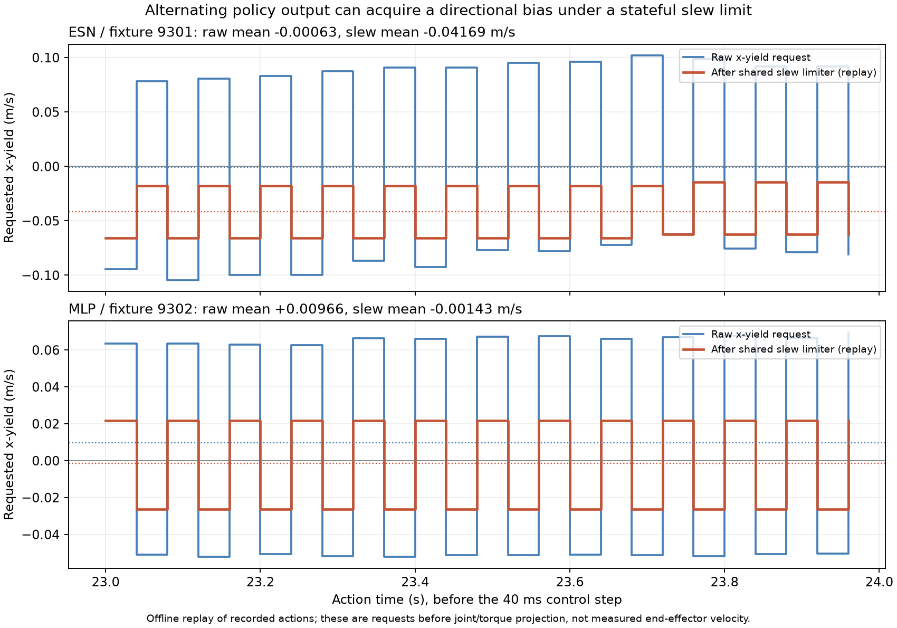

# 48D student 开发矩阵失败诊断与预声明消融

日期：2026-09-23。数据来源为 `docs/evidence/classical_20260923/panel48_traces` 的 9 条原始 VMC/MLP/ESN rollout，每条 600 个 25 Hz action step。使用已在 `CANONICAL_MODEL_PROVENANCE_20260923.md` 固定的 checkpoint，不重选 seed、checkpoint 或 gate。以下结论只涉及三个开发 fixture，不能解释为 blind-test 性能结论。

工具：`tools/diagnose_panel_students_20260923.py`。结构化证据：`docs/evidence/classical_20260923/student_causal_diagnostics_v2.json`。工具每次只加载一条短 trace，只做离线推断和 action filter 重放，不创建 MuJoCo 环境。

## 已排查的接口问题

1. 所有 9 条轨迹都在记录时间 2.44 s 进入 stage 3（loaded lift），前三阶段正常通过。ESN 的两次失败发生在持物抬升/受扰恢复阶段，不是缺少抓取或未进入 lift。
2. 使用冻结 checkpoint，按记录的 observation 顺序从零 reservoir state 重放，MLP/ESN action 与原 trace 的最大绝对差均小于 `9.44e-16`。可排除这批轨迹中的 checkpoint 加载错误、actor 初始化差异和离线/在线 ESN 推断序列错配。
3. VMC 使用本矩阵同一 `CORE_VMC_CONFIG` 从记录的 6D estimated wrench 重放，最大 action 误差不超过 `2.23e-16`，确认 observation 的 wrench 切片 `[39:45]` 与教师实际输入一致。
4. 全部 9 条轨迹归一化后 `max(abs(z)) < 12`（最大约 10.63）。MLP 训练输入有 `clip(-12,12)` 而部署 `CurrentMLP` 未 clip 的源码差异确实存在，但这里没有触发，不能将其当作本次失败原因。z-score 也不能证明状态完全处于训练支持集内。
5. student rollout 中 `teacher_action` 全为零，是 `mixture=0` 时不调用教师的占位输出，不能用于计算 student 对 teacher 的 imitation MSE。工具另行从同条本体 wrench 历史重放固定 VMC，只将它作为诊断参考，而非唯一训练标签。

## 失败发生在哪里

| 方法 | fixture | 任务成功 | 最后一个 25 Hz 接触样本/s | 最后一帧末端目标误差/mm |
|---|---:|---|---:|---:|
| VMC | 9300 | 是 | 5.68 | 4.03 |
| VMC | 9301 | 是 | 9.84 | 5.67 |
| VMC | 9302 | 是 | 15.40 | 10.99 |
| MLP | 9300 | 是 | 4.60 | 4.61 |
| MLP | 9301 | 是 | 6.00 | 5.66 |
| MLP | 9302 | 否 | 24.00 | 207.83 |
| ESN | 9300 | 是 | 13.92 | 2.53 |
| ESN | 9301 | 否 | 23.92 | 72.19 |
| ESN | 9302 | 否 | 23.60 | 59.97 |

接触分组仅使用 trace `norm(force)>.05 N` 的稀疏样本。首次/末次之间不代表持续接触；后续必须以统一物理子步 metrics 分辨 rod/panel/其他接触。最后一帧误差也不是原 gate 使用的最后十帧均值，工具未修改成功判定。

ESN9301/9302 的末次接触非常晚，只剩 0.08 s / 0.40 s 的无接触样本，缺乏充分恢复时间。ESN9300 虽然最终成功，接触结束也显著晚于 VMC。MLP9302 的失败同样伴随末端长期接触。

## 关键机制：高频 action 与有记忆的 slew limiter 形成负偏置

执行源码 `VelocityResidualActionFilter` 定义：

```text
raw_yield_x = clip(action[1], -1, 1) * 0.32 m/s
filtered_yield_x[t] = filtered_yield_x[t-1]
    + clip(raw_yield_x[t]-filtered_yield_x[t-1], -0.048, 0.048) m/s
```

这里的 `0.048=1.2 m/s² * 0.04 s` 是 action 执行目标的变化率限制。它不同于 `[-1,1]` 幅度限制，也不同于其后的关节速度/加速度限制和 torque slew。本批 9 条轨迹的原 action 幅度均未越界（amplitude_saturated_steps=0）。

ESN9301 的最后 1 s，x action 为 `[-0.294,+0.245,-0.326,+0.252,...]`，几乎逐样本翻转。其均值接近零，但状态型 slew 在无法一步跨过正负峰值时保留上一动作历史，输出持续负的 x-yield。离线重放得到：

| 方法/fixture，末 1 s | raw x action lag-1 相关 | 符号翻转比例 | raw yield x 均值 m/s | slew 后 yield x 均值 m/s |
|---|---:|---:|---:|---:|
| ESN9301 | -0.9773 | 1.00 | -0.00063 | **-0.04169** |
| ESN9302 | -0.0541 | 0.50 | -0.02012 | **-0.03247** |
| MLP9302 | -0.9993 | 1.00 | +0.00966 | **-0.00143** |
| MLP9301 | +1.0000 | 0.00 | -0.00180 | -0.00180 |

ESN9301/9302 全程分别有 484/472 个 action step 触发至少一项 slew，MLP9302 为 511/600。不能因为 raw action 均值小就判断控制器接近零残差。



图中曲线是原始动作换算后的速度请求与离线重放的 slew 请求，不是实测末端速度，也未包含其后的关节/力矩执行限制。

末 1 s 观测中的 nominal vx 对 ESN9301/9302 分别约 +0.0157 / +0.0155 m/s，而重放得到的请求 yield x 反向且更大。这支持“残差与追踪方向对抗”的假设，但不是已测得的实际执行速度：后面还有 Jacobian 映射、关节限幅/加速度限制和力矩投影。

ESN9301 尾部 raw x action 与 estimated wrench Fx 的相关约 +0.997。它说明动作随交替的本体负载估计变化，不能单独决定是 actor、观测器、接触动力学还是它们的闭环首先引发振荡。MLP9302 也有相似交替，因此不能把问题直接归罪于 ESN reservoir。

## 时间对齐与 slowdown 的真实语义

- 一行 trace 的 observation/action 在 `env.step` 前形成，`time/position/twist/torque` 在 step 后记录，间隔 40 ms。结构化证据中的 `pre_step_time_s=poststep_time_s-.04` 明确标记此差别。
- `desired_scale=1-max(action[0],0)*(1-.2)` 经过自身变化率限制。`direct_esn` 模式把它保存在 `_last_policy_wbc_scale`，下一 action step 才将该值加载为 WBC feedback authority；随后把组合 action 的 `wbc_scale` 设置为 1，避免二次缩放。
- 因此不能简单计算 `scale * recorded_nominal_twist + yield` 声称是实际命令。外层记录 observation 时，内部 WBC feedback field 还可能是更早一拍的值；工具保留原观测 nominal twist，另存前一 action 的 feedback scale，不伪造重算后的 WBC 命令。
- ESN9301/9302 尾部 filtered feedback scale 约 .9006/.9562。单凭这一减速程度无法解释失败，尤其不能把 action[0] 当作直接速度乘子。优先诊断 yield 振荡，然后用独立分量干预确认 slowdown 的贡献。

## 训练目标与执行语义

当前 MLP 和 nonlinear ESN 以逐 action、按训练 action 标准差缩放的 MSE 训练。ESN reservoir 是固定的，训练前顺序计算 features，再对输出 head 随机取 scene/episode/time 样本。这个损失没有显式惩罚 action 时间差分，也没有优化经执行 slew 后的闭环偏置或 contact escape 时间。

老师和 student 在此次 panel 共享相同 action7 映射；未发现维度或单位交换。Teacher 的 `action_limit_6d` 是生成 action 的内部参数，不是 runner 的执行上限，不能把内部 `.16/.20` 与 runner `.32` 不同直接认定为 student 独有 bug。当前源数据还混合不同 VMC 参数组；同一本体状态是否对应多种合理动作，是后续数据审计问题，本轮尚未证实。

## 可证伪假设与精简消融队列

所有变体保留原 checkpoint、原 safety slew/limit、同一 physics/gate、同一 fixture9301，不用消融输出替换原 ESN 成绩。独立模块：`scripts/panel_policy_ablations_20260923.py`。

| 假设 | 干预 | 支持证据 / 反证 |
|---|---|---|
| H1：ESN x-yield 振荡及负偏置显著阻碍恢复 | `no_x_yield(policy)` 只令输出 action[1]=0，每步仍调用原 ESN 更新其记忆 | 若接触更早结束且目标误差下降，支持 x 分量的因果作用；若无改进或更差，x 偏置不足以解释，需要旋转/其他残差或接触拓扑分析 |
| H2：高频输出通过 slew 形成的历史偏置是关键中介 | 固定 `lowpass_025`，全 7D `a_lp[t]=.75*a_lp[t-1]+.25*a_raw[t]`，初始为零，前置于完全不变的安全 slew | 应同时降低符号翻转和 raw→slew 均值偏置；若只降低振荡而任务无改善，说明还有其他瓶颈 |
| H3：相同滤波本身改善一般接触执行，而非 ESN 独有效应 | 对同一 fixture9301 的 MLP 和 VMC 应用同一个 `lowpass_025` | 比较所有方法的接触结束、恢复和物理峰值；禁止只为 ESN 调滤波系数 |

预声明 `alpha=.25`，40 ms 下连续等效时间常数 `-.04/log(.75)=.1390 s`，不依据后续结果搜索 alpha。队列共四条：ESN x-off、ESN lowpass、MLP lowpass、VMC lowpass。若初步结果支持机制，再在另外两个开发 fixture 复核；正式 held-out 不参与调参。

包装器每步仅调用原 policy 一次，保留 ESN reservoir 更新；lowpass 对 teacher 也转发 `.slide/.config` 属性和原 `act` 参数。`baseline_resume` 负责通过 `run_with_substep_metrics_20260923.py` 统一采样物理子步指标并协调服务器运行，避免另起重仿真并发。

## 七方法完整24秒配对结果：振荡消除不足以恢复任务

DGX Spark 已完成 fixture9301 的四条预声明干预。每条均有 600 个 action step 和完整物理子步审计，不是 smoke。输出源：

```text
/home/arm1/vmc_mujoco_runtime/mujoco_6d_vmc_benchmark/outputs/baseline_impedance_admittance_20260923/measured_campaign/measured28
```

本地完整结果：`evidence/classical_20260923/measured_ablation_complete7/REPORT.md` 和 `analysis.json`；输入摘录位于 `measured_ablation_inputs/`。分析工具 `tools/analyze_measured_policy_ablations_20260923.py` 核验冻结 checkpoint SHA、完整24秒、无 audit error，并从各自访问的 observation 重放原动作及相同干预。三条未干预方法现已补齐。采样不变性证书 `evidence/classical_20260923/substep_campaign/full24_invariance.json` 确认全部24条原方法重跑各18个NPZ数组完全相同，包含这里的VMC/MLP/ESN配对；加装子步测量没有改变这些轨迹。

| 9301干预 | task / strict | 物理位置RMSE xyz / 3D（mm） | 物理峰值末端速度（m/s） | 物理峰值关节力矩（Nm） |
|---|---|---|---:|---:|
| VMC 原始 | 是 / 否 | 4.56 / 23.17 / 135.00；137.05 | 0.1267 | 37.273 |
| MLP 原始 | 是 / 否 | 6.98 / 16.10 / 102.50；103.99 | 0.1455 | 36.359 |
| ESN 原始 | 否 / 否 | 17.62 / 21.96 / 147.84；150.49 | 0.1418 | 36.072 |
| ESN x-yield off | 否 / 否 | 3.15 / 31.24 / 208.67；211.02 | 0.1505 | 33.742 |
| ESN lowpass .25 | 否 / 否 | 13.76 / 31.29 / 222.86；225.47 | 0.1258 | 34.401 |
| MLP lowpass .25 | 是 / 否 | 8.98 / 20.84 / 142.44；144.23 | 0.1260 | 34.851 |
| VMC lowpass .25 | 否 / 否 | 8.28 / 31.15 / 205.46；207.97 | 0.0974 | 32.515 |

RMSE沿用原任务目标，包含stage切换目标跳变。三列核心指标都来自统一物理子步审计；力矩是completed mj_step保留的动力学评估值，与post-integration运动学可能相差一个物理子步，未声称严格同时间。

| 干预 | 尾1秒 x action std | raw→slew x请求均值（m/s） | 末端终点误差（mm，原结果字段） | 最大外部穿透（mm） | 末次外部接触（s） |
|---|---:|---|---:|---:|---:|
| VMC 原始 | 0 | 0 → 0 | 5.72 | .210 | 9.936 |
| MLP 原始 | .00007 | -.00180 → -.00180 | 5.68 | .208 | 7.646 |
| ESN 原始 | .27551 | -.00063 → -.04169 | 72.77 | .200 | 24.000 |
| ESN x-off | 0 | 0 → 0 | 213.21 | .2010 | 24.000 |
| ESN LP.25 | .01499 | -.03502 → -.03502 | 218.55 | .2014 | 24.000 |
| MLP LP.25 | .00005 | -.00082 → -.00082 | 6.76 | .2053 | 12.796 |
| VMC LP.25 | .01380 | -.00558 → -.00558 | 206.65 | .1996 | 24.000 |

这些结果区分了三种不同的失败：

- **ESN低通确实消除了额外的slew偏置，但任务未恢复。** 原9301尾x action std约.276；低通后为.01499，尾部所有yield分量的slew额外均值偏置均为0。然而新轨迹上策略输出本身已形成约-.035 m/s的持续x请求，机器人持续与back guard / bracket接触；lift仅37.6mm，终点误差218.6mm。不能将失败只解释为.2014mm略超穿透门；任务本身已失败。
- **把x分量全程置零也没有恢复。** lift仅41.4mm，终点误差213.2mm，rod与back guard接触持续至结束。x分量可能同时承担有用的接触逃逸，不能把它在原失败尾段的负偏置外推为“任何时刻都应去掉x”。
- **低通引入的延迟具有方法无关的代价。** VMC低通穿透.1996mm低于.2mm门，却只有48.9mm lift、206.7mm终点误差，任务失败；原VMC9301任务成功。MLP低通仍成功，但最后外接触从7.65s延至12.80s，回到15mm且持续10帧需再3.20s；其strict失败与.2053mm穿透有关。

完整物理配对确认：低通令ESN的速度峰值从.1418降至.1258m/s、关节力矩峰值从36.072降至34.401Nm，但3D追踪RMSE从150.49增至225.47mm；VMC同样降低峰值（.1267→.0974m/s，37.273→32.515Nm），却从任务成功变成失败，RMSE137.05→207.97mm。MLP任务仍成功，峰值也下降，但RMSE103.99→144.23mm。不能以更小速度/力矩峰值宣称整体改善。表中穿透取整值不能重新判断gate，strict始终使用原始未取整结果。

因此目前支持的是“高频action经过slew确会产生偏置”，而**“消除该偏置即可解决ESN闭环失败”被这组干预否定**。原始故障还包含接触状态分布、必要的逃逸方向、其他平移/旋转分量和控制延迟相互作用。策略更平滑不是任务成功或接触合规的替代指标。

### 新访问状态上的符号与记忆敏感性

补充证据保存在 `evidence/classical_20260923/measured_ablation_complete7/analysis.json` 的 `same_state_memory_diagnostic`。使用完整24秒 observation 序列，分别重放同配置VMC、原冻结ESN及逐帧reset的ESN；没有进行新物理仿真。

ESN-LP9301最后1秒的平均估计力 `Fx=+4.9836 N`，三种离线重放输出如下：

| 同一ESN-LP访问状态/历史 | 平均x action | 按公共0.32尺度换算的raw x请求（m/s） |
|---|---:|---:|
| 固定VMC，同一wrench历史 | +.0669 | +.0214 |
| 冻结ESN，完整顺序记忆 | -.1053 | -.0337 |
| 冻结ESN，每帧重置记忆的敏感性检查 | +.4799 | +.1536 |
| 实际ESN-LP包装输出 | -.1094 | -.0350 |

实际LP输出之后的slew额外均值偏置为0，所以新失败轨迹尾段的负x请求来自**策略自身的状态/历史映射**，不是安全slew再次整流。固定VMC在同样输入下方向相反，支持下一轮检查teacher分布与student记忆/读出泛化。这里不能据VMC方向直接宣称替换这一分量会成功，因为改变动作后状态历史和接触拓扑也会变化。

逐帧reset会翻转ESN输出符号，说明读出对reservoir历史敏感；但不能把reset当作修复。作为反例，在已经恢复的MLP-LP轨迹尾段（估计wrench几乎零），正常历史ESN平均x action约-.0038，逐帧reset却约+.3120。这种人工历史破坏本身可让网络偏离训练时的特征分布。下一轮应审计训练轨迹中接触脱离/持物抬升的历史覆盖、特征归一化与时间连续误差，不能以反复reset制造表面改善。

### 下一步决策

不将α=.25作为修复，不立即将这一低通扩展到另外两个fixture当作通过性验收，也不替换原ESN成绩。原VMC/MLP/ESN的统一物理审计和采样不变性现已确认。下一步先离线审计混合teacher参数在相同wrench历史上的输出差异、真实训练样本的符号及历史支持，再分析首次rod接触至back-guard/bracket持续接触建立期间的方向变化；不据单个fixture搜索低通系数或用逐帧reset修复。

该离线审计现已完成，见 `TEACHER_MIXTURE_HISTORY_AUDIT_20260923.md`：714条训练push确有714种实际config；固定抽36种config在ESN-LP9301同一历史上尾x均值全部为正（+.01894至+.07445），不能解释ESN自身的-.10527。实际训练首次接触stage3为119/714，但687/714均存在后续loaded-contact样本；不能说训练没有持物接触。训练loaded阶段接触样本比例7.49%，验证32.73%，且fixture与首次接触阶段耦合。下一步优先固定teacher参数做新的train/validation接触历史覆盖对照，冻结模型先离线评估，再决定是否共同补充MLP/ESN训练；不把930x/940x评估轨迹用于新训练。

### 跨平台重放边界

2026-09-24后续：固定teacher的12条阶段对照已完成并归档，见 `TEACHER_HISTORY_DIAGNOSTIC_20260924.md`。真实首次接触stage0/stage3按计划发生，但teacher任务0/12；ESN在teacher访问历史上全程action RMSE低于MLP，而角向slew误差四组均高。这进一步限制了“监督误差低就能改善闭环”的解释，不构成对ESN的成功修复，也不把本批失败轨迹直接加入成功训练bank。

这里的冻结actor同观察序列重放一致，以及DGX同平台24条轨迹加测量仪器后18数组完全一致，不等于DGX与本机数值动力学必然一致。独立RL诊断 `outputs/canonical48_ppo_diagnosis_20260923_r1/LINEAGE_AUDIT.json` 在同CORE_VMC_CONFIG与观测器/安全控制核心源码一致的历史重建中，发现第一步前q已有约3.94e-8差异；估计wrench在.52s、action在.8s开始超过1e-8差，1.04s action差约5.51e-4，随后接触分支放大。完整历史数值库、传递依赖及MJB一致性尚未证明，所以不能认定硬件是唯一原因；应称跨平台历史重建未达到动态等价。此现象不否定本文离线策略重放，也不证明RL目标不可学。

生成完整七方法配对报告的命令接口：

```text
python tools/analyze_measured_policy_ablations_20260923.py \
  --campaign <measured28或本地measured_ablation_inputs目录> \
  --esn <冻结ESN checkpoint> --mlp <冻结MLP checkpoint> \
  --output <全新分析目录>
```

工具会把缺文件、audit error或不足24秒的轨迹标为pending/invalid，不将smoke当作性能结果；任何一条未齐时自动结论为`WAIT_FULL_PAIRED_RESULTS`。该工具只读实验输出，写入独立分析目录，不改任何controller/gate/checkpoint。
