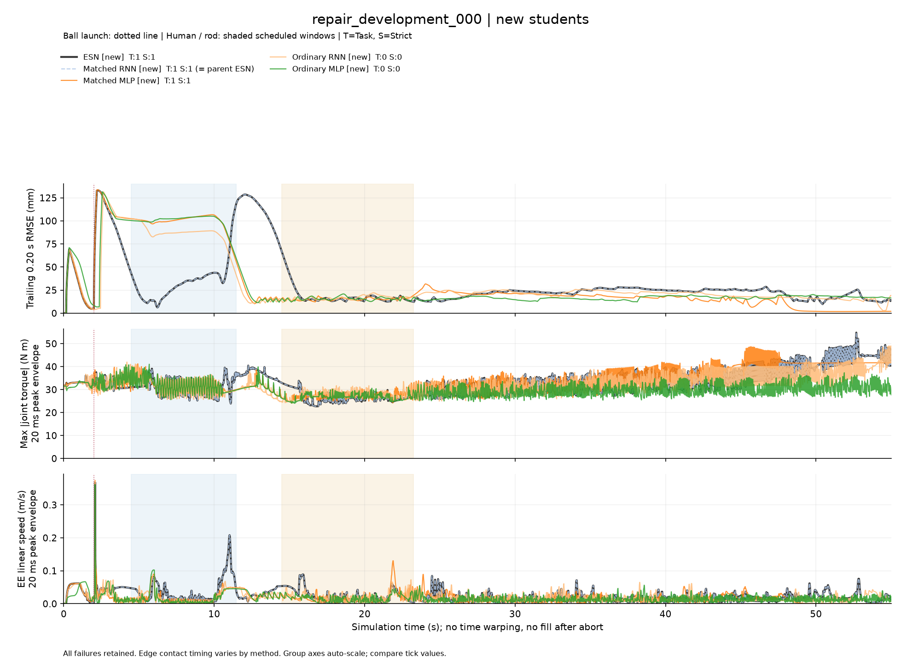
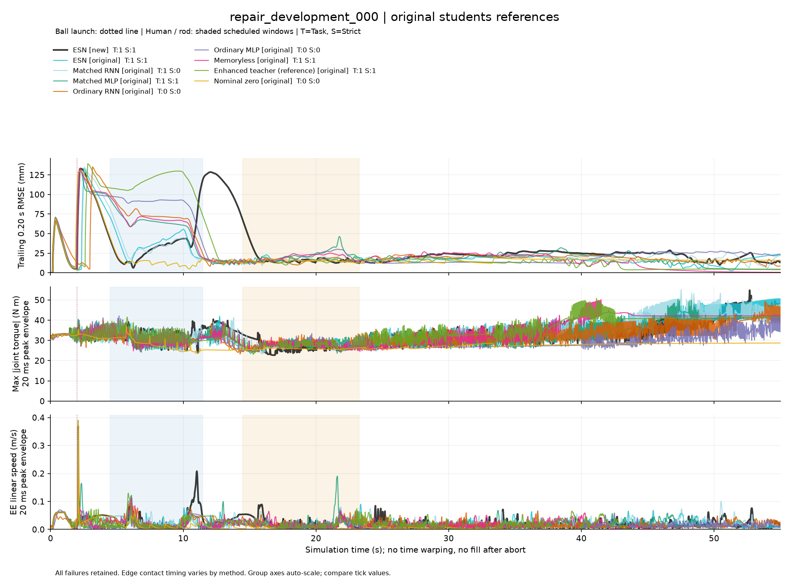
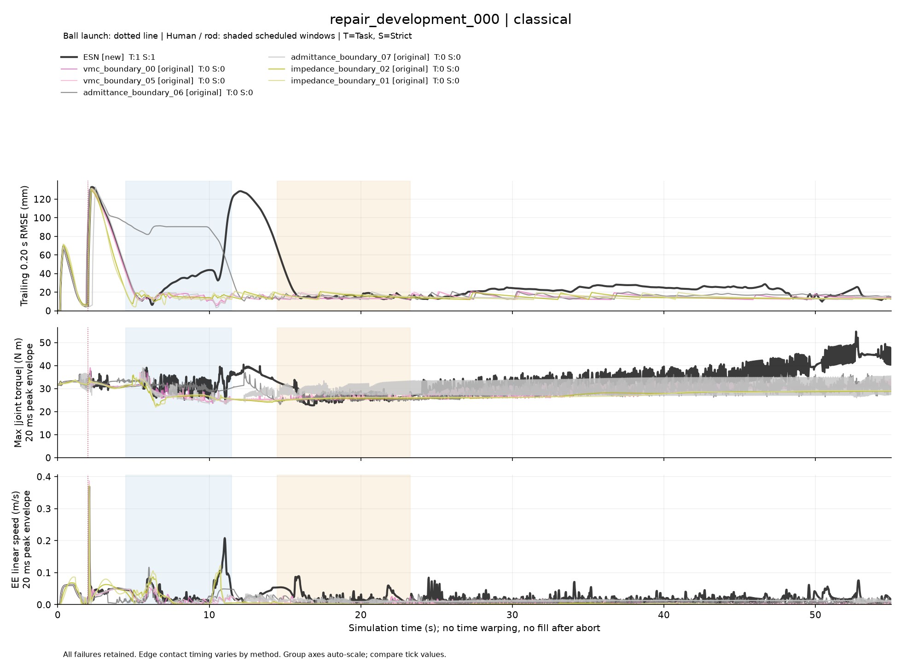
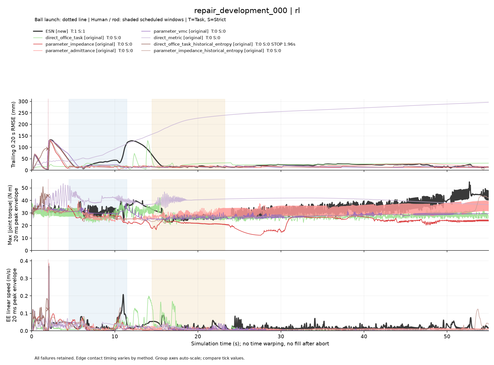

# 全过程 RMSE、力矩、速度：26配置 × 8条件

2026-10-13；本轮仅分析已审计的208条历史轨迹，不重训、不仿真、不修改运行中的公平比较。
图对应 [完整配置表](TEACHER_STUDENT_COMPLETE_COMPARISON_20261013.md)，保留所有原/新版本、
经典候选、RL历史熵附组和失败，不能解释成同训练预算的网络结构消融。

## 查看入口与共享产物

服务器已逐文件核验：

`arm1@192.168.31.70:/home/arm1/sii_shared/SII_compliance/runs/main/full_task_curves_20261013_v2/evidence/`

- `index.html`：无需外部网络依赖的交互图，切换8条件、26配置、三种误差定义和时间范围，悬停读数。
- `all_conditions_all_methods.pdf`：32页，8条件 × 4组；每组都包含新ESN作为参考，历史ESN另外保留。
- `repair_development_000…007__*.png`：全部32张逐条件分组图。
- `curves.csv.gz`：所有方法的完整绘图数值；`curve_data.json`保存来源、事件、任务结果和曲线。
- `AUDIT.json`：208条原始物理子步hash/回合审计hash及整回合三指标重算核验，包含每行来源。
- `plot_full_task_curves_20261013.py`：实际执行的绘图源码快照；`FAILED_PLOT_ATTEMPT_V1.json`保留最初无接触字段兼容问题，不涉及仿真失败。

43文件、183820146字节；manifest SHA256
`6dcfcb90e1822b4c1ad8183786a4800c232af090b1ac8e4161eda1501e9b5aae`。
核验时间 `2026-10-13T06:26:32.981817+00:00`。

本机缓存 `/home/airpig/桌面/hwy/compliance_control/SII_compliance/code/mujoco_6d_vmc_benchmark/outputs/full_task_curves_20261013_v2/`。
本次本机临时浏览入口 [交互图](http://127.0.0.1:8768/index.html)（仅本机，服务最长24小时）。
长期使用可直接在浏览器打开共享副本的HTML；PDF和数值下载需保留同目录相邻文件。
输入时间范围后离开输入框；也可点分组按钮刷新。不同组纵轴自动缩放，须看刻度，不按曲线相对高度跨图比较。

## 指标定义

所有量来自正式 `dt=5e-5` 物理子步。横轴是共同仿真时间，不对不同策略做动态时间配准。
轨迹参考使用原记录的规划参考，可能随任务进展变化，因此误差低不等于放置成功。

令 `e(t)=末端位置−记录参考位置`，`v(t)`为实际末端平动速度，`tau_j(t)`为实际
`qfrc_actuator`（不是请求动作、关节速度或物体速度）。

|曲线|定义|用途|
|---|---|---|
|过去0.20秒RMSE，静态图默认|`sqrt(integral(||e||² dt)/窗口时长)`，窗口为`[max(0,t−0.20),t]`|看局部偏差与恢复，起始不足窗口用实际历史|
|累计RMSE，交互可选|`sqrt(integral_0^t(||e||² dt)/t)`|最后一点与原表整回合RMSE一致；不能用于判断瞬态峰值|
|每20ms位置误差RMS，交互可选|同公式，但仅当前20ms区间|更细时间尺度的位置误差，非零窗口“瞬时RMSE”|
|力矩|每个20ms区间内`max_t max_j abs(tau_j(t))`|保留实际关节力矩峰值；不表示各关节符号或同时受力|
|速度|每个20ms区间内`max_t ||v(t)||`|保留实际平动速度峰值，不把角速度混进去|

RMSE三轴合成后计算，不额外除以3；所有积分按真实子步时长加权。0.20秒窗口在原始子步上
计算，最后一个显示分箱不足20ms时也不缩短原始滚动窗口。力矩/速度不是平滑均值或隔点抽样，
但20ms分箱仍不能展示区间内的全部波形；调查更快瞬态需要原始轨迹。

粉色虚线为球发射，蓝色/黄色阴影为人手/棍计划时段，不冒充所有策略相同的实际接触时长。
桌角实际接触因策略而变化，不画一个虚假的共同桌角窗口；逐方法首末接触及接触总时长保存于数值包。
本轮8条早停曲线均在实际终止时刻停止，不补零、不延长到55秒；图例显示T/S和早停时间。

## 第一编号条件预览

默认展示 `repair_development_000`，按编号选择，不按成败挑选。这一条件新ESN通过、普通RNN
失败，但全8条件普通RNN的Task仍是7/8、新ESN为5/8，单张预览不代表整体排序。
matched RNN新模型选回父ESN，图中重合属实，不能算独立训练有效的RNN证据。
Enhanced teacher有额外机制，只作为系统参考。

新学生：

原学生与参考（含新ESN对照）：

经典控制器（含新ESN对照）：

RL（含新ESN对照）：

## 验证和解释边界

两份上游报告SHA与最终审计一致；208/208原始文件、每回合审计hash核对；逐条复算整回合
RMSE/峰矩/峰速通过，累计RMSE末点与原指标一致。2项数值测试覆盖因果滚动窗口和最后不完整
分箱；32页PDF页数核对，PNG目视检查；交互页测试全部26配置、场景切换、误差定义、时间缩放，
浏览器错误日志为空。只用本机1线程、1GiB上限、禁swap，分析任务约91秒；服务器只存储及校验。

图可以定位何时偏离、何时振荡或长期不动，不能单凭三条曲线证明柔顺性优劣。低力矩可能是停滞，
短时大误差可能是合理让位；需要结合Task/Strict、接触受力、接触时长和任务进展一起解释。
未根据这些图调整模型、门槛或正在运行的前瞻性评估；8个开发条件不是广泛泛化证明。
