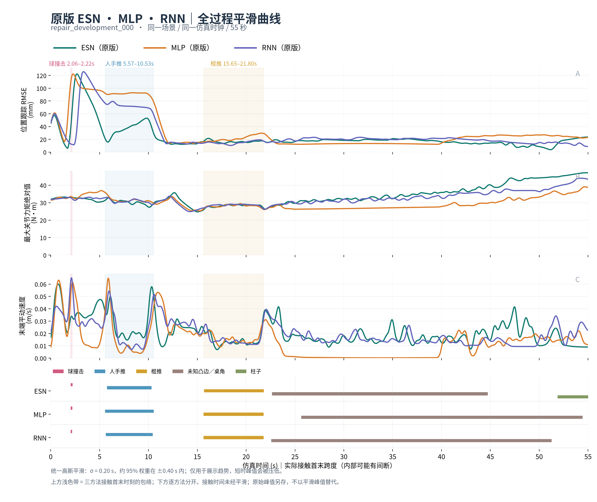

# 原版 ESN、MLP、RNN：平滑全过程曲线与接触时段

本轮只重新绘制已有数据，未训练、仿真或修改控制参数。对应原完整对比中的
`esn__original`、`ordinary_mlp__original`、`ordinary_rnn__original`，不是 matched
变体、新数据重训版，也不包含近期旧布局修复候选。包含编号000–007全部8个开发条件，
每种方法8条完整55秒轨迹；物理步长5e-5。默认预览按第一编号选择，不按成败选择。



## 如何读图

三方法使用完全相同的高斯核：标准差0.20秒，截断半宽0.60秒，约95%权重在±0.40秒内。
边缘按可用样本重新归一化，不补零；离线居中处理仅用于显示，不是在线控制滤波。
平滑会压低短时峰值、把突变展宽到邻近时间，因此不能据图判断毫秒级反应延迟或原始峰值。

- RMSE：对已有20ms位置误差平方均值做高斯加权，再开平方；三轴合成，不除以3。
  这是局部高斯加权RMSE，不是全任务累计RMSE，也不同于旧图的过去0.20秒窗口。
- 力矩：对原20ms物理子步 `max_t max_j |qfrc_actuator_j|` 包络平滑。
- 速度：对原20ms物理子步末端平动速度模最大值包络平滑，不是关节速度或请求速度。
- 上部浅色带为三方法实际接触首末的共同包络；下部逐方法分别标注。
  首末跨度内可能断续接触，不等于累计接触时长。接触标记不平滑、不用计划触发时刻替代。
  球、手、棍之外，未知凸边/桌角和柱子也按原记录列出；缺失条带意味着未记录该项接触。

第一编号条件的实际接触首末跨度（秒）：

|接触对象|原ESN|原MLP|原RNN|
|---|---:|---:|---:|
|球|2.066–2.225|2.064–2.177|2.063–2.157|
|人手|5.770–10.297|5.575–10.529|5.648–10.421|
|棍子|15.707–21.803|15.665–21.767|15.650–21.766|
|未知凸边/桌角|22.672–44.715|25.655–54.415|22.591–51.251|
|柱子|51.890–55.000|无记录|无记录|

第一编号条件未经平滑的原指标保留如下，不用图上平滑最大值替换：

|方法|全任务RMSE(mm)|原始峰矩(N·m)|原始峰速(m/s)|Task/Strict|
|---|---:|---:|---:|---|
|原ESN|29.408|50.683|0.349432|1/1|
|原MLP|43.349|42.913|0.376359|0/0|
|原RNN|36.830|49.338|0.389858|0/0|

这里是同场景表现展示，不是等参数量、等训练预算的结构消融；低力矩/速度也可能来自停滞。
8条件的原Task分别为ESN7/8、MLP4/8、RNN3/8，Strict分别2/8、4/8、3/8。
这些既有开发结果未改变，不将平滑后的视觉效果当作新增性能或泛化证据。

## 来源、复现与交付

源码与全部产物已逐文件核验共享：
`arm1@192.168.31.70:/home/arm1/sii_shared/SII_compliance/runs/main/original_three_smoothed_20261013_v1/evidence/`。
19文件34610827字节，manifest `b28c07f829e3b2c90459629d55494c6cc04b5d48dc805e81b3e549f4c42d8b7b`；
父目录含`ARCHIVE_VERIFICATION.json`，归档REPORT.md为发布前版本，最终共享索引以本报告为准。

工具：`tools/plot_original_students_smoothed_20261013.py`。
已有提取数据：`outputs/full_task_curves_20261013_v2/curve_data.json`；
本次缓存：`outputs/original_three_smoothed_20261013_v1/`。

输出包括8张PNG、8页矢量PDF `original_three_all_8_conditions.pdf`、首场景单页PDF、
`contact_intervals.csv`（含累计接触时长）、`raw_metrics.csv`、原始与平滑绘图数值JSON、
完整来源核验 `AUDIT.json`、执行记录、源码快照和HTML图集。Git保留首图及小型审计证据。

```bash
OPENBLAS_NUM_THREADS=1 OMP_NUM_THREADS=1 MKL_NUM_THREADS=1 \
  /home/airpig/桌面/hwy/compliance_control/.venv-canonical-rl/bin/python \
  tools/plot_original_students_smoothed_20261013.py \
  --input outputs/full_task_curves_20261013_v2/curve_data.json \
  --out outputs/original_three_smoothed_20261013_reproduction
```

24/24回合原始物理数据hash、AUDIT hash、checkpoint hash核对，原三指标与回合审计一致；
等间隔/有限数值/事件边界及常量边缘保持、核对称性检查通过。原版checkpoint固定为：

- ESN `acd3b27e37c3e7d7690570df5276f52492d6597951643bf5011ad8ac2aee2ec7`
- MLP `50bb22dd179e34af387f7e3375a9c7214e0eaa524df34c33a16562f52a03ea07`
- RNN `6f3df0b65da56926214b523f7d431a3773f5b03632cb595d8f9008f642f1a910`

本机单线程/1GiB/禁swap，分析5.4秒；原公平比较继续运行，未触碰其worker。
首末编号PNG已目视核对，PDF页数由`/usr/bin/pdfinfo`核验为8。Python环境缺pypdf，
打包pdfinfo也因GLIBC版本不兼容无法执行，改用系统pdfinfo完成核验。
服务器只作存储校验；共享核验路径与收据见根UPDATE_LOG本轮记录。
