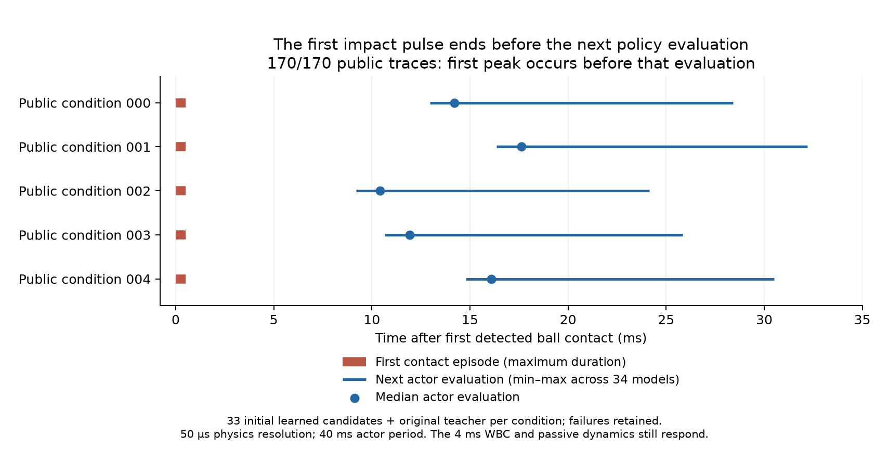

# 首次球撞峰值与策略更新时间：170条公开轨迹核对

2026-10-03。首次球撞峰值不能单独证明25Hz ESN的即时反应更柔顺。
在前五个已完整公开开发身份、全部33个初始学习候选及原teacher的170条轨迹中，
球事件窗内最大峰值和首段接触结束均先于第一次可能利用碰撞后观测的actor计算。
所有失败和短回合保留；并非选中最终模型后的成功率或封存评估。

| 时序量 | 170条轨迹范围 | 中位数 |
|---|---:|---:|
| 首段连续球/机器人接触时长 | 0.45–0.50 ms | 0.50 ms |
| 首次接触至下次actor计算 | 9.20–32.20 ms | 14.875 ms |
| 实际actor更新周期 | 40.00 ms | 40.00 ms |
| 该事件窗内球接触峰值 | 5485.92–7407.39 N | 6459.35 N |

接触按原统计阈值0.05N识别，原始物理分辨率50μs；使用轨迹中的真实`neuron_time`，
不是推测的理想时钟。force采样时间标记在完成物理步后，判断峰值/接触结束先于actor计算时
额外留一个dt的分辨率余量；同时间戳不计为严格提前。全部170条都满足这个保守判断。

这支持一个有限结论：下次策略尚未计算，不能用较低首个峰值证明它已经对这次碰撞做了即时反馈。
它**不**证明策略对碰撞没有影响——碰前姿态、先前动作和接触条件可能不同，公共4ms WBC及
被动物理仍可在一个40ms策略周期内响应。首次碰后计算也只是最早机会，不保证滤波负载估计已
引起有效让位。接触模型的kN瞬态不等于经过真机标定的人体安全受力。

因此仍完整报告球峰值，但解释柔顺效果时同时核对碰撞后的任务恢复、持续人手/推杆接触
负载与脱离、累计误差、安全和最终放置。没有改变指标计算、gate、采样周期或控制器输入；
没有因为该发现删掉对ESN不利的峰值。这是公开开发观察后的诊断，不是最初预注册的新主要终点，
也不是ESN相对任何baseline的因果优势证明。RL及增强神经baseline尚未进入这170条诊断。

## 复现和执行

诊断在Spark原生环境只读运行，2026-10-03 20:29:31–20:30:04UTC，单线程、3GiB；
systemd记录CPU 23.299s。4项合成时序检查通过：短接触、后续更大再碰撞、同时/缺少更新、无接触NA。
0新物理回合、0训练更新、未读取最终24身份。绘图在airpig本机单线程3GiB，图已目视核验，
绘图manifest保留真实本地命令和NumPy2.4.6，不冒充服务器计算。

以下路径主机均为`arm1@192.168.31.70`，本轮根为
`/home/arm1/sii_shared/SII_compliance/runs/main/research72_20261003_1149/`。

- `public_impact_timing_v1/SPECIFICATION.json`：执行前固定5身份/34模型范围，SHA256
  `166648074e86fc909ddbed9dd1bc183878f36c6cace5035025eef0c04f1ffe33`。
- `public_impact_timing_v1/IMPACT_TIMING.json`：逐条原始轨迹/子步/接触hash、时间及全部结果，SHA256
  `cd8a9ec1f707fdb1be008eceb5331d83ce17e2a4f1ee7d9a929616aa141686e8`；小型副本也在Git evidence。
- `public_impact_timing_v1/EXECUTION_RECEIPT.json`：依据登记/结果及systemd日志补写的**事后**执行说明，
  不是运行器发出的原生execution；SHA256 `a1c9d99d50f02a6cae2f075308954314b81f41cf76f45e311e698a9a612c0eea`。
- 实际诊断源：`/home/arm1/sii_shared/SII_compliance/incoming/research72_impact_timing_20261003_2025.py`，
  SHA256 `2a7db52731480f3dae1bed9c0c47df4c62cbb8c7352898a5a86523e179a19fa5`；base main be473ca加本次新脚本。
- `impact_timing_plot_archive_v1/`：PNG/PDF/manifest/实际绘图源共4文件已核验；归档tar SHA256
  `fc1c842de54cac4a87d1f25ccd076f9b09db3ebb9feed393cb1dddf6d632bfd3`。
  PNG SHA256 `c9cab76a261e3f6b567776da6a5e1efd8b63ac2f8e8c78f3b44e2c291eb94a8a`；
  PDF SHA256 `d4d50030273d4edfb53112b8ceaba9082cdbcd9cea2925f9193907b2da5aea05`。

20:37UTC运行快照：初始学习184/264、五条件完整、第六条件19/33；四稳定仿真未重启。
RL v2继续等待前序，学习预算修订02仍未登记。teacher选择、新ESN/增强baseline和最终比较未完成。
