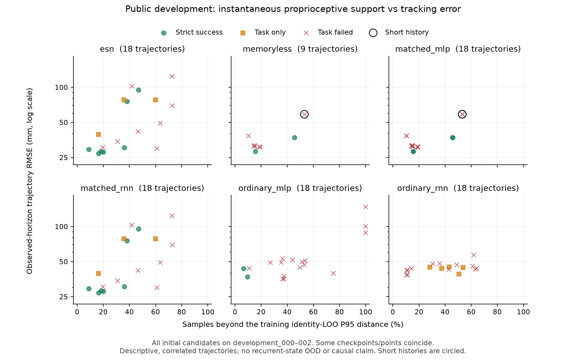

# 闭环本体状态与teacher示范覆盖：公开诊断

2026-10-03 19:32UTC完成计算。**尚不能把ESN失败归因于数据不足，但单纯输入裁剪不是主要现象。**
这次固定检查最早三个完整公开身份development_000–002的全部33候选，共99轨迹；包括所有失败和短回合。
不是最终留出评估，不选checkpoint，不新增学习候选或teacher标签。

## 距离的含义

只用18个已有本体actor字段：参考相对速度/位置、测量运动、估计负载和路径方向。
按已有ESN固定物理尺度归一化并使用其clip范围；比较的是所有方法的同一本体坐标，
不是各网络内部embedding。欧氏距离无量纲，不是末端的毫米距离。

以18个合格teacher训练身份、24,750帧为参照。阈值计算时，每个训练帧只能寻找其他整条训练身份中的近邻，
整条自身历史都排除，避免相邻帧造成虚假的零距离；阈值为所得距离的P95=0.3088981070。
不使用6个imitation-validation身份，也不使用任何development值来校准阈值。
随后为99轨迹逐帧保存距全部训练样本的最近距离。

这里只描述瞬时本体覆盖：没有包括储备池状态、时间历史或动作标签，不是经过校准的OOD概率，
不能把“超阈值”当因果失败检测。使用裁剪后的距离无法衡量边界外的幅度，因此另存输入触及裁剪的比例。
所有帧和多损失候选相关，图没有把它们当独立统计样本；matched初始模型重合点如实保留。

## 有信息量的观察

| ESN候选/条件 | 原strict | RMSE mm | 超训练参照P95帧比例 | 解释 |
|---|---|---:|---:|---|
| seed301 point / development_000 | 通过 | 29.40 | 8.9% | 较接近teacher覆盖的成功例 |
| seed302 point / development_001 | 通过 | 75.66 | 38.0% | 最终成功仍可能长期大误差 |
| seed302 temporal / development_001 | 通过 | 95.20 | 46.9% | 覆盖偏离不是任务失败的充分条件 |
| seed303 temporal / development_001 | 失败 | 124.44 | 72.7% | 高误差并有明显覆盖偏离，仍不能单独证明因果 |
| seed301 point / development_002 | 失败 | 49.34 | 63.4% | 多数闭环输入偏离训练参照，输入裁剪比例为0 |

这18个ESN回合在前三身份合计7严格通过；matchedRNN相同，因为初始组选中了相同父模型行为。
后续小学习率强化baseline与context-gate组尚未跑完，不能据此说训练RNN无效。
ESN各回合clip比例约0–0.3%，teacher训练0.0687%；多数偏离不是输入已饱和而被粗暴截断。
数据覆盖及读出机制都值得继续处理，但这份诊断不支持只选成功teacher、只选有利seed或改门槛。

第四共同身份后来也完整：ESN与matchedRNN各5/6task、4/6strict，matchedMLP2/6strict、
memoryless1/3strict、ordinaryMLP1/6strict、ordinaryRNN0/6strict。它不纳入这次已固定的99轨迹距离诊断。
截至19:37UTC初始开发143/264；整阶段独立复核仍待完成，以上是已完成逐回合AUDIT的公开开发结果。

## 复现及成本

2项合成检查验证字段隔离、固定尺度裁剪和整身份排除；真实99轨迹提取均核对trace/AUDIT/model hash。
Spark提取无新物理；本机airpig Python3.11.15、NumPy2.4.6、SciPy1.17.1，单线程3GiB计算4.163秒，
无随机近邻、无新拟合。原始路径和systemd执行命令见EXECUTION_RECEIPT；没有把本机执行改写成服务器执行。
图v1轴标签拥挤，v2改为共享标签并目视核验；点和数据不改，v1本地保留。

主机 `arm1@192.168.31.70`，根
`/home/arm1/sii_shared/SII_compliance/runs/main/research72_20261003_1149/`：

- `public_proprio_export_v1/`：99轨迹本体观测及原始hash映射。
  MANIFEST SHA `5c899414fe54dbc6137ccd0041c457d087e446288a0c600819a0a5e719f9209e`；
  NPZ SHA `a89726279567508e7a204ca667b02de1845622bec8ec192599da9bc3283b7133`，传输两端一致。
- `proprio_support_archive_v1/`：结果、逐帧距离、实际源码、执行记录与事前诊断选择，共5文件核验。
  tar SHA `dc07c9d45036ecda010dd2124208f1d421ff6628f04d3490211eaa608363f6b4`；
  SUPPORT SHA `aae1c69074b09bc3f7f1b4e0ae406044b197b0ee070b678012b4ce972a80dde7`。
- `proprio_support_plot_archive_v2/`：PNG/PDF/绘图源码/manifest，共4文件核验。
  tar SHA `78f681f29e7f14bfb46810f484a2ef45057e7dc2a9d4a72297cbefa1bc931fad`；
  PNG SHA `c7d4a4f4397148972371da7c91a435749f478a8e6acdda77754097e10c9d20ea`，与Git图一致。

封存身份未读；下一步仍是完成teacher确认和已登记模型开发。读出再拟合的修订02尚未登记，当前cap仍48。
