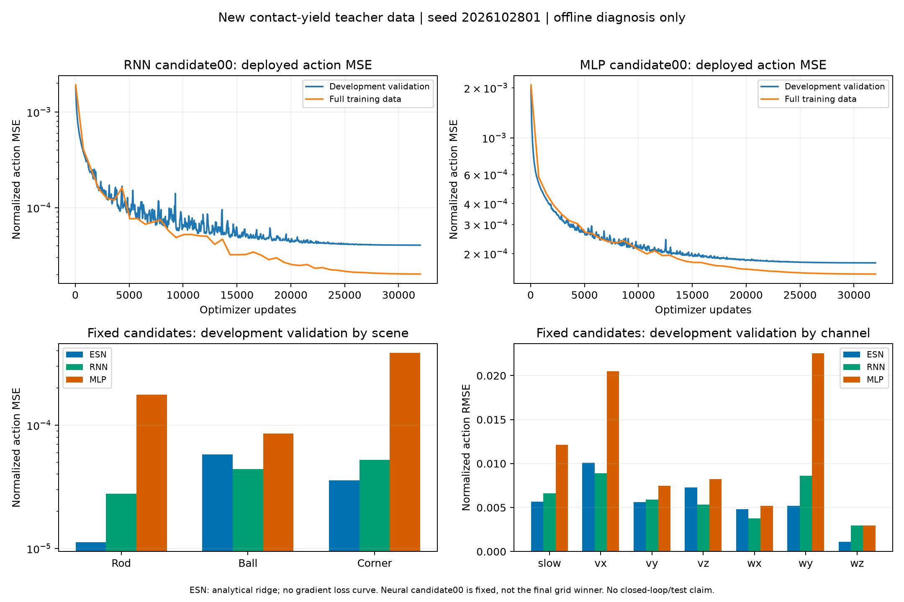

# 新teacher数据：首组候选真实学习诊断（2026-10-30）

本图只读取当前数据SHA 67c01021964857020a039a644a9ff6a5b67735c034d45bb7cc5c84b53cf0691b，三个新隔离场景30条/15,750帧，不复用旧实验图。固定seed2026102801，MLP/RNN只看预登记candidate00；没有根据图替换模型、调参或读取最终条件。ESN是该seed已完成12格搜索的validation最小者，神经只有首格，因此此图不是等调参预算的最终排名。

| 固定开发模型 | 全train动作MSE | 开发val动作MSE |
| --- | ---: | ---: |
| ESN seed01（已完成12格搜索） | 1.14392e-5 | 3.84549e-5 |
| RNN seed01 candidate00 | 2.02661e-5 | 4.05807e-5 |
| MLP seed01 candidate00 | 1.50751e-4 | 1.76038e-4 |

两神经候选均完成32,000次更新；895条真实history记录。图上方使用整个训练集的部署动作MSE（每20epoch及末次评估）和开发validation逐epoch动作MSE，采用原始采样点连线，无平滑。末mini-batch训练目标包含mask/global mass且raw slowdown训练分支与部署截断不同，不能冒充全train误差，所以未用last_train_loss充当上图训练曲线。训练MSE和validation MSE均独立从已保存部署prediction重算，并与最后history/metadata精确对应。

两条曲线均有明显学习下降，后段逐渐趋平；不据此宣布整个搜索完成或闭环通过。ESN为解析ridge，没有梯度loss曲线或reward曲线。本轮不制定新收敛阈值或改变选模规则。

首个MLP候选的离线偏差在厚桌角更明显，validation场景MSE约3.84702e-4，棍推约1.76382e-4、球约8.53880e-5；动作vx、wy通道误差较大。这是定位后续学习/表达能力问题的线索，不证明唯一根因或物理失败；仍须等待全部候选和固定27配对闭环。RNN/ESN也不能凭低离线误差推断任务成功。三个模型各在全部15,750帧按episode reset独立部署重放，和各自exported_replay精确一致，最大绝对误差0，未发现这组模型导出错误。

绘图入口code/mujoco_6d_vmc_benchmark/experiments/plot_contact_yield_first_candidates_20261030.py；PNG/PDF、全部源/输入/输出hash和逐场景/动作误差详见同名JSON证据。已目视核验图例、坐标、无裁切。无新物理/拟合/重选/测试。公平75fit仍运行，后继27与108仍等待；主六指标矩阵尚未更新。

服务器raw归档限制仍未解决，本图与源/小证据发布GitHub，不宣称新raw已在服务器共享。
