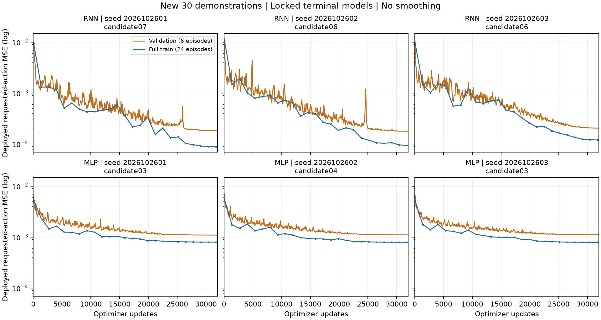
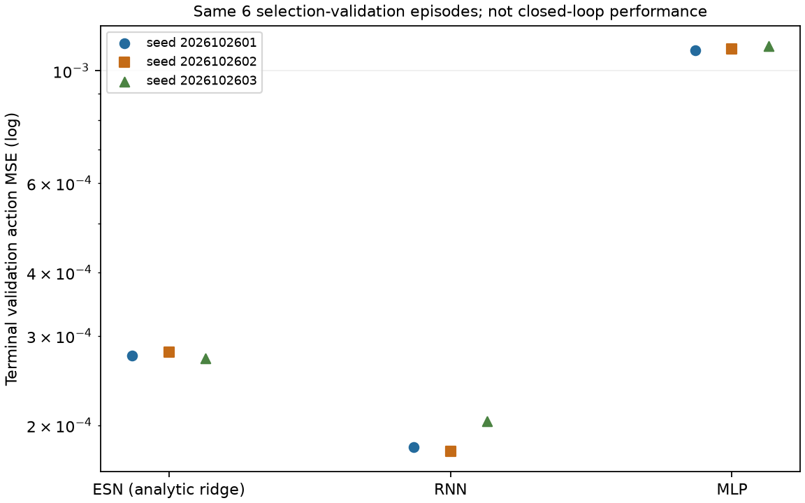

# 新增30条示范：历史ESN学习方法与RNN/MLP公平比较

用户决定采用历史ESN的训练思路，但只使用新增30条实际示范，并要求RNN/MLP公平对比。
本轮实现为独立有限实验`nonrl_new30_fair_20261026_v2`，不会覆盖历史模型或旧矩阵。
RL不在本轮范围。截至2026-10-26 07:24 UTC，训练与9模型选模审计已通过，108回合闭环评测正在运行；不是最终物理结果。

## 数据与方法

从原55条NPZ按已登记lineage抽取episode25–54，重编号0–29，其他10个数组字段不改。
只有新增单一教师产生的30条，保留原整轨迹划分：24训练/6验证、33000/8250帧。
数据SHA256：`4b4a734bc5adb008fa3b93348c8efbd4b99cff1f49326892e3626cfa12594eca`。
原55条父数据SHA256：`f00edd388a476879e56e51cf91c9cc04425a91d1df649eb9b78bf6197f33ddd6`。
抽取前逐条核验原trace、execution、chain hash；不混入旧25条、搜索示范或测试回合。

| 方法 | 学习方式 | 隐状态宽度 | 可训练参数 |
|---|---|---:|---:|
| ESN | 固定随机储备池与固定state-context特征，只用解析ridge学习线性读出 | 128 | 3780 |
| RNN | 普通Elman RNN，从随机初始化梯度训练输入、循环与输出权重 | 128 | 21888 |
| MLP | 普通tanh MLP，从随机初始化梯度训练输入与输出权重 | 128 | 5504 |

三者都是模仿学习，都学习实际requested teacher action。部署均使用canonical48接口中
相同18个允许的本体感知字段、相同action7及公共滤波器；无运行时教师、教师身份或特权信息。
历史ESN的上下文交叉特征/多时间常数/固定读出特征属于其设计，普通RNN/MLP使用训练集归一化
的18字段及其绝对值。这是三种完整方法的公平数据/选择/评测比较，**不是等参数量、同特征映射
的纯记忆机制消融**；不得将差异仅归因于储备池或递归结构。

三者均从头训练，不加载历史checkpoint或用ESN权重初始化RNN。冻结的历史actor实现同时放入
隔离训练和物理执行快照，防止后来的可选state-delta ESN扩展混入该实验。

## 调参与选模

随机种子：2026102601、2026102602、2026102603。每方法每种子12个候选，共108个候选。

- ESN：rho `{0.5,0.8}` × input gain `{0.08,0.25,0.6}` × ridge `{0.001,0.1}`，
  延用历史解析训练器的`--state-context-readout`，不使用梯度ESN。
- RNN/MLP：learning rate `{1e-4,3e-4,1e-3,3e-3}` × weight decay `{0,1e-5,1e-4}`；
  每候选32000更新，batch8、TBPTT64、float64，cosine从初始LR降到1%，无额外delta/drift损失。
  固定批质量归一化，避免短尾块被过度加权；训练slowdown通道使用裁剪前损失避免负区间梯度为零，
  验证与部署仍按原动作边界裁剪。没有更改执行器限制或公共滤波器。
- **统一选择规则**：每方法每种子按相同6条验证示范的部署动作MSE选12个终态候选中的最小值，
  同分按候选名。神经网络不选中间最佳epoch，避免额外数百次checkpoint选择机会；中间验证值
  只用于诊断，不反馈到选模。最终共9个模型，全部训练完成才写MODEL_LOCK。
- 相同候选数量不等于相同FLOPs/运行时间；逐候选记录墙钟时间、参数数、实际样本曝光、更新次数。
  32000步是有限预算，不是收敛证明；保留全训练集部署MSE轨迹及验证曲线，不根据测试失败追加调参。

## 评测矩阵

训练启动前，以seed2026102617冻结12个新扰动身份，沿用原登记扰动范围；检查与旧公开条件、
扩展采集身份、原8条件矩阵无完全重复，不读取旧封存测试组。新身份不是新几何或广泛场景泛化。
三方法×三seed×12条件共108个完整55秒回合，在全体9模型锁定后才执行。

所有方法使用同一冻结物理源码/MJB、dt5e-5、Task/Strict gate、canonical48接口、公共filter和执行器限制。
统一报告Task与Task AND Strict成功率、SPT、回合峰值力矩、接触期舒适阈值合规比例、机器安全违规率。
完整108矩阵双通过回合的最短完成时间作为一个全局T_ref，失败SPT为0；没有双通过则T_ref=NA。
阈值`[43.5,43.5,43.5,43.5,6,6,6] Nm`；人体接触力>0.05N的实际dt才进入分母。
每seed12条件先聚合，再报告三seed均值和样本标准差，不将36回合伪装成36个训练seed。

每条回合保留失败、trace/chain/MJB/config/checkpoint/source hash及actor/filter审计；原始子步
重新计算指标。部分矩阵仅保存PARTIAL_ROWS，不生成最终SPT排名。不承诺ESN获胜。

## 实施状态与运行

本机airpig单路、单线程、CPUQuota100%、MemoryMax3GiB、禁worker swap，全局计算锁防重复。
仿真与ESN拟合使用`.venv-sii-local-rl`（MuJoCo3.11.0/Numpy2.2.6）；神经拟合使用`.venv-rl`
（Torch2.11.0/Numpy2.4.6），该环境中的MuJoCo3.14.0**不用于物理运行**。
源码、环境及每个执行argv均记录，不能将不同库版本称为同机逐位训练复现。

正式服务：`sii-nonrl-new30-fair-20261026-v2.service`。
主目录：`/home/airpig/桌面/hwy/compliance_control/SII_compliance/code/mujoco_6d_vmc_benchmark/outputs/nonrl_new30_fair_20261026_v2/`。
先看`execution.json`、`learning/*/progress.json`、systemd状态，不可重复启动`--run`。
如需停止，在该独立目录创建`STOP_REQUESTED`，候选/完整回合边界停止；不强杀整个进程组。
异常保留`failed_preserved`，不自动覆盖或从头重复已完成候选；恢复前必须核对故障边界与hash。

启动前验证：2项梯度/部署契约测试通过；RNN/MLP分别8更新预检成功，导出最大差异
`3.05e-16`/`2.78e-16`。预检使用独立seed2026102699，不参与候选选择或正式模型统计。
首次准备v1因历史/当前actor源码不一致被拒绝，未训练/仿真；v2使用相同历史actor快照修复。
一次预检因相对输出路径不能归档源码失败，独立绝对路径重试通过；正式协调器使用绝对路径。
失败产物均保留，不把它们计为算法失败。

首次进度核验：三个ESN种子的36候选已全部拟合，所选验证MSE分别为
`0.0002742503`、`0.0002788274`、`0.0002707210`；RNN首候选已启动。
这只是离线拟合，不能称为新指标通过、物理成功或ESN优于baseline。实时时间戳以执行记录为准。

入口：`tools/run_nonrl_new30_20261026.py`的`--prepare`/`--run`。
小型协议/数据来源/预检/进度快照见`docs/evidence/nonrl_new30_20261026/`。
提取后的30条数据、完整候选训练产物与登记源码已有服务器归档副本（见下方07:49记录）；
原始采集轨迹与本轮物理评测产物仍在本机。小型交接包路径与核验状态记录于根UPDATE_LOG。

## 2026-10-26 06:01 UTC进度审计

持续Goal保持active。真实服务/协调器/子进程均在运行，未重启或重复派发。完成15/75个拟合
进程：ESN 3个进程含36候选，RNN 6/36、MLP 6/36；正在训练后续候选，物理回合0/108。
此处是时间点快照，不是最终结果。cgroup核验无OOM事件、worker swap为0，内存约0.65GiB。

新增独立检查器`tools/audit_nonrl_new30_20261026.py`，`--progress`核验冻结源码1357项、
数据/划分/协议hash、完成候选的checkpoint、ESN完整网格与选择、神经终态32k更新与实际LR/正则、
部署导出一致性、优化器schedule没有验证身份。06:01快照通过，证据
`docs/evidence/nonrl_new30_20261026/PROGRESS_AUDIT_0601.json`。未完成矩阵被最终验收入口正确拒绝。
首个只读检查因重复构造身份集合效率低而停止（35.4秒、SIGTERM），优化后独立重跑0.263秒通过；
未触碰正式训练。该检查不选择局部网格赢家，也不把低拟合MSE当成闭环成功。

最终验收入口还将检查75拟合/108候选/9模型锁/108回合完整性，独立重放6验证身份动作，核验
物理来源/hash/配置与actor/filter审计，重算SPT、接触合规、峰矩、机器安全以及按seed汇总。
完整物理分支尚待实验结束后执行，不宣称已通过。最终需分别报告选模所用6条验证示范误差和
12个预登记独立条件的闭环指标；前者不是未见测试结果。

06:07 UTC补充：服务仍运行，已完成ESN全部36候选、RNN9/36、MLP8/36。检查器新增
`--progress --replay-completed`，对快照内20个完成模型逐条重放6个选模验证身份，部署MSE与
训练收据一致（最大绝对差2.17e-19），证据为`VALIDATION_REPLAY_PROGRESS_0610.json`，
准确采样时间以JSON内`created_utc`为准。独立审计限单核/3GiB/禁swap，2.329秒退出0。
首个固定候选的全训练集部署MSE从update66到32000：RNN `0.0076912→0.000198563`，
MLP `0.00786814→0.000853701`。这些是指定候选的学习诊断，不是完整网格赢家或收敛结论；
没有使用新12条件调参，也未开始物理评测。

## 2026-10-26 07:24 UTC：完整训练与选模审计

75个拟合进程全部正常完成，覆盖108候选（每方法36）；72个神经候选各完成32000更新。
07:16:14 UTC冻结9模型后，原协调器自动进入108回合闭环评测，没有重启、重复派发或追加搜索。
全部75个拟合产物的部署验证重放与训练收据一致，见`ALL_FITS_VALIDATION_REPLAY_0717.json`。
新`--training-only`入口独立验证完整网格、9个选择是否为对应seed最低验证MSE、checkpoint哈希
以及9模型在6个选模验证身份上的动作重放。证据`TRAINING_SELECTION_AUDIT_0725.json`通过；
文件时间标识不代表采样时间，以内部`created_utc=2026-10-26T07:24:18.585764+00:00`为准。
默认最终审计仍拒绝未完成物理矩阵，拒绝测试已通过；冻结训练/仿真源码没有变化。

| 方法 | seed 2026102601 | seed 2026102602 | seed 2026102603 |
|---|---:|---:|---:|
| ESN 验证动作MSE | 0.0002742503 | 0.0002788274 | 0.0002707210 |
| RNN 验证动作MSE | 0.0001809877 | 0.0001775017 | 0.0002040008 |
| MLP 验证动作MSE | 0.0010956467 | 0.0011055553 | 0.0011180708 |

RNN选择candidate07/06/06，MLP选择candidate03/04/03；ESN由各自完整12参数网格选定。
这是选模集动作拟合误差，不是未见任务成功率、SPT或收敛证明，也不说明ESN必然胜出。
07:23 UTC进度快照完成1/108，第二个RNN回合真实推进。首ESN回合Task=true但Strict=false：
外部穿透0.293744mm超过0.2mm，峰矩51.491859Nm，actor/filter重放误差0。
保留该失败，不把完成放置算成双通过；不以单回合给三方法排名。服务active，内存约1.48GiB，
上限3GiB且禁worker swap。最终仍需108回合与完整子步审计，Goal保持active。

## 2026-10-26 07:49 UTC：完整训练产物共享归档

已核验服务器副本：
`arm1@192.168.31.70:/home/arm1/sii_shared/SII_compliance/runs/main/nonrl_new30_fair_20261026_v2_training_bundle_0749/TRAINING_BUNDLE.tar.gz`。
SHA256 `c8affcee0e67343f985b5716dd2eb2adf037c81d9455ffed07df3259d18c0e85`，
285495369字节；1995个有效载荷文件、605458060字节，另附逐文件manifest和独立命名的执行状态快照。
包含新增30条NPZ、全部75拟合目录/108候选、9模型锁、1357项登记源码、协议与正式MJB及训练审计。
打包前后逐文件hash、包内每项重读hash、服务器暂存与发布后包SHA/大小均已核验；收据为
`docs/evidence/nonrl_new30_20261026/TRAINING_BUNDLE_ARCHIVE_0749.json`。

没有包含未登记的嵌套旧输出、Python环境、外部runtime全部依赖或原始采集轨迹；绝对路径仅保留
来源，不声称解包即可直接运行。当前物理评测还在进行，其轨迹和最终报告不在此包内。
本机副本保留，服务器只做文件归档，没有新增服务器训练或仿真，也没有重启原本机服务。

## 2026-10-26 08:10 UTC：首个完整条件独立审计

原协调器完成条件`new30_prospective_20261026_acceptance_000`的9个模型回合后自动接续001。
新增`--completed-condition ID`审计入口，要求指定的登记条件覆盖全部9个锁定模型，复用最终
审计的hash/配置/运行时/完成时刻/原始子步指标核验；不会计算局部T_ref、SPT或最终排名。
实际首组审计通过：9×55秒、990万子步，1357项冻结源码、模型锁与选模重放、物理MJB/配置/
checkpoint/轨迹hash、原动作/filter审计收据、接触合规比例、峰矩、穿透与机器违规分类一致。
独立审计单核/3GiB/禁swap、3.953秒退出0；证据`FIRST_CONDITION_PHYSICS_AUDIT.json`。
默认最终入口对未完成108矩阵的拒绝、单条件入口对未完成条件的拒绝检查均通过。

该条件中Task通过ESN 2/3、RNN 1/3、MLP 0/3；Strict三类均0/3。已完成放置但不满足安全门
的回合仍为双通过失败。MLP较低峰矩/100%接触阈值比例伴随任务失败，不能解释为整体更好。
这是一个条件的进度收据，不能外推12条件表现或广泛泛化；模型、预算、协议和任务门保持冻结，
不根据这组结果再选模型或调参。完整108回合、全局SPT与最终审计仍未完成，Goal继续active。

## 2026-10-26 09:05 UTC：第二个完整条件核验

条件001的9个55秒回合、990万子步独立审计通过，证据`SECOND_CONDITION_PHYSICS_AUDIT.json`。
同一检查器核验冻结来源、锁模、运行时、动作/filter审计收据及原始峰矩、接触合规、穿透和安全分类，
4.524秒退出0。累计18/108回合完成，原协调器已接续条件002，未重启或追加训练。

条件001的Task成功数为ESN3/3、RNN2/3、MLP0/3；Task AND Strict为ESN2/3、RNN0/3、MLP0/3。
两个双通过ESN分别完成于42.84秒和48.56秒。未通过记录保留；上述仅为单条件描述，
不计算局部T_ref/SPT或最终排名。最终仍等待完整12条件与整体审计。

## 2026-10-26：锁定模型的真实学习曲线

新增只读绘图工具`tools/plot_nonrl_new30_learning_20261026.py`，从本次MODEL_LOCK定位六个
神经终态候选，先核对checkpoint/metadata hash、32000终态更新及最终验证MSE，再读取history。
未重新选模、追加更新或访问闭环结果来调整训练。每个模型485个验证记录、26个全训练集部署
MSE记录，全部实际采样点保留、不平滑；稀疏训练点间仅画直线连接，不冒充逐步记录。

这是部署requested-action的模仿误差，不是RL reward，也不是随机mini-batch优化loss。
三seed的RNN全训练MSE从首个记录update66的0.00932/0.01088/0.00944降至
0.00008775/0.00009427/0.00011979；MLP从0.00525/0.00550/0.00512降至
0.00079624/0.00078996/0.00078858。MLP在本预算末段较平坦，RNN仍有下降和波动。
末10%更新仅4个全训练MSE采样，极差/均值RNN为3.79%/12.44%/3.57%、MLP为
0.237%/0.271%/0.227%；该描述没有预登记收敛检验，且cosine学习率已降至初值1%，
不能据此证明充分收敛或增加测试后调参预算。

ESN使用解析ridge，无优化器迭代曲线，只展示已核验的终态验证误差。RNN离线验证MSE较低
并不证明其任务成功率/SPT更优；这里的6条是选模验证身份，完整108回合的独立闭环评测仍待完成。
`LEARNING_CURVE_EVIDENCE.json`保存所有绘图数值、模型/历史/脚本/图片hash，便于逐点核对。

## 2026-10-26：前两条件完整物理轨迹归档

已核验共享副本：
`arm1@192.168.31.70:/home/arm1/sii_shared/SII_compliance/runs/main/nonrl_new30_fair_20261026_v2_physics_000_001_0938/PHYSICS_BUNDLE.tar.gz`。
SHA256 `ac879373696ab35a7db5666761dc8ba9e4d73ab55fe7e109c14bd2f72db1ffd2`，
2201829494字节。包括条件000/001全部18条评测目录（失败也保留）、对应metrics、两份独立
物理审计、协议/条件/模型锁及归档工具；421个源文件2751583137字节，另附逐文件manifest、
已审计结果行和明确标为快照的执行记录。当前活动回合未打包。

新增`tools/archive_nonrl_new30_physics_20261026.py`要求每条件9模型完整且已有独立审计，
先核对审计中的模型/轨迹/指标hash，再核对源文件打包前后及包内逐项hash。单核/3GiB/禁swap、
低优先级本机任务正常退出；服务器只传输并验证暂存与发布后包SHA/大小，不运行训练或仿真。
收据`PHYSICS_000_001_ARCHIVE.json`记录准确范围。原始本机文件未删除或改写；后续条件
物理轨迹仍仅本机，完整训练源码/数据/候选模型另见前述训练包，不声称完整环境可移植复现。

## 2026-10-26 09:58 UTC：第三条件核验及最终汇总检查补齐

原协调器已完成27/108回合并自动接续第四条件，未重启或修改冻结模型。条件002的9个
55秒回合、990万物理子步独立核验通过，证据`THIRD_CONDITION_PHYSICS_AUDIT.json`；
单核/3GiB/禁swap检查4.822秒退出0，包含1357项冻结源文件、9锁模/验证重放、物理来源和
原actor/filter审计收据核对，以及原始峰矩、接触合规、穿透、安全分类的复算。

该条件Task成功数ESN3/3、RNN1/3、MLP0/3；Task AND Strict为ESN2/3、RNN1/3、MLP0/3。
双通过完成时间ESN43.04/48.64秒、RNN41.56秒；第三seed ESN完成任务但穿透0.357605mm，
仍为Strict失败。所有失败保留。这是单条件描述，不计算局部T_ref/SPT，不外推完整矩阵排名。

同时修复独立最终审计的汇总覆盖检查：此前只遍历已有family_summary项目，遗漏整个方法族
或指标时可能跳过；现明确要求三方法族、六项指标及per_seed/mean/sample_sd字段完整。
3项回归测试包含完整输入、真实无接触NA、缺方法族/指标/统计字段、错误种子顺序/均值/标准差
与种子数量，全部通过。仅独立审计器变化，正式模型、运行时、数据与评测规则保持；完整108回合
默认最终审计仍未执行，不把本次单条件通过当作最终通过。

## 2026-10-26 10:51 UTC：第四条件完整核验

原协调器完成36/108回合并自动接续第五条件。条件003的9×55秒/990万物理子步独立核验
通过，证据`FOURTH_CONDITION_PHYSICS_AUDIT.json`；单核/3GiB/禁swap检查4.606秒退出0。
1357源文件、模型锁/验证重放、物理来源/hash、原actor/filter审计收据及原始峰矩、人体接触
合规比例、穿透和机器安全分类均核对一致；没有新增训练、调整模型或重算已完成物理回合。

该条件Task成功数ESN3/3、RNN3/3、MLP1/3；Task AND Strict为ESN3/3、RNN2/3、MLP1/3。
ESN完成时间47.04/42.84/43.76秒；RNN两双通过50.32/53.04秒，第三seed虽然41.36秒完成
任务，但最大穿透0.411261mm导致Strict失败。MLP首seed53.36秒双通过，另两seed未完成任务。
全部失败保留。该单条件不能外推全12条件排名，不生成局部T_ref/SPT，完整108矩阵与最终审计仍待。

第三、第四条件共18条完整物理轨迹已核验共享：
`arm1@192.168.31.70:/home/arm1/sii_shared/SII_compliance/runs/main/nonrl_new30_fair_20261026_v2_physics_002_003_1052/PHYSICS_BUNDLE.tar.gz`。
SHA256 `913ea1a8b6f8c84744598633ed65103f7cd249a6e0d746bafbaa98d4657d46f3`，
2184900745字节；421源文件2735022932字节，含完整失败轨迹、MJB/checkpoint/配置/执行记录、
原始子步、对应指标与两份独立审计，另附manifest/已审计行/执行快照。既有归档工具核验源文件
打包前后及包内逐项hash，59.842秒正常退出；服务器暂存与最终发布后包SHA/大小一致。
收据`PHYSICS_002_003_ARCHIVE.json`。连同前两条件，前36条物理记录已有服务器副本；
后续条件轨迹仍仅本机，本机原件保留。归档期间原协调器正常推进至37/108、第五条件RNN在途。

## 2026-10-26 11:46 UTC：第五条件完整核验

原协调器已完成45/108回合并自动进入第六条件，未重复派发或更改冻结模型/协议。
条件004全部9×55秒、990万物理子步独立核验通过，证据
`FIFTH_CONDITION_PHYSICS_AUDIT.json`；检查单核/3GiB/禁swap，4.592秒正常退出。
核验1357项冻结源文件、完整训练与9模型选择/验证重放、物理MJB/config/checkpoint/轨迹hash、
原actor/filter审计收据，并从保存的原始子步重算峰矩、接触合规、穿透和机器安全分类。
这是对已有轨迹和重放收据的独立检查，没有重新仿真或独立重建整套物理动力学。

该条件Task成功ESN1/3、RNN1/3、MLP0/3；Task AND Strict成功1/3、0/3、0/3。
第二seed ESN在51.28秒完成并双通过；第三seed RNN在47.88秒完成任务，但穿透
0.323634mm导致Strict失败。第一seed ESN任务失败且穿透0.747769mm；第三seed ESN虽到
retreat阶段，最终Task仍为false，不能用阶段名替代任务判据。三MLP全部在carry阶段结束未成功，
接触期舒适合规100%不能据此声称整体更优。九条均完整55秒，无提前abort，所有失败保留。

这只是第五个登记条件的描述，不生成局部T_ref/SPT，不给完整矩阵排名。
完整训练包及前36条物理原件已有服务器副本；本条件原始轨迹仍仅本机，待下一条件完整后
按已审计的条件对归档。最终108回合、共同T_ref/SPT、三seed汇总及最终独立审计仍待完成。

## 2026-10-26 12:40 UTC：第六条件完整核验

原协调器完成54/108回合后正常接续第七条件，未重复派发。条件005的9×55秒、990万
物理子步独立核验通过，证据`SIXTH_CONDITION_PHYSICS_AUDIT.json`；单核/3GiB/禁swap，
4.881秒退出0。核验1357项冻结源码、完整训练与9锁模/验证动作重放、物理来源/hash、原
actor/filter重放审计收据，并从原始子步重新计算峰矩、接触合规、穿透和机器安全分类。

该条件Task成功ESN2/3、RNN2/3、MLP1/3；Task AND Strict为1/3、2/3、1/3。
首seed三方法均双通过，完成时间ESN43.12秒、RNN43.84秒、MLP51.16秒；第二seed三方法
全部在carry阶段结束未成功。第三seed ESN42.04秒完成任务，但随后穿透0.293360mm导致
Strict失败；同seed RNN54.36秒双通过，MLP在load_transfer阶段结束而Task=false。
九条均完整55秒、无提前abort，失败完整保留，不用阶段名或较低峰矩替代任务/安全判据。

以上只是第六条件描述，尚未进行完整矩阵排名。全108回合、共同T_ref/SPT、按seed汇总与
默认最终独立审计仍未完成；原评测继续，Goal保持active。

第五、六条件的18条完整原始轨迹已核验归档至
`arm1@192.168.31.70:/home/arm1/sii_shared/SII_compliance/runs/main/nonrl_new30_fair_20261026_v2_physics_004_005_1241/PHYSICS_BUNDLE.tar.gz`。
包大小2194324004字节，SHA256 `f6bf2d103ceef67fc8db83c2141806732d3f0574894f57b3889dde1e7a5ce257`；
421源文件共2744771558字节，包括全部失败轨迹、配置/checkpoint/模型/执行记录、原始子步、
指标和两份独立审计，另附manifest、已审计行与执行状态快照。既有工具核验源文件前后和包内
逐项hash，本机单核/3GiB/禁swap/Nice10打包59.867秒退出0；服务器暂存及最终副本SHA/大小一致。
收据`PHYSICS_004_005_ARCHIVE.json`。连同既有两包，前54条物理原件已共享；后续仍仅本机，
本机原件保留。服务器未运行训练或仿真；传输期间原协调器继续至55/108、第七条件RNN在途。

## 2026-10-26 13:34 UTC：第七条件完整核验

原协调器完成63/108回合后自动接续第八条件，未重复派发或改变冻结实验。条件006全部
9×55秒、990万子步独立核验通过，证据`SEVENTH_CONDITION_PHYSICS_AUDIT.json`；
单核/3GiB/禁swap检查4.635秒正常退出。核对1357项冻结源码、完整训练与9模型锁/验证
动作重放、物理MJB/config/checkpoint/轨迹hash、原actor/filter重放收据，并从原始子步
重算峰矩、接触合规、穿透和机器安全分类；未重新仿真或改动原始记录。

该条件Task成功ESN2/3、RNN3/3、MLP0/3；Task AND Strict为2/3、2/3、0/3。
ESN第二/三seed分别53.32/44.92秒双通过；首seed虽到retreat阶段，最终Task仍false。
RNN首/三seed分别49.36/50.44秒双通过；第二seed47.28秒完成任务，但穿透0.233791mm
导致Strict失败。三MLP在carry阶段结束未成功，接触期舒适合规100%不能替代任务完成。
全部九条均完整55秒、无提前abort，所有失败保留；单条件结果不作为全矩阵排名。

本条件原始轨迹仍仅本机，待第八条件完整后按条件对归档；前54条物理原件和完整训练产物
另有已核验共享副本。全108回合、共同T_ref/SPT、三seed最终汇总和默认最终审计仍待完成，
Goal保持active，原服务继续运行。

## 2026-10-26 14:28 UTC：第八条件完整核验

原协调器已完成72/108回合并自动接续第九条件，未重复派发或更改冻结实验。条件007的
9×55秒、990万子步独立核验通过，证据`EIGHTH_CONDITION_PHYSICS_AUDIT.json`；
单核/3GiB/禁swap检查4.625秒退出0。核对1357项冻结源码、完整训练与9锁模/验证动作
重放、物理MJB/config/checkpoint/轨迹hash及原actor/filter审计收据，并从保存的原始
子步重算峰矩、人体接触合规、穿透和机器安全分类；未重新运行仿真或修改原始记录。

该条件Task成功ESN1/3、RNN3/3、MLP1/3；Task AND Strict为1/3、0/3、1/3。
第二seed ESN51.40秒双通过；首seed在carry结束，第三seed虽到retreat但Task仍false。
三个RNN分别51.32/47.88/50.76秒完成任务，但穿透0.461520/0.480506/0.792629mm，
全部未过Strict，不能将Task3/3表述为整体通过。首seed MLP49.48秒双通过，另两seed
在carry结束未成功。九条均完整55秒、无提前abort，失败全部保留。

以上仅为第八个登记条件的描述，不计算局部T_ref/SPT或最终方法排名。全108回合、共同
参考时间、三seed汇总和默认最终独立审计仍待完成，原评测继续，Goal保持active。

第七、八条件18条完整原始轨迹已核验共享至
`arm1@192.168.31.70:/home/arm1/sii_shared/SII_compliance/runs/main/nonrl_new30_fair_20261026_v2_physics_006_007_1429/PHYSICS_BUNDLE.tar.gz`。
包大小2204253882字节，SHA256 `f503ae6b6eb7a9b3c1154b80b4e9a447fe908f03071ae2bc55fdae3b3455238b`；
421源文件共2754341683字节，保留全部失败、原始子步、模型/配置/checkpoint、指标和两份
独立审计。既有工具核验源文件打包前后与包内逐项hash，单核/3GiB/禁swap/Nice10运行
60.638秒退出0；服务器暂存及最终副本SHA/大小一致，独立目标目录此前不存在。
收据`PHYSICS_006_007_ARCHIVE.json`。累计前72条物理原件已有共享副本；后续轨迹仍仅本机，
本机原件保留，服务器未训练或仿真。传输期间原评测持续至73/108，第九条件RNN在途。

## 2026-10-26 14:43 UTC：最终报告入口准备（尚未生成最终结果）

独立新增`tools/present_nonrl_new30_final_20261026.py`，不改运行中的冻结训练/物理源码。
现有自动REPORT.md沿用旧矩阵标题且按9个模型列数；新入口读取同一最终REPORT.json，
生成新30条的三方法×六指标图（PNG/PDF）、三seed均值±样本标准差表、逐模型结果及来源收据。
六项为Task、Task AND Strict、SPT、平均回合峰矩、实际接触时间加权舒适合规、机器安全违规率；
另报最坏峰矩、总接触时长和失败原因。图显示全部seed，标准差不是置信区间。

入口要求execution与report均complete、完整108格、对应同run且hash匹配的final_audit_passed，
不接受单条件或训练审计代替最终审计，不覆盖已有输出目录。当前74/108的真实矩阵拒绝检查
通过，AST检查通过，已确认绘图库Matplotlib3.11.2可导入；尚未使用完整结果运行或目视验图，
不能将入口准备完成写成最终评测完成。最终时必须先运行默认独立审计，再执行新入口并验图。
新增工具已纳入Git交接；独立最终图/报告/证据待生成并随最终产物归档。原服务继续，第九条件
MLP实际仿真时间18.04→47.04秒，原worker144177 CPU时间2:07→5:11，无重启。

## 2026-10-27 03:14 UTC：休眠停顿核实，恢复后79/108

主机systemd-suspend日志显示北京时间2026-10-26 23:03:50进入休眠，2026-10-27
11:09:23返回，11:09:25服务结束；此前23:03:15–23:03:22还有一次短休眠。
这解释了第九条件第三seed ESN跨越约12小时墙钟却只累积少量CPU时间：不能称为整夜持续计算。
本次未修改系统电源设置、重启协调器或重新派发回合。唤醒后原ESN进程146764的实际仿真
时间14.04→49.04秒持续推进，03:14:24 UTC协调器86607保存第79条结果并接续同条件
第三seed RNN；新worker150217存活且CPU时间增加。服务active，检查时OOM事件0/swap0。
完整81条条件审计及108条最终矩阵仍待，未据这三个新增部分回合发布方法排名。

GitHub TLS暂时故障后fetch恢复，已读取并快进同步main
`dbb1d76ed79177067c48ed49ff9f67f023c704aa`，baseline仍
`f6e8f8c2711a93f0b5dfc88c608bd82647084d5d`。另一任务更新未改变本机冻结运行时。

## 2026-10-27 03:26 UTC：第九条件完整核验

原协调器完成81/108回合并自动进入第十条件，没有重复派发。条件008的9×55秒、990万
子步独立审计通过，证据`NINTH_CONDITION_PHYSICS_AUDIT.json`；单核/3GiB/禁swap检查
4.745秒退出0。核验1357冻结源文件、完整训练/选模/9锁模与验证动作重放、物理来源/hash、
原actor/filter重放收据，并从保存的原始子步复算峰矩、接触合规、穿透和机器安全分类。
这是已有记录的独立核验，没有重新仿真或独立重建全部动力学。

该条件Task成功ESN3/3、RNN2/3、MLP0/3；Task AND Strict为1/3、0/3、0/3。
第二seed ESN50.64秒双通过；第一/第三seed虽46.12/49.44秒完成任务，但穿透
0.619590/0.227577mm导致Strict失败。第一/第三seed RNN45.72/43.16秒完成任务，
穿透0.257711/0.410441mm，均未过Strict；第二seed RNN和全部MLP在carry结束失败。
九条均完整55秒、无abort，失败保留。MLP接触期力矩合规100%仍伴随任务失败，且实际
人体接触峰力约359.89–427.94N，不能用力矩代理宣称人体接触安全或整体更优。

本条件原始轨迹仍在本机，待第十条件完成后按条件对归档；此前72条物理原件与完整训练
另有已核验服务器副本。全108回合、共同T_ref/SPT、三seed最终汇总及默认最终审计仍待。
Goal保持active，模型/训练预算/评测条件未因当前结果调整。

本次4文件小型审计证据包已核验共享至
`arm1@192.168.31.70:/home/arm1/sii_shared/SII_compliance/runs/main/nonrl_new30_fair_20261026_v2_ninth_condition_20261027_0326/NINTH_CONDITION_AUDIT.tar.gz`。
36382字节，SHA256 `af0d0d04c2a37e6c3600640048f53a0909ba140e4755b1d322b0bcbe5fcee0a3`；
包内逐文件与本地一致、服务器暂存与最终包SHA/大小一致。收据
`NINTH_CONDITION_ARCHIVE_20261027_0326.json`。这不是第九条件原始轨迹的共享副本。
