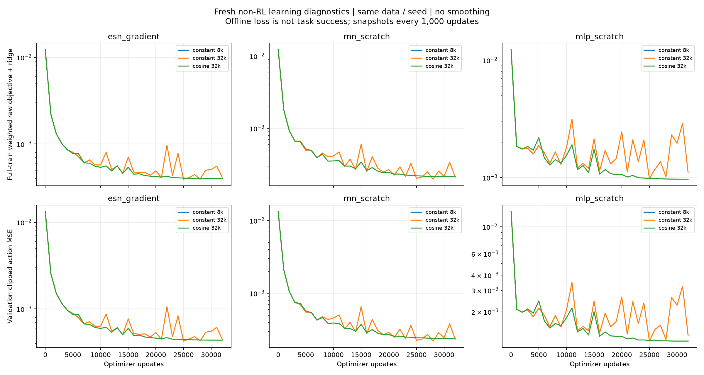

# 非 RL 学习修复与解析 ESN 审计

本轮承接已完成的 [64 回合新指标矩阵](NONRL_SPT_RESULTS_20261026.md)，不改变
SPT、Task/Strict、接触期舒适力矩或机器安全定义，不接手 RL。
使用同一 44/11 整轨迹划分、同一数据、seed 2026101301、公开特征和动作接口；
所有新拟合从头开始，checkpoint 仅按 imitation validation MSE 选择。
单 seed 是诊断，不能推断整个方法族的优越性。

## 解析最优性检查

对固定 ESN 储备池，按原 train-only 特征归一化和 importance 重建正规方程。
优化目标为全部训练帧的加权 raw-action MSE，加系数为 0.1 的读出 ridge 正则；
输出 clipping 仅用于部署与另报的验证 MSE。逐轨迹累加矩阵避免大规模内存占用。

| 选定 ESN checkpoint | 完整训练目标 | 相对解析最优值的缺口 | 验证 clipped MSE |
|---|---:|---:|---:|
| 解析 ridge | 0.000220331 | 约 0 | 0.000267401 |
| 旧梯度 8k | 0.000586319 | 166.11% | 0.000644172 |
| global 修正、恒定 LR 8k | 0.000605703 | 174.91% | 0.000670353 |
| global 修正、恒定 LR 32k | 0.000392616 | 78.19% | 0.000424821 |
| global 修正、cosine LR 32k | 0.000398687 | 80.95% | 0.000435579 |

解析 checkpoint 的正规方程相对残差为 `4.19e-15`；独立重建解与保存权重的目标差约为零。
所有 ESN 的储备池、输入权重、leak、特征归一化逐值相等，数据/模型 hash 一致。
正定二次目标的直接计算值与参数差构成的解析 gap 通过一致性核验。
这支持“梯度 ESN 尚未达到该固定特征问题的最优值”，不支持“ESN 表达能力必然不足”。
它也不证明解析 ESN 有最佳闭环任务表现，或当前数据已充分覆盖失败恢复。

cosine 曲线稳定而仍有较大最优性缺口，说明有限窗口 plateau 与最优解必须分开报告。
本轮不因为曲线变平就宣布 proposed 已训练充分，也不将 offline MSE 改善写成 SPT 改善。
解析 ridge 是机制对照，不与神经网络宣称相同优化器更新预算。

## 32k 学习率对照已完成

六次恒定学习率拟合及三次 cosine 拟合均完成，执行收据为 complete、退出码为 0。
cosine 使用原初始学习率（ESN/RNN 1e-5、MLP 1e-4），按相同公式降至其 1%；
没有按闭环测试成绩为某个方法额外选择学习率。

| 方法 | 恒定 32k 最佳验证 MSE | cosine 32k 最佳验证 MSE | 恒定末四点目标相对极差 | cosine 末四点目标相对极差 |
|---|---:|---:|---:|---:|
| 梯度 ESN | 0.000424821 | 0.000435579 | 28.39% | 0.201% |
| RNN | 0.000219847 | 0.000238295 | 50.77% | 0.458% |
| MLP | 0.001148648 | 0.001146292 | 87.26% | 0.197% |

三种 cosine 拟合都达到本阶段预先登记的描述性 plateau（训练目标下降至少 10%、
末四点极差/均值 ≤1%），但不等同于全局最优或任务成功。ESN/RNN 的最佳验证 MSE
略差于恒定组，MLP 略好；不能声称三者均取得泛化提升。
新图来自本轮完整训练目标和验证记录，每 1000 更新一次、无平滑，未混用旧 minibatch loss。



## 下一轮物理诊断已锁定，尚未启动

`docs/evidence/nonrl_learning_repair_20261026/MODEL_LOCK.json` 已锁定七模型：
三方法的 constant/cosine 32k，共六个模型，加解析 ridge ESN。每个模型都跑同样八条件，
共 56 回合，不按表现筛掉任何方法或失败。原八条件已经看过，因此新组属于已见诊断；
不能将其当作新方法的未见测试集。后续确认性比较仍须新条件、多 seed、公平曝光。

沿用冻结 MJB/gates/dt5e-5/canonical48/filter/执行器限制。七模型共享本张矩阵的一个
Task AND Strict 成功最短完成时间作为 T_ref。旧 64 回合与新 56 回合若参考时间不同，
不得直接以 SPT 数字差宣称提升；需在显式共同参考下另行重算比较。
入口支持独立诊断 model lock、检查元数据/数据/模型 hash、全局计算锁、3 GiB/禁 swap
和磁盘准入；审计器按登记的完整笛卡尔积验证，不接受缺失条件或重复回合。

当前磁盘可用约 **4.41 GiB**。根据上一轮单回合最高约 152 MiB，准入按每回合
192 MiB 加 1 GiB余量计算，56 回合需 **11.5 GiB**。dry-run 的 `disk_admitted=false`，
`PHYSICS_PREFLIGHT.json` 记录 `blocked_storage` 和 `execution_started=false`。
因此尚未创建 `nonrl_learning_closed_loop_20261026_v1` 物理运行，没有声称新模型 SPT 已提升。
不使用内存盘替代持久存储，不删除旧回合，也不绕过待授权的原始轨迹导出。

存储解决后在仓库根目录使用唯一新 unit 执行（若已有进程或执行收据，先核验）：

```bash
systemd-run --user --unit=sii-nonrl-learning-closed-loop-20261026-v1 \
  --property=Type=exec --property=MemoryMax=3G --property=MemorySwapMax=0 \
  --property=CPUQuota=100% \
  --working-directory=/home/airpig/桌面/hwy/compliance_control/SII_compliance \
  /usr/bin/env OMP_NUM_THREADS=1 OPENBLAS_NUM_THREADS=1 MKL_NUM_THREADS=1 \
  /home/airpig/桌面/hwy/compliance_control/.venv-sii-local-rl/bin/python \
  code/mujoco_6d_vmc_benchmark/tools/run_nonrl_spt_matrix_20261025.py \
  --source-run code/mujoco_6d_vmc_benchmark/outputs/fair_comparison_20261013_v2 \
  --root code/mujoco_6d_vmc_benchmark/outputs/nonrl_learning_closed_loop_20261026_v1 \
  --runtime code/mujoco_6d_vmc_benchmark/outputs/baseline_local_rl_20261009/runtime \
  --model-lock docs/evidence/nonrl_learning_repair_20261026/MODEL_LOCK.json
```

完成后才对新 root 调用 `finalize_nonrl_spt_report_20261025.py`。此命令不恢复旧运行，
不覆盖旧 64 回合目录；中途资源失败须保留收据并审查安全边界，不自动重启重复进程。

## 产物与复现

源码：`code/mujoco_6d_vmc_benchmark/tools/audit_nonrl_ridge_optimality_20261026.py`。
原始审计只读训练数据与 checkpoint，不修改历史输出；数据 SHA256：
`f00edd388a476879e56e51cf91c9cc04425a91d1df649eb9b78bf6197f33ddd6`。
实际计算主机为 airpig，Python 为本地 `.venv-rl/bin/python`，单线程/3 GiB/禁 worker swap。
证据发布于 `docs/evidence/nonrl_learning_repair_20261026/`。

本地运行目录均位于
`/home/airpig/桌面/hwy/compliance_control/SII_compliance/code/mujoco_6d_vmc_benchmark/outputs/`：

- `nonrl_learning_repair_20261026_v1/`：三方法各 8k/32k，恒定学习率六拟合。
- `nonrl_learning_repair_20261026_cosine_v1/`：三方法各 32k，cosine 从初始 LR 衰减到其 1%。
- `nonrl_ridge_audit_20261026_v1/AUDIT.json`：逐模型 hash、完整目标、最优性缺口。

大文件仅本地，尚无经核验的服务器副本。此前自动审批拒绝向 arm1 上传整批原始轨迹，
理由是未确认该 payload 的导出授权；未绕过该决定。GitHub 仅发布已授权的小型研究证据与源码。
