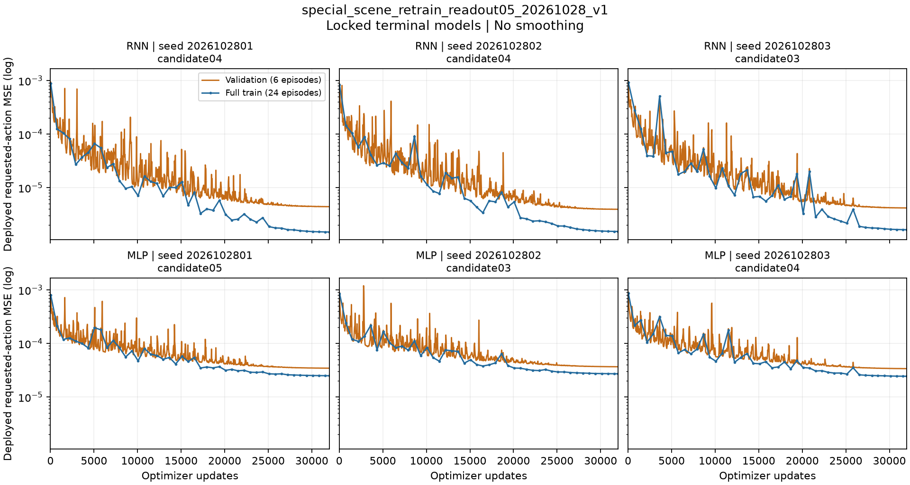
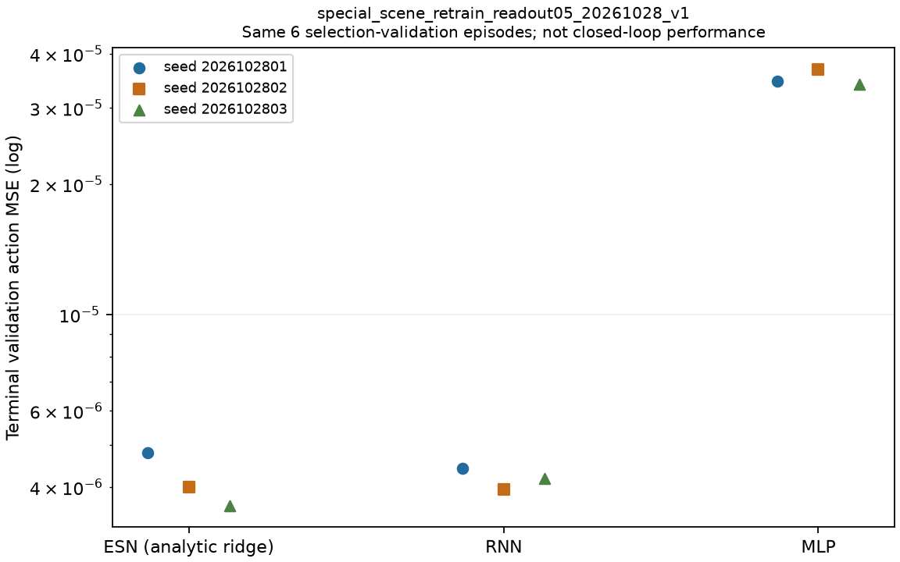

# 三真实场景采集继续与冻结108入口准备

## 实际新学习曲线与首两回合复核（10:59 UTC）

原接续772606与协调器791378仍live，2/108完成，MLP seed1首条件worker796016
从2.04推进到39.04物理秒。真实3GiB/swap0、OOM0，没有新训练或重复测试。
本轮已查询/fetch/read main `ffdf6c681c409f2c1ae0192284de5d10addc4df9`、baseline
`f6e8f8c2711a93f0b5dfc88c608bd82647084d5d`，没有本任务协议变化。

训练已经完整，因此在独立输出目录提前生成了真实新学习图，不等待108才查看训练历史。
原自动接续的`LEARNING_CURVES`路径未写入、原快照未修改，后续自动绘图保持原协议。
两张PNG已目视检查，曲线每个数据点与所选候选原history逐项一致，尾段统计独立math.fsum核验；
证据见[学习图与首两回合复核](evidence/NONRL_SPECIAL_FROZEN108_PREP_20261028/ACTUAL_LEARNING_PLOT_REVIEW.json)。

六个神经模型均固定32000更新：RNN三seed全训练动作MSE从约8.3–9.2e-4降到
1.49–1.65e-6（下降545–590倍），MLP从约7.9–8.6e-4降到2.44–2.72e-5（下降31.6–35.3倍）。
最后10%区间仅有5个完整训练集读出点，其极差/均值为RNN3.31–4.06%、MLP1.24–1.90%。
原cosine学习率从3e-4降至3e-6；末段变平受步长退火影响，不能据此独立认定充分收敛。
没有平滑或伪造reward；ESN解析ridge只给终态验证误差，不构造梯度更新曲线。

首两条物理回合共1720000保存子步和来源/config/checkpoint/actor/filter链复核通过。
ESN首回合保持31秒全局穿透中止；RNN首回合完整55秒，无abort，仍停carry阶段，
物体末端XY放置误差87.04mm，Task/Strict均失败。RNN该回合峰矩37.452694Nm、
接触3.83025秒、舒适力矩代理100%、机器合规，但不能把这些值写成任务完成或人体安全认证。
首两条均不进入双成功SPT；不提前计算局部T_ref或推断完整方法排名，不据测试调整模型。

实际图、全部绘图数据点、复核收据及绘图来源共5文件逐字节核验，462101字节包SHA256
`3d380edd700c25422420b7d33cb371e526755c7db51b2a496cdb59cfa8584159`已上传并回读核验发布：
`arm1@192.168.31.70:/home/arm1/sii_shared/SII_compliance/runs/main/nonrl_special_actual_learning_20261028_v1/nonrl_special_actual_learning_20261028_v1.tar.gz`。
本包不含108原始物理轨迹；完整物理归档、六指标最终比较和contact补充仍待，Goal active。

发布前原队列已3/108完整，ESN seed2首条件继续。远端新增 `f67b4196` 为另一RL任务，
已读日志并安全合并；AGENTS/UPDATE_LOG顶部并行新增冲突逐段保留双方，原运行快照未变。

## 最新：训练完整，冻结108已运行，完整拟合档案已共享

2026-10-28 10:52 UTC：新三场景30条示范的全部75作业/108候选已完成，
九模型按原共同六条验证集动作MSE选定。全拟合审计通过，九模型分别在全部15750观测
使用冻结测试actor重放，最大绝对误差均0。原训练服务自然退出，勿重启。
这验证训练/推理一致性，不代表闭环成功或训练收敛。

完整训练档案已核验发布：
`arm1@192.168.31.70:/home/arm1/sii_shared/SII_compliance/runs/main/nonrl_special_complete_fits_20261028_v1/COMPLETE_FITS.tar.gz`，
141512629字节，SHA256 `319212a1d3605c4da4699ef25ca4bacd3f41b9c4baf49f0930bff929bd3dcd55`。
含900个来源文件：完整数据、全部候选、九模型锁、训练历史/采样日程、收据/拟合源码及全拟合审计；
源和tar成员逐大小/hash核验，上传和正式目录回读一致。旧教师失败另有完整归档；本包不含新108物理轨迹。
工具`archive_special_completed_fits_20261028.py`对不完整75作业拒绝打包，实际完整包通过。

模型锁SHA256 `481c971ed0d5658ecbc18d9e4e1b34a42d5133bd13ee619c38939e0f807d2519`；
全拟合审计SHA256 `0b75b13141a118cb3ce14040c3b27b412673fa4a767b95a5aae4f754590a1741`。
九模型checkpoint/metadata hash及验证误差完整见
[实际收据](evidence/NONRL_SPECIAL_FROZEN108_PREP_20261028/FITS_COMPLETE_TEST_STARTED.json)。
验证MSE：ESN三seed为4.80649e-6/4.00223e-6/3.62635e-6，
RNN为4.42452e-6/3.94944e-6/4.19081e-6，MLP为3.45597e-5/3.67610e-5/3.39733e-5；
仅表示示范动作拟合，不是测试方法排名。候选数相等，不声称FLOPs/参数量相同。

原接续772606/start28001859已于10:45:36启动原108，dispatcher791342、协调器791378，
单模拟器/线程1/真实3GiB/swap0；10:52 OOM0、约1.26GB实际内存。593冻结物理来源一致。
**测试已经在运行，禁止再启动dispatcher或另建重复矩阵。** 当前1/108完整，RNN seed1首条件在途。
首条ESN seed1在31秒因`global_penetration_exceeded_2mm`中止，Task/Strict均失败；
保存的外部/edge穿透峰值0.407256mm与全局中止门是不同口径，不将它改写为全局峰值。
其620000子步、actor/filter零误差收据、来源/模型/config/checkpoint链及指标已独立复核；
峰矩68.891434Nm，实际人体接触1.2179秒，舒适代理58.0959%，机器不合规。
这是首回合失败证据，不是最终比较；失败保留，不据测试调整选模或重训。

后续仍由原接续完成108及自动审计/学习曲线/六指标图；完整后另执行下节contact补充，
目视图表、归档全部物理产物，再报告双成功条件SPT等六指标。当前12已看过，不称新未见确认。
Goal active，不涉及RL或子agent。开工真实fetch/read main `dbf7c3e5e6c41736578144ad290bf8b1475f6c57`
与baseline `f6e8f8c2711a93f0b5dfc88c608bd82647084d5d`，独立RL更新已fast-forward保留。
下文“训练尚未完成/测试未创建”为此前快照，以上状态优先。

## 接触超阈值诊断补充（完整108后再执行）

10:12–10:31原训练实际47→63/75，RNN seed1/candidate10实测22720更新；原725995/746822
及接续772606保持，两服务3GiB/swap0/OOM0。194原源码/5接续快照hash不变，测试尚未创建。
本补充准备包11577字节/SHA256 `fe2176911d2ffa51aa86fe1d01ebf73f847176fa5cb043931bffe479064fe509`
已核验发布至 `arm1@192.168.31.70:/home/arm1/sii_shared/SII_compliance/runs/main/nonrl_special_contact_supplement_20261028_v1/special_contact_supplement_preparation_20261028_v1.tar.gz`，
含工具/历史预检/准备说明，不含新结果。开工/收尾main7b4aa7c1、baselinef6e8f8c已fetch/read。

评估标准第57行要求舒适阈值的超阈值持续时间及超额积分。新增独立读出
`tools/supplement_special_contact_metrics_20261028.py --audit <新接续根>/FINAL_AUDIT.json --output <新接续根>/CONTACT_DIAGNOSTICS.json`，
只接受完整108审计及不变report/model lock，逐回合验证子步hash；计算实际人体接触期间
各关节`∫max(|tau_j|-threshold_j,0)dt`及`∫max_j max(|tau_j|-threshold_j,0)dt`，
并给出接触峰力/冲量/超阈值时长。后者的容差与原舒适比例一致；积分使用名义阈值，
全无接触仍NA。这是描述性附录，不更改六主指标/成功门、不作人体标定。

该脚本不在已启动的冻结接续快照内，**接续完整结束后需单独执行一次**，不要修改或重启原服务。
实际旧首条ESN110万子步预检：逐关节积分与独立math.fsum逐项累加一致，篡改hash拒绝；
不是新108结果。初次测试假定旧矩阵有无接触行，实际108全有接触而StopIteration，未执行评测；
改用实际首条接触轨迹通过，不虚构无接触实测。
见[预检证据](evidence/NONRL_SPECIAL_FROZEN108_PREP_20261028/CONTACT_SUPPLEMENT_PREFLIGHT.json)。

## 最新：原训练43/75，有限测试接续服务已启动

发布前10:09:21已45/75，原训练与等待器保持。准备小包23806字节/SHA256
`0a44ae3f56e8d1d8e9157fa13203b653254722b0576c1ed53b7b0227ecd03cf2`已核验发布到
`arm1@192.168.31.70:/home/arm1/sii_shared/SII_compliance/runs/main/nonrl_special_test_handoff_20261028_v1/special_frozen108_handoff_preparation_20261028_v1.tar.gz`；
含不可变登记/五来源快照/启动证据，不含新训练网格和测试。开工main e6bd92c2/baseline f6e8f8c，
收尾main3a19c133独立RL更新已读并fast-forward保留，原科学运行来源未变。

**覆盖下文早期“没有等待器、需要手动派发”的状态。不要另外手动启动冻结108。**
原训练725995/start27488598、协调器746822继续；10:07:11 UTC为43/75，RNN seed3候选06。
新增 `sii-special-frozen108-handoff-v1-20261028.service`，PID772606/start28001859，
目录`outputs/special_scene_frozen108_handoff_20261028_v1`，登记SHA
`429689c5b5d61b32fd54e737d3eac304f9f4d3d5578046a133a48e1d5e34143f`。
从10:06:01起最多等待7200秒；绑定原训练进程身份，等待时不持有全局仿真锁、无模拟器。
真实3GiB/swap0/数值线程1，原训练与新服务均OOM0；194原源码/5新快照hash一致。

原训练完整75、九模型锁且服务成功退出后，调用原准备目录内冻结dispatcher，先全拟合审计
再执行同一108；随后运行已快照的独立保存证据审计、真实学习曲线和六指标报告工具。
不提前使用候选、不新增测试条件、不重训；任何异常/超时保存失败收据并停止该接续，
不停止原训练、不自动重试。全部子任务仍是原有限预算。
输出最终状态只是`complete_pending_visual_review_and_archive`，不能自动宣称Goal完成。
最终审计在新接续根`FINAL_AUDIT.json`，图在`LEARNING_CURVES/`和`PRESENTATION/`；
尚未生成，仍需后续实际目视检查、完整训练/测试归档及最终比较发布。

9项父进程转换控制检查通过；首次启动后立即读execution早于文件创建，随后同一772606
真实复核active/等待时间推进，没有重启。当前测试目录未创建，非新测试成功。
见[实际启动收据](evidence/NONRL_SPECIAL_FROZEN108_PREP_20261028/TEST_HANDOFF_LAUNCH.json)。

## 最终呈现入口与本轮来源复核（训练仍在进行）

本轮小源码/准备证据包已核验发布至
`arm1@192.168.31.70:/home/arm1/sii_shared/SII_compliance/runs/main/nonrl_special_report_preparation_20261028_v1/special_report_preparation_20261028_v1.tar.gz`，
10691字节，SHA256 `40905ccd7ea795d99f75330b5b79e0d595808892096a1fcb6de3c1bad3fe49ae`。
不含新候选网格或测试结果；[准备收据](evidence/NONRL_SPECIAL_FROZEN108_PREP_20261028/REPORT_PREPARATION.json)。
09:58:21已37/75，当前RNN seed3/candidate05；原725995/start27488598、746822/start27699608
保持live，实读OOM0/swap0/3GiB。收尾远端02dc99ea独立RL进展已读，运行源码不变。

新增 `tools/report_special_frozen108_20261028.py --audit <完整108审计JSON> --output <新目录>`。
仅接受真实完整108审计，核对其report/model lock/preparation/source hash，再从原108行重算
聚合并与审计相等后生成六指标PNG与Markdown；各三seed散点、均值±样本SD同时保留，
SPT双成功条件、全回合峰矩、接触dt舒适和机器合规分母明确。无双成功/无接触仍NA，
不能以NA替换失败率；另列九模型Task/Strict/BOTH计数和实际接触时长，不作全新未见测试声称。
目前仅AST/import与缺真实audit/错用采集完成收据的拒绝检查通过，**尚无新108图或渲染通过声称**。
初次importlib预检未把tools加入模块搜索路径而失败；按命令行入口的实际同目录导入语义重试通过，
没有改冻结执行器或模型。真正绘图和目视检查在完整108审计后执行。

本轮还逐条核对全部30来源轨迹：150个lineage文件hash一致，训练数据全部15750行observation/action
与原轨迹逐数组相同，且来源均为v5真实三场景；每场景8train/2validation、总12600训练帧，
无回合跨划分。此检查不代替训练结束后的全75/九模型审计。原194登记运行源和冻结108准备输入
均保持，不启动重复训练。29→33/75实测推进，09:53:21原服务PID725995保持，当前RNN seed1候选05。

最新续接：原训练在09:47 UTC附近推进到27/75，`rnn_scratch_s2026102801_candidate04`
实测16372更新。194交接源和190拟合快照hash保持；原服务3GiB/swap0、OOM0，未重启。
全部75、最终九模型审计、冻结108及最终结果仍待，Goal active。

最终绘图入口`tools/plot_nonrl_new30_learning_20261026.py`已支持新family与实际seed，
先验证完整执行、数据hash和锁定checkpoint/metadata，图题写明实际run。旧锁没有顶层
datahash，使用原登记数据hash、DATA_COMPLETE及已锁模型metadata交叉核验；新锁严格检查
其datahash与execution记录的锁hash。真实旧九模型兼容渲染及学习曲线目视检查通过；
**这些图只用于历史兼容性预检，不是新训练结果。** 当前新run实际调用已拒绝，未创建输出。
检查详情见[PLOT_READINESS.json](evidence/NONRL_SPECIAL_FROZEN108_PREP_20261028/PLOT_READINESS.json)。

工具/检查证据/历史兼容图小包已逐大小/hash核验发布：
`arm1@192.168.31.70:/home/arm1/sii_shared/SII_compliance/runs/main/nonrl_special_plot_readiness_20261028_v1/special_plot_readiness_20261028_v1.tar.gz`，
357372字节，SHA256 `dbbac8fdfdcaeb42ed576112921c34fdb46dc7f46ca73a33ca03e9e301c94ca4`。
不含新学生网格或尚未执行的108。开工main b546441a/baseline f6e8f8c，收尾main5714588b
独立RL进展已读并fast-forward保留，冻结运行来源未变。

**最新：v5已于09:15:30 UTC完整30/30合格，原交接已启动公平拟合。** 下面“18/30、24/30、没有学生”是此前快照；正式九模型选择与108测试仍未完成。

本轮继续原Goal，前轮是实质进展，本轮原采集已验证live且推进；不重启原服务。
开工实际查询/fetch/read main `a13a92f6f71006bb51b4d33a00b6cf683c6a48c4` 与
baseline `f6e8f8c2711a93f0b5dfc88c608bd82647084d5d`，两分支无新增本任务约束。
[前轮完整交接](NONRL_SPECIAL_BALL_STABILITY_20261028.md)。

## 原采集与训练状态

09:09 UTC附近读取原v5：18/30完整且合格，棍10/10、球前8条通过，ball_08在途。
上一轮失败的ball_01在本轮原条件下已完整通过。全部棍推真实手接触、越过、持续回位
及撤回时刻已逐条读取原V3行为审计：回位7.88–9.44秒，撤回12.80–13.00秒。
这些是采集资格，不是尚未训练学生的测试Task/Strict。

`sii-special-collection-v5-20261028.service` 原725751、
`sii-special-learning-handoff-v2-20261028.service` 原725995仍active；后者等待全30，
没有提前构建正式训练数据、没有新学生模型/正式108结果。全部交接登记源码hash不变。
所有模型仍按同一24train/6val、三seed、每家每seed12候选、神经每候选32000更新，
以同一验证requested-action MSE选择；有限预算不声称训练收敛。旧结果和失败全部保留。

## 冻结测试准备，尚未派发

新增 `tools/prepare_special_frozen_test_20261028.py`：在拟合完成前固定原12条件、
父协议、593个冻结物理Python来源、归档几何/参考/运行协议、测试协调器及拟合审计源码。
目标固定九个新模型×12条件=108；不读取测试成绩来选模型、不拆分局部参考时间。

准备目录 `code/mujoco_6d_vmc_benchmark/outputs/special_scene_frozen108_preparation_20261028_v1`，
登记SHA256 `51fdc49b05b202acdd3fdd919d316b8c1082f191303722cc9a856b15e51caebe`。
未来目标 `outputs/special_scene_frozen108_readout05_20261028_v1`，当前不存在。
此工具**没有后台自动等待器**；后续需在原拟合服务完整退出后，真实3GiB/swap0/单线程
服务中执行准备目录下的 `tools/prepare_special_frozen_test_20261028.py --root <准备目录绝对路径> --run`。
先确认没有已存在execution或测试目录；禁止重复派发。

执行入口只有在原交接状态为`fitting_complete_pending_test_review`、服务inactive/success、
九模型完整且所有固定输入不变时才运行全拟合审计；审计通过后才调用已保存的测试协调器，
由原全局计算锁保持单仿真。结束后只标记`evaluation_complete_pending_independent_audit`，
不能据此宣布Goal完成。异常保留原收据，不自动重启/覆盖。

首次预检把归档几何的原dt=1e-4字节hash直接与正式dt=5e-5模型hash比较，错误拒绝
`Frozen MJB drift`，发生在创建准备目录之前，零模拟步。查原冻结loader确认其规范流程为
加载原MJB，在内存设定已冻结5e-5，再序列化核验；新预检已按原流程修正，未修改归档模型。
实际MuJoCo3.11：归档SHA `173e404bed4531cd193afc299f7c2243c276ce75797a169d8ea7c49d0bda8d11`，
正式SHA `d4c28e40950d6c8414e7e3b667b0a7070be8d816b71483b88df8b373ee7778e3`，与旧冻结协议一致。
这不是发现/修复了物理环境漂移，也不是重编译模型。

真实提前调用`--run`退出1并拒绝`Original fitting handoff incomplete`；没有生成execution、
FIT_AUDIT或测试目录。准备成功不等于九模型审计或新108测试成功。

## 完整矩阵保存证据审计准备

新增 `tools/audit_special_frozen108_20261028.py` 要求全部108与九模型完整：
逐条检查源、MJB、config、checkpoint、轨迹与子步hash，原actor/filter审计值，
固定条件与运行版本；重算子步RMSE/速度/峰矩/穿透、真实人体接触dt分母和机器合规。
独立重算Task/Strict全分母，SPT仅双成功且有完成时间的回合，完整108统一最短T_ref。
双成功缺时间直接拒绝；无双成功/无人接触为NA，不用0掩盖。给出每seed六指标及三seed
均值/样本标准差，任一种子缺值仍NA；不把少数成功上的条件效率等同整体任务能力。

实际验证使用**旧**new30首个ESN回合：1100000保存子步的RMSE28.395402609mm、
峰速0.375389187m/s、峰矩51.491859436Nm复算一致。故意将内存中的报告峰矩加1后拒绝；
合成Task-only成功更快的例子未影响双成功T_ref，缺失双成功时间被拒绝。
这是审计工具接口/算术预检，不是新模型结果；没有新增物理仿真。
两入口编译通过。最终新108全审计、正式图表、归档仍未完成。

审计范围是保存子步算术和证据链，不冒称独立动力学重新积分。当前12条件已被研究者查看，
只能称冻结当前测试组重评，不能称全新未见确认。舒适阈值仍是工程代理而非人体标定。

## 共享归档与后续状态

本轮小证据/准确提交前来源包已逐大小及SHA核验，无覆盖发布到
`arm1@192.168.31.70:/home/arm1/sii_shared/SII_compliance/runs/main/nonrl_special_frozen108_prep_20261028_v1/special_scene_frozen108_preparation_20261028_v1.tar.gz`。
62255字节，SHA256 `9ed9f05676b1ed84a562484a3ba4a18040113568f0c5e47d2c6a7a5ad491aeb2`，
[收据](evidence/NONRL_SPECIAL_FROZEN108_PREP_20261028/ARCHIVE_RECEIPT.json)注明范围。
不含live v5 raw、新学生或新测试，未使用服务器计算。

09:13:25 UTC原服务仍active，24/30已完成，棍10/10、球10/10均合格，corner_04在途。
采集MemoryCurrent1119170560、MemoryMax3221225472、swap上限0；交接等待完整30。
这是进度快照，后续须读取真实状态；尚无新模型排名。

## 全30完成与真实新学生训练启动

v5自然完成，棍10/10、球10/10、角10/10；原交接实际执行全30审查和builder成功。
数据15750帧：棍每条500、球750、角325；每场景8train/2val，合计12600训练帧、3150验证帧。
同一教师，未混入旧综合场景。数据SHA256 `8824c24df3991b0783c9954b8e6b0e81a9db1c8c4cf4333dd7d39040c94e3d86`。
`outputs/special_scene_retrain_readout05_20261028_v1` 已真实建立；190个fitting_source文件逐hash核验，
基准commit `e22724d455a44a17e74c334574b5a43bdf0b4204`，实际字节由快照清单确定。
原交接725995派生训练协调器746822，3GiB/swap0，OOM/OOM-kill均0；未重复启动新服务。

三ESN作业已各完成全部12候选。独立复核36个checkpoint hash与验证最小值，
三个所选模型各在完整15750观测上用旧冻结测试actor重放，全部逐数组相等、误差0。
三seed验证action MSE分别4.806492199e-6、4.002228821e-6、3.626354846e-6。
见[真实新ESN重放](evidence/NONRL_SPECIAL_FROZEN108_PREP_20261028/NEW_ESN_REPLAY.json)。
这只是示范模仿误差，不等于闭环Task/Strict成功，也不提前证明ESN优于未完成的MLP/RNN。

首个RNN候选seed2026102801/candidate00已实际完成32000更新，验证MSE6.195590951e-6，
NumPy/Torch导出差3.88578e-16。其余候选按原75作业计划继续；不据首个候选选择赢家，
不把有限预算说成收敛。当前六指标测试仍未启动，全部拟合完成后的全九模型审计仍待。

完整30 raw/全资格审查/新数据与拟合源码本地包
`outputs/special_scene_v5_complete_and_dataset_20261028_v1.tar.gz`，1670057992字节，
SHA256 `e6c2becee95f5eba53a3de1d6717a44dccdbf31eed41ca38fecdf0ea5281498c`；
正在上传独立incoming，不含运行中拟合和尚未开始的测试；归档最终状态后续按真实核验追加。

上述全量数据包及69314字节训练启动小证据包已传输完成，逐大小/SHA核验，无覆盖发布到
`arm1@192.168.31.70:/home/arm1/sii_shared/SII_compliance/runs/main/nonrl_special_v5_dataset_20261028_v1/`。
小包SHA `62a6349e6e53683f9e322f61d261a6bee1c221693a3544c47348b2200ec1a3f3`，
[完整范围收据](evidence/NONRL_SPECIAL_FROZEN108_PREP_20261028/DATASET_ARCHIVE_RECEIPT.json)。
本地完整包gzip测试通过。运行中学生checkpoint/history不在此包，后续独立归档；旧v4失败包仍保留。

发布前原训练已完成8/75作业，当前`mlp_scratch_s2026102803_candidate00`，实测3836更新。
原725995/746822身份保持；实际内存1360064512字节、上限3221225472、swap上限0、OOM/OOM-kill均0，
全部190拟合源hash未变。完整九模型锁/全拟合审计/108闭环和最终图表仍未完成，Goal active。
测试准备科学提交048b9027、整合远端RL进度e22724d4已push；非快进拒绝后正常合并，无force。

## 原训练继续与首批神经候选重放

接续开工实际查询/fetch/read main `2f494d5cae3fa71b386873ea40593cd79f180284`、
baseline `f6e8f8c2711a93f0b5dfc88c608bd82647084d5d`，无新增本任务约束。
原725995/746822真实active；从9/75、RNN种子1候选01第23656更新推进到12/75、
MLP种子2候选01第11060更新，内存1318264832字节，未重复启动。这一轮是原训练的
已验证等待加完成候选审查，不因尚未完成而宣称阻塞或改小目标。

已对固定快照中8个完整神经候选（candidate00两家×三seed，candidate01两家×seed1）
逐一复核metadata/checkpoint/source/schedule hash、32000最终更新、同seed相同曝光序列。
每个模型独立使用冻结旧推理实现重放全部15750新示范观测，均与导出动作逐数组相等，
验证MSE独立复算一致。证据[NEURAL_PREFIX_REPLAY](evidence/NONRL_SPECIAL_FROZEN108_PREP_20261028/NEURAL_PREFIX_REPLAY.json)。
该快照的执行文件hash用于注明读取时刻；原执行文件继续更新，八份完整候选目录均保持原样。
这不是完整网格或九模型最终选择，不从部分候选中挑赢家、不用于测试调参。
旧综合场景结果仍历史保留，完整75候选作业、九模型审计及108测试继续待完成。

这八个已完成神经候选的checkpoint、导出动作、完整history/schedule/source overlay及收据
已打包并逐大小/SHA核验，发布到
`arm1@192.168.31.70:/home/arm1/sii_shared/SII_compliance/runs/main/nonrl_special_neural_prefix_20261028_v1/special_scene_neural_prefix_20261028_v1.tar.gz`。
13314426字节、SHA256 `00637462d4b889742c8b6776512fd923988405a82d6aea4ae2413f9c6fd4b3b5`，
[范围收据](evidence/NONRL_SPECIAL_FROZEN108_PREP_20261028/NEURAL_PREFIX_ARCHIVE.json)。
其他完成/在途候选尚未包含，不能称完整拟合备份。原数据另有完整归档，本地副本保留。
发布前原训练推进到15/75，正在RNN seed1/candidate02；原服务active、内存1289695232字节、
实际3GiB/swap0、OOM/OOM-kill均0。只继续原队列，尚无最终模型锁及物理测试。
