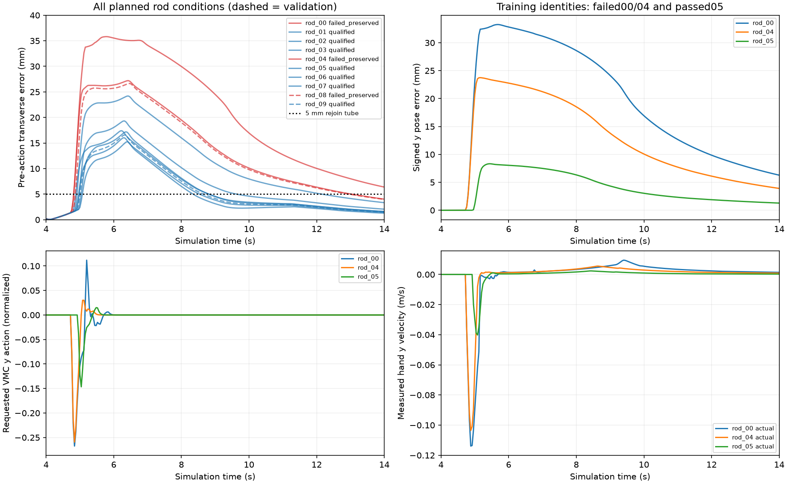

# 三真实场景：完整首轮采集、棍推读出修正与第二轮重采

持续 Goal active。首轮30条完整结束，27条合格、3条棍推不合格；有限四条件读出对照全部合格后，已启动保持原30条件与划分的第二轮完整重采。**新正式 ESN/MLP/RNN 拟合及108回合测试尚未开始，不能报告新学生胜负。** 本文承接 [前轮交接](NONRL_SPECIAL_TEACHER_QUALIFIED_20261028.md)，旧综合场景结果只保留为历史。

## 首轮完整结果与问题定位

`outputs/special_scene_vmc_collection_20261028_v3` 于2026-10-28 07:41:57 UTC自然结束，原服务inactive/Result=success，但科学结果为 `finished_with_nonqualified_demonstrations`。带挡板棍推7/10、自由球10/10、厚桌角10/10合格。原计划、seed、全部失败与子步数据完整保留，不把服务正常退出等同科学成功。

棍推10条都实际接触、让位并几何越过，但 `rod_00/04/08` 未在撤回开始前持续回位；`rod_04` 外部穿透0.222716 mm还超过0.2 mm限制。逐轨迹分析显示，失败条件接触早已结束，仍有较大横向误差且恢复慢。失败00/04在撤回前最后一秒平均y误差约9.19/5.70 mm；VMC的y残差动作已接近0。该观察不是程序bug或某单参数因果机制的证明。

诊断图由这10条当前原始轨迹生成，虚线为验证身份，只作描述；不是旧训练曲线。读入数据的资格哈希已核验。新实验只选择两个失败的**训练**身份00/04，没有依据验证/测试成绩选择条件。

## 有限读出对照

登记时间07:34:27 UTC；原采集仍在运行时，执行入口明确拒绝启动。待原30完整结束、原服务退出后，07:42:57–07:48:18 UTC在本机单路、线程1、真实3GiB/swap0执行4条；全部完成、无OOM/swap，记录cgroup峰值约1.00 GB。

唯一配置变化是 `velocity_weight: 0.3 → 0.6`，保留相邻输入平均、原虚拟动力学和recovery配置。新教师序列化SHA256为 `d95606522e84ff8d53125f42850a0ddef26d16e3df246af8006287d94f85179e`。各对照与对应原条件的MJB哈希一致，没有延长保持时间、减小扰动、修改gate/接触材料/filter/执行器限制/dt。两棍条件和球条件取原训练身份；角条件取原合格开发示范。

| 对照 | 修正前→后 | 修正后持续回位 / 撤回开始 | 外部穿透，前→后 mm | 峰值关节力矩，前→后 Nm |
|---|---|---|---:|---:|
| rod_00 | 不合格→合格 | 8.72 / 12.80 s | 0.184552→0.076365 | 33.7839→34.3577 |
| rod_04 | 不合格→合格 | 8.28 / 12.80 s | 0.222716→0.042696 | 33.8026→34.3714 |
| ball_00 | 合格→合格 | 不适用 | 0→0 | 47.5186→46.5689 |
| corner_reference | 合格→合格 | 不适用 | 0→0 | 46.1915→52.3570 |

两棍分别让位14.85/12.09 mm，均7.72 s越过，接触均来自手本体。角峰矩上升约13.35%，不能声称所有指标改善。四条均通过原场景完整任务、接触、保存子步安全及actor/filter重放。几何审计仍为40 ms采样，回位管5 mm、保持80 ms、至少2 mm分离；不冒充全子步连续几何或独立动力学重积分。这里的“合格”不是冻结测试组Task/Strict认证，也不是广域鲁棒性结论。

小证据见 [REVIEW.json](evidence/NONRL_SPECIAL_READOUT06_20261028/REVIEW.json)，含全部原30结果、4条配对及原始资格/执行哈希。审计脚本 `review_special_collection_probe_20261028.py` 核验完整输入哈希、状态、原计划绑定和对照MJB。

## 第二轮与接续规则

本机运行 `outputs/special_scene_vmc_collection_20261028_v4`，服务 `sii-special-collection-v4-20261028.service`，07:50:32 UTC启动。计划SHA256 `f1f56cbac17d9c99a3b676bd09ab04ab2aa0a4b2d09cda470abb136994f1a871`。新准备器逐字段保留原30个物理条件、seed和24训练/6验证划分；不以probe的rod_00为新中心重新偏移条件，不混用前后教师的示范。每场景8train/2val，全部30重新执行并保留失败。

交付小证据中的进度只是快照，最新状态须读实际 `COLLECTION_PROGRESS.json` 和服务/PID，禁止重复启动。首三条均合格；不能提前说30条全合格。采集继续使用全局单仿真锁、BLAS1、实际MemoryMax3GiB、MemorySwapMax0。新准备器已在实际完整四条件证据上运行，计划校验通过。

若30条全部合格，再用 `build_special_scene_dataset_v2_20261028.py` 构建全新数据目录，随后 `train_special_scene_models_20261028.py`：历史128储备池ridge ESN、普通MLP/RNN，3seed，每家每seed12候选、神经每候选32000更新，同训练/验证身份和验证requested-action MSE。候选数公平不代表FLOPs相等，固定更新预算不等于收敛。

锁九模型后，使用原 `outputs/nonrl_new30_fair_20261026_v2/physics_source` 与当前12条件做108回合。Task/Strict各用全分母；SPT只在双成功且有完成时间回合平均，全108统一最短双成功时间为T_ref，无双成功NA；全回合平均峰值力矩、真实人接触dt加权舒适比例、机器合规率。不得根据该已见测试组挑模型、修改教师或再称未见测试。RL完全不在此任务范围。

## 保存与同步

开工实际查询/fetch/read main `d43ff0ad07b38eadd88b53a06bea33c0ccdd8437`、baseline `f6e8f8c2711a93f0b5dfc88c608bd82647084d5d`，无非RL协议新变动。源码编译、实际完整30/4审查、重采计划校验及归档gzip完整性验证；图已目视检查。没有修改运行中的仿真来源。

本地执行/归档基准目录：`/home/airpig/桌面/hwy/compliance_control/SII_compliance/code/mujoco_6d_vmc_benchmark`。

- `outputs/special_scene_collection_v3_complete_20261028.tar.gz`：1629905304字节，SHA256 `90ab3e6d097740bc53927d816afec01cef111eb5636698b88c2f9df0596c7b05`。完整原30，包括失败、原始子步/MJB/来源；附首轮诊断和完整审核。
- `outputs/special_scene_readout06_probe_20261028_v1.tar.gz`：233686087字节，SHA256 `dc04b12e6ab374f10da29ce9023162236f00b7f54560a5845ca06d5e47959a8d`。完整4条probe、登记/审查、配置和新增工具源码、新30计划。**不含正在运行的v4原始轨迹**。

本地副本保留。目前服务器归档待同步：SSH归档目录创建因自动审批通道报“Concurrency limit exceeded for user”而未执行，并非服务器已创建目录或数据已上传；没有服务器计算。后续核验成功时追加真实服务器路径/大小/hash，不覆盖历史收据。
