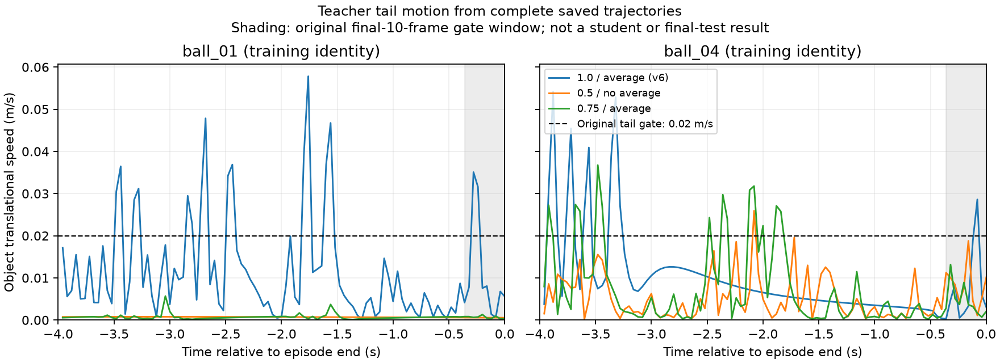

# 新三场景模型退化：接口修复与教师／学生／场景对照

2026-10-28，Goal active。用户明确要求定位并修复 ESN 的异常退化，而非接受全失败作为主结果。
本页覆盖此前“原108继续等待”的交接指令。旧结果全部保留，不能把未完成矩阵或低力矩当作算法结论。

## 16:35 UTC 更新：所有有限对照结束，仍未达到重采/重训条件

最后release005六条完整结束，四条train合格、ball04任务失败（末段最大速度0.045488679m/s，
原0.02门未改），office000仍Task/Strict false、carry；两类失败均保存且回放/安全检查保留。
[完整六项收据](evidence/NONRL_SPECIAL_FAST_RELEASE_20261029/RELEASE005_COMPLETE.json)。
完整132文件/607457280字节，SHA256 `1694801fe421c00516119d96240bfabba66ba94b0eb941282f71ef2be65e6a82`，
本机逐成员及远端暂存/最终核验通过，已共享于
`arm1@192.168.31.70:/home/arm1/sii_shared/SII_compliance/runs/main/nonrl_special_release005_controls_20261029_v1/FULL_PROBE.tar`。
没有在途模拟器、没有v7或新拟合，不重启已完成队列。此前“在途”段落仅为历史快照。
Goal仍active，修复未完成；不能将该候选或原35失败作为新的主比较结果。

已实施的统一动作尺度修复仍有效，但teacher在当前任务上的恢复/稳定权衡尚未解决；
已完成的有限释放时间检查不支持继续简单缩短该时间常数。
下一步应隔离恢复触发的自激活与接近目标时的指令依赖，并检查只有新三场景的训练覆盖。
若采用新的teacher机制，须明确独立版本、保留历史actor与源码、证明只读取canonical48、
检查同一actor配置在真实场景与冻结office执行/回放一致；公共环境、MJB、过滤器和最终门不改。
采集仍只允许三个真实场景，不使用office测试轨迹拟合学生，旧条件已看过须称回归比较。
新30资格审查、公平三seed重训、学生18闭环及最终108/六指标/完整归档仍必须实际完成。

## 16:24 UTC 更新：0.25秒释放假设未修复office，0.05秒有限对照继续

原六条全部结束：五个训练身份仍全部合格，但office完整55秒仍carry、Task/Strict false，
RMSE28.2307mm。末250帧竖直误差均值-18.1198mm、恢复记忆均值0.4804946，
相比原`.75/平均`失败的0.4222785反而更大。缩短释放在同历史离线反事实中有效，
**不代表实际闭环有效**；此实际回合否定了“.25秒足以修复”的假设。所有失败保留，
未启动v7或重训。[完整复核](evidence/NONRL_SPECIAL_FAST_RELEASE_20261029/RELEASE025_COMPLETE_REVIEW.json)。

这六项完整132文件/606750720字节，SHA256
`d3c1892cdf0541a0c43fad225181603b1eb828efd9115a59a1fc9dc69e580c12`，
逐成员及远端暂存/最终核验通过，已共享于
`arm1@192.168.31.70:/home/arm1/sii_shared/SII_compliance/runs/main/nonrl_special_release025_controls_20261029_v1/FULL_PROBE.tar`。
该包含office失败，不含后续release005对照。

接续只改release_s .25→.05秒的一组固定六回合，仍先五train身份，再原office000，
没有验证调参或自动采集/训练。服务`sii-special-recovery-release005-v1-20261029.service`，
parent956881，登记SHA256 `71f654eff125d3188ea018f110b51fb23196fa2d3a872d2e136feaefcc824c77`；
本机单模拟器/单线程/3GiB/swap0，实际OOM0。
[登记](evidence/NONRL_SPECIAL_FAST_RELEASE_20261029/RELEASE005_REGISTRATION.json)。
禁止改绑定源、重复启动或跳过完整回合结论；若仍失败须重新检查恢复触发/任务覆盖，
不能把有限参数改动的离线改善当成成功。旧18/108静态准备依旧不可执行。

补充只读输入检查：当前真实rod00的canonical path只为±Z，水平分量恒0，因此此例的
水平progress恢复项不激活；棍推通过不能证明该恢复项在水平office搬运中正确。
球撞有水平路径、桌角路径也不同。三真实场景与office的覆盖差异仍需在teacher/学生分层验证，
不能只凭“棍推已好”认定整个主矩阵已好。这个检查没有新增actor输入或把office轨迹加入训练。

16:29 UTC在途补充：`.05`五个train身份已结束，rod00/ball00/ball01/corner00合格，ball04失败，
原office回归仍在途。因训练条件已有失败，本组不能进入全量采集，即使office后来通过也不例外。
下一步应检查恢复触发的自激活、接近目标时的指令依赖与真实训练覆盖，不能继续单凭更短release_s
推断修好；如需要新的teacher读出机制，必须独立登记、保留旧actor/源快照，明确改变的是teacher，
保持公共物理/filter/输入/最终gate，并重新做actor/filter独立回放和全场景配对控制。当前未实现新机制。

## 16:00 UTC 更新：中间权重训练检查通过，office仍失败；定位恢复记忆残留

十项中间权重对照全部结束并逐收据/物理输入hash核验。`.75/不平均`4/5合格，
ball04末10帧最大速度0.020248537m/s超原0.02而失败；`.75/平均`5/5合格，
ball00/01/04末段最大速度0.006086735/0.001318248/0.013152809m/s。
按预登记训练规则选择后者，全部失败保留。
[完整审计](evidence/NONRL_SPECIAL_TEACHER_MIDPOINT_20261028/MIDPOINT_REVIEW.json)。
保存训练身份球撞轨迹的实际末段图如下；最后0.36秒灰区才是原末10帧运动判据窗口，
ball04此前仍有波动，不能把通过末段门写成全程稳定。

单条已看过office000回归随后跑满55秒，仍Task/Strict false，停在carry，
actor/filter replay均0；没有自动进入v7采集。
[完整失败](evidence/NONRL_SPECIAL_RECOVERY_RELEASE_20261028/MIDPOINT_OFFICE_COMPLETE.json)。
末250帧（10秒）位置误差最小12.0023mm、中位16.5259mm，竖直有符号误差均值-15.8226mm；
原位置门12mm未持续满足，姿态/速度并非该窗口主要问题。恢复记忆中位0.36513、均值0.42228，
仍通过恢复项产生正向抬升动作。这支持“接近目标仍有恢复偏移”的机制线索，尚需单变量物理证实。
历史1.0两配置虽通过office，也只有少数接近目标帧，不可把偶然越过门视为稳健完成。

下一组有限六项已登记：保持`.75/平均`，只把原progress恢复项的`release_s`
从1.257675717s改为0.25s。原衰减率是`max(progress,0)/distance+(1-intent)/release_s`，
所以intent=1时该改动不改变更新；期望在接近目标、运动意图减弱时更快释放抬升记忆。
依旧只用canonical48，未新增阶段/接触身份/目标oracle输入，未改公共filter、MJB或gate。
固定rod00、ball00/01/04、corner00五个train身份，加原office000已看条件的回归，共六条，
不使用验证08/09调参；全通过才可重新登记原30全量采集，失败保留、不自动拟合。
服务`sii-special-recovery-release-v1-20261028.service`，本机单模拟器/单线程/3GiB/swap0，
注册SHA `be3bdcb96f23a5db2e2f99d171d3d7ea752214232d9deb04b56c7df96da3f307`。
[诊断](evidence/NONRL_SPECIAL_RECOVERY_RELEASE_20261028/RELEASE_DIAGNOSIS.json)、
[登记](evidence/NONRL_SPECIAL_RECOVERY_RELEASE_20261028/RELEASE_REGISTRATION.json)。
初次只读窗口准备因45秒浮点边界选到251帧而拒绝，在写目录/启动前结束；
修为最后250帧并核对0.04s间隔，未改物理数据或判据，错误也已记录。

十项中间权重对照完整214文件/907642880字节，
SHA256 `47e6d16b787d93a1a7704890dcce67841429ef49b7f2fe167ec7f34e7cfc64a6`，
逐成员及远端暂存/最终核验通过：
`arm1@192.168.31.70:/home/arm1/sii_shared/SII_compliance/runs/main/nonrl_special_teacher_midpoint_20261028_v1/FULL_PROBE.tar`。
后续单条office失败27文件/149770240字节，SHA256
`ecde9b55be285782f3b6929eee517c5073de5e18bc41958c84e961ce608de44b`，亦经逐成员及远端最终核验，
共享于`arm1@192.168.31.70:/home/arm1/sii_shared/SII_compliance/runs/main/nonrl_special_midpoint_office_failure_20261028_v1/FULL_PROBE.tar`。
四个新完整包的[共享收据](evidence/NONRL_SPECIAL_TEACHER_STABILITY_20261028/SHARED_ARCHIVES.json)，不含当前在途六项。
新模型、完整主矩阵均未完成，Goal继续；不是“只改蹭棍就使ESN必然变差”的证据。

## 15:36 UTC 更新：完整v6暴露teacher末段问题，重训已拒绝

v6在15:04:31 UTC自然完成全部30条：棍推10/10合格、桌角10/10合格，球撞6/10合格。
失败是ball01/04（train）及08/09（validation）；均通过保存子步安全/接触/动作回放检查，
但末10帧物块最大速度分别为0.0350799、0.0286068、0.0373701、0.0297257m/s，
超过原任务阈值0.02m/s。原阈值、物理、时长和全部条件不变，失败没有删掉或重标。
[完整审查](evidence/NONRL_SPECIAL_TEACHER_STABILITY_20261028/V6_FULL_REVIEW.json)。
原learning-handoff-v3于15:04:33拒绝不合格示范，状态failed_preserved；拟定训练目录不存在，
不能说学生已经重训。已准备的18真实场景学生闭环/108评测仅静态，绑定失败v6后不可继续使用。
实际不完整训练输入拒绝检查已通过，未产生新物理或模型输出。

随后四项有限对照已全部结束并逐输入hash核验：

| 对照 | 结果 |
| --- | --- |
| ball01，速度权重.5/不平均 | 合格，末段物块速度0.0005913m/s |
| ball04，速度权重.5/不平均 | 合格，末段物块速度0.0187867m/s，接近原阈值 |
| 原office000，.5/不平均 | 完整55秒，Task/Strict false，停在carry |
| 原office000，1.0/平均 | 完整55秒，Task/Strict true，到retreat |

[四项完整收据](evidence/NONRL_SPECIAL_TEACHER_STABILITY_20261028/TAIL_COMPLETE.json)、
[复核与训练身份末段对照](evidence/NONRL_SPECIAL_TEACHER_STABILITY_20261028/TAIL_REVIEW.json)。
两次office actor/filter replay均0；此前.5/平均失败、1.0/不平均通过，补全同条件2×2因素对照。
这说明teacher读出改变确实影响任务完成及末段稳定，不能把故障全部推给ESN。
但仅一个已看过的office条件，不是未见测试或全12成功证明；其轨迹不进入拟合。

15:28:51 UTC已启动仅训练身份的十回合中间权重检查：速度权重固定.75、平均关/开，
每种各跑rod00、ball00、ball01、ball04、corner00。阈值/条件/seed/几何/共同0.32不变。
先完整检查两种，只有五条都合格才可候选，预登记优先不平均再平均；任一不合格不能直接重采30。
首组五条已完成，ball04失败，其余四条合格；第二组在途。失败保留，不用验证08/09调参。
服务`sii-special-teacher-midpoint-v1-20261028.service`，parent933116，单模拟器/单线程/3GiB/swap0。
[登记](evidence/NONRL_SPECIAL_TEACHER_STABILITY_20261028/MIDPOINT_REGISTRATION.json)
SHA256 `80815d48c297be9470208d8cfdecaedbe11e88dd5947b0360deedaf0bc50fb4d`。
禁止改绑定源码或重复启动。没有自动重采/拟合/最终评测；完成后审查实际结果。

v6全30原始物理、配置、源快照、资格收据共604文件/2804715520字节，
SHA256 `4eff3fc1c46d89f7f4d82bb7e09b7c0cb63d7d3363f0df3fc8910544be8753ac`，
本机逐成员与远端暂存/最终大小SHA核验通过，完整共享于
`arm1@192.168.31.70:/home/arm1/sii_shared/SII_compliance/runs/main/nonrl_special_v6_failed_collection_20261028_v1/FULL_COLLECTION.tar`。
该包不含后续FULL_COLLECTION_REVIEW、失败handoff和四项新对照，后续小证据见本节链接。

四项tail-v2完整对照另包90文件/472432640字节，
SHA256 `06f08d804d7e165e0812ac24aa2eca7caf60834d8d704decc5d8543f3f9ffc40`，
本机逐成员及远端暂存/最终核验通过：
`arm1@192.168.31.70:/home/arm1/sii_shared/SII_compliance/runs/main/nonrl_special_teacher_tail_controls_20261028_v1/FULL_PROBE.tar`。
[两包共享收据](evidence/NONRL_SPECIAL_TEACHER_STABILITY_20261028/SHARED_ARCHIVES.json)。
不含在途中间权重对照；未删除本地或历史产物。

首次tail-v1准备错误地要求所有失败身份属于train，断言拒绝；随后未检查该返回码而误启动，
因REGISTRATION不存在在物理前退出。该基础设施错误及日志保留，v2才是真正四项对照。
此错误没有产生物理或掩盖四条采集失败。后续已将准备成功验证和启动拆开执行。
Goal仍active：teacher修复、新30、公平三seed重训、真实场景学生闭环、完整108及六指标均未完成。

## 14:29 UTC 更新：完成隔离对照，v6修复采集已启动

十回合诊断已完整结束并逐输入hash核对，见
[完整对照及离线误差](evidence/NONRL_SPECIAL_REGRESSION_REPAIR_20261028/COMPLETE_CONTROL_REVIEW.json)。
同一冻结条件000、MJB、命令和gate下：新teacher（velocity_weight=.5，pair_average=true）
55秒仍停在carry，Task/Strict false；历史teacher（1.0、false）55秒到retreat，Task/Strict true，
放置XY误差5.417mm。两者actor/filter replay均0。新teacher RMSE29.283mm比历史38.917mm更低，
却未完成任务，说明不能用更低RMSE或峰矩替代成功。这只证明这个配对条件上的teacher配置退化，
不能扩展为全部12条件的因果结论。

在三个真实训练身份、同0.32动作尺度下：

| 控制器 | 厚桌角00 | 棍推00 | 球撞00 |
| --- | --- | --- | --- |
| 新teacher .5/true | 合格 | 合格 | 合格 |
| 已冻结ESN seed1 | 抓取/放置失败 | 合格 | 合格 |
| 已冻结RNN seed1 | 本轮未测 | 合格 | 本轮未测 |
| 已冻结MLP seed1 | 本轮未测 | 合格 | 本轮未测 |

这里的“合格”是原真实采集任务、保存物理子步审计及接触行为合格，**不是**冻结office测试Strict。
ESN棍推7.92秒越过、9.36秒确认回位，撤棍12.8秒，原行为判据未放宽。
ESN桌角在原0.16采集轨迹上的动作MSE为1.1227906e-6，在修正0.32后的teacher轨迹上为
1.9787818e-3；而棍推/球撞新旧teacher历史的动作误差完全相同（6.7991344e-7、1.4651303e-6）。
这支持桌角接口变化造成分布偏移的判断，不是只凭验证loss断言学好；对学生历史的teacher反事实预测
也存入review，仅作诊断，未执行这些动作、未把它们当作训练数据。

随后完成预登记的另外9回合，补齐velocity_weight∈{.5,1.0}×pair_average∈{false,true}因素对照：

| 速度权重/输入平均 | 棍推00 | 球撞00 | 厚桌角00 |
| --- | --- | --- | --- |
| 1.0 / false（历史） | 合格 | 失败：末态物块运动条件未满足 | 合格 |
| .5 / false | 合格 | 合格 | 合格 |
| 1.0 / true | 合格 | 合格 | 合格 |
| .5 / true（前十回合参考） | 合格 | 合格 | 合格 |

[登记](evidence/NONRL_SPECIAL_REGRESSION_REPAIR_20261028/TEACHER_FACTORS_REGISTRATION.json)、
[全部完成收据](evidence/NONRL_SPECIAL_REGRESSION_REPAIR_20261028/TEACHER_FACTORS_COMPLETE.json)。
原parent896071已自然退出；原10/新9全部保留，无OOM、无重复模拟器。
完整历史teacher在球撞失败，因此没有整套盲目回退。按恢复历史组件且三场景均合格的开发优先级
1/false→1/true→.5/false→.5/true，选择**1.0/true**：恢复历史速度权重，保留输入平滑。
该选择依据三个真实训练身份；当前12条件已经看过，之后只能称回归比较，不能称unseen。
只有一个身份/场景的对照，不能宣称新30或整个主矩阵已修复。

修复采集v6已于14:29:05 UTC启动，服务`sii-special-collection-v6-20261028.service`，
parent903064；本机单模拟器、单线程、3GiB/swap0。缓存
`code/mujoco_6d_vmc_benchmark/outputs/special_scene_vmc_collection_20261028_v6`。
[计划](evidence/NONRL_SPECIAL_REGRESSION_REPAIR_20261028/V6_COLLECTION_PLAN.json)
SHA256 `d20543be6c9d6fb35b9c4cc094269bd7da1a1c7ae6ec68292b22d1100a1ad4ac`。
原30个物理条件、seed、24train/6validation划分逐字段保持；三个场景全部重新执行，统一0.32m/s。
采集器新增开工/回合边界source hash检查，实际正确计划接受、注入错误hash拒绝、未完成因素对照拒绝通过。
首条已实测推进到15物理秒/300000子步，不以该中间值冒充完整成功。**不得改v6登记绑定源码或重复启动。**

14:42:08 UTC追加实测：原parent903064/start29580292保持，已完成7/30，rod00–06全部合格、
各20秒/400000物理子步；回位确认7.72–9.72秒，均早于各自12.8–13.0秒撤棍。
正运行rod07，当前已完成资格收据输入hash和绑定源码再核对通过。
[在途进度收据](evidence/NONRL_SPECIAL_REGRESSION_REPAIR_20261028/V6_LIVE_RECEIPT.json)。
这7条是teacher示范，不是重训后的ESN或最终测试结果。

旧35失败及前10诊断的完整原始物理、checkpoint、源码、收据共1758文件已打包并逐成员比对，
5923307520字节，SHA256 `6d8a464d96ef8e6e7bd744d3970ec822624fecb06c124b710f862be5d54e6598`。
服务器暂存及最终目录的大小/SHA256均已核验，完整共享路径：
`arm1@192.168.31.70:/home/arm1/sii_shared/SII_compliance/runs/main/nonrl_special_regression_full_20261028_v1/FULL_REGRESSION.tar`。
[共享收据](evidence/NONRL_SPECIAL_REGRESSION_REPAIR_20261028/FULL_ARCHIVE_SHARED_RECEIPT.json)。
此完整包不含后9因素对照或在途v6。

后9因素对照（包括球撞失败）的完整物理、源快照、审计，及修复工具/报告/含v6计划的小证据，
另包842936320字节，SHA256 `e1f4a361f12ed6541fed67bffe782130f5fc934d138287e36bfcfc9b2651bffd`，
本机tar逐内容比较和远端暂存/最终核验通过：
`arm1@192.168.31.70:/home/arm1/sii_shared/SII_compliance/runs/main/nonrl_special_teacher_factors_20261028_v1/special_teacher_factors_and_repair_20261028_v1.tar`。
[收据](evidence/NONRL_SPECIAL_REGRESSION_REPAIR_20261028/TEACHER_FACTORS_SHARED_RECEIPT.json)。
该包早于随后v6在途收据及报告追加，不含在途v6物理。两包不删除本机或历史产物。

后续先审全部30示范；若任一失败，保留并修复，不删失败条件或直接拟合。
再以新数据按同划分/预算/验证规则/三seed训练ESN ridge、普通RNN、MLP，先检查三个真实场景的
学生闭环是否重现teacher行为，尤其桌角抓取/放置，再重跑完整冻结108和六指标。
teacher配置修正尚未在原office000重新验证，也不能保证覆盖问题消失；仍需完整检验。
Goal active，旧35失败和v5模型均为故障/历史结果，新主矩阵尚未完成。

## 已确认的问题与尚未确认的原因

30条新示范的15750帧标签逐数组核对，均精确等于实际提交给过滤器的教师请求动作，
不是重复过滤后的物理速度；dataset/150个lineage文件hash及30个filter文件核对通过。
但三个场景的实际动作尺度不统一：20条棍推/球撞为0.32m/s，10条厚桌角为0.16m/s。
已完成34条测试的完整filter配置均与棍推的0.32m/s配置相同；桌角唯一配置差异就是该线速度尺度。
最初“全部配置相同”的断言失败与完整差异清单都保留在
[动作契约诊断](evidence/NONRL_SPECIAL_FROZEN108_PREP_20261028/ACTION_CONTRACT_DIAGNOSIS.json)。

来源：`scripts/render_compliance_audited.py`创建桌角环境时没有显式传入线速度尺度，
继承`VelocityResidualSafetyConfig`的0.16默认值。共同filter源码相同并不代表参数相同；
此前只检查AST/hash和各自回放，未充分检查跨场景配置一致性，这项核验已补上。
同样的归一化请求在桌角转换出的目标线速度仅为测试的一半。这是确定的接口不一致，
但尚不能证明它单独导致整个测试矩阵退化，不能据此承诺改一个数字就全部成功。

此外，本次并非只修改棍推动作：训练数据已整体换成三个短特化场景，教师readout也经过开发调整。
先前已发现训练路径方向Y仅覆盖[-.38075,.38075]，当前测试可到-.99028；
这是已观测的覆盖差异，不是闭环失败因果证明。需要用教师直控、同场景学生闭环对照分离原因。

## 已实施的代码修正

- 真实场景wrapper在第一步物理执行前统一到当前测试的0.32m/s线速度尺度、0.6rad/s角速度尺度；
  使用dataclass replace并同步同一个filter配置，保留其他限制、物理模型、gate和任务时长。
- 新采集计划须显式登记动作契约。数据集构建拒绝缺失契约、非教师动作、非0.32m/s数据，
  防止旧混合尺度数据再次悄悄进入新主结果。旧数据文件不改写。
- 增加纯学生诊断入口：同一canonical48观测、同一场景/过滤器/时钟，真实保存checkpoint并独立重放。
  学生诊断不能登记为教师采集，也不能混入教师数据集。

已检查四文件语法、冻结dataclass替换、实际动作转换到0.32、三类真实checkpoint适配器输出。
真实调用新dataset builder读取旧v5计划会拒绝且不创建输出。完整修复物理效果尚待对照，未宣称通过。

## 原评测在安全边界停止，完整保留

原`special_scene_frozen108_readout05_20261028_v1`使用已存在的`STOP_REQUESTED`协议，
在第35回合及其指标后处理结束后自然停止，`execution.status=stopped_at_episode_boundary`，
35条results、无在途条目；原772606/791378进程均退出。没有kill worker或改冻结模型/条件。
上层handoff检测“不足108”而自然记录`failed_preserved`，不是OOM/意外崩溃，也不是完整比较。
原35回合原始数据仍在本机，之前完整训练/采集已归档；这35回合的全部物理归档仍待。
[安全边界与新服务实测](evidence/NONRL_SPECIAL_REGRESSION_REPAIR_20261028/REPAIR_BOUNDARY_RECEIPT.json)
也保留原观察器21个样本：33→35，最后原进程消失且明确停止状态。

## 已登记并实际运行的十回合对照

本机benchmark缓存：`code/mujoco_6d_vmc_benchmark/outputs/special_scene_regression_controls_20261028_v2`。
服务`sii-special-regression-controls-v2-20261028.service`，parent883961/start29348650；
首个worker883963/start29348654，13:51:51 UTC已13.04物理秒、carry，3GiB/swap0/OOM0。
[完整登记](evidence/NONRL_SPECIAL_REGRESSION_REPAIR_20261028/DIAGNOSTIC_REGISTRATION.json)
SHA256 `73e8b6b6e95476398869c4e5192ca5f79a82e763a25fa54d67e4f73b195d6184`。

1. 新教师、历史教师分别直接控制同一当前测试条件000，冻结原MJB/gate/dt5e-5。
2. 各在corner00、rod00、ball00训练身份上运行新教师和现有ESN seed2026102801，
   所有场景同0.32m/s，共六回合；条件/seed/MJB与原采集一致。
3. RNN、MLP同一seed各在rod00运行一回合，避免只检查ESN。

这是十回合有限诊断，不是调参搜索、最终矩阵或新的独立测试。旧测试已看过，
不能再叫unseen；不把测试轨迹作为训练示范。所有任务失败照常保存，只有基础设施异常才停止本诊断队列。
最初v1缺少`MUJOCO_MENAGERIE_PATH`，在物理开始前FileNotFoundError退出，原失败目录/日志保留；
补齐原评测环境变量后独立登记v2，未覆盖或重试原目录。

## 后续必须完成

第一项实际对照已完成：新教师在当前条件000跑满55秒，Task/Strict均false，终态carry，
无abort；RMSE29.283021mm，峰矩38.164642Nm，最大外部/edge穿透.140178/.081284mm。
原actor/filter重放误差0。[原完整审计收据](evidence/NONRL_SPECIAL_REGRESSION_REPAIR_20261028/NEW_TEACHER_OFFICE_CONTROL_AUDIT.json)
SHA256 `34ce849b929782b6b4f56e0cd688ea042db13f1c63efb5858cd1f0d4164fe18d`。
这证明至少该测试条件下新教师本身不能完成任务，不能只归因学生没学好；
尚非完整对照或全部测试结论。历史教师对照13:56:43自然接续，原服务继续。

源码/原35停止状态/诊断登记/动作契约差异等13文件小包逐成员字节、远端暂存与最终hash核验，
76718字节，SHA256 `b7f13b26b6864bbe5d4e4f404c169a72f83e07020134cb6be2ef9ad5d179ed8e`：
`arm1@192.168.31.70:/home/arm1/sii_shared/SII_compliance/runs/main/nonrl_special_regression_repair_20261028_v1/nonrl_special_regression_repair_20261028_v1.tar.gz`。
包内报告为第一项对照完成之前版本；后追加的教师审计见Git，原物理全归档仍待。
本轮开工main d1b1bf89、收尾main80553b71/baselinef6e8f8c已实际fetch/read，独立RL更新fast-forward保留。

核对每个对照的真实完整回合和保存子步。若教师在当前测试失败，先隔离教师设计和任务迁移；
若教师通过但同场景学生失败，检查模仿误差、闭环分布和模型学习；若同场景均好而跨场景失败，
在三个真实场景内增加任务方向/阶段覆盖，不回到旧综合场景采动作。
修复后的数据重新登记，三类方法使用相同划分、预算和验证规则重训，再独立运行完整冻结108及六指标审计。
不得把本次35条失败或十回合诊断当成最终结果；保留旧数据、模型、失败及全部版本。
还需实际图表、contact补充、完整物理归档、更新主结果入口与逐项完成审查，之后才可完成Goal。
