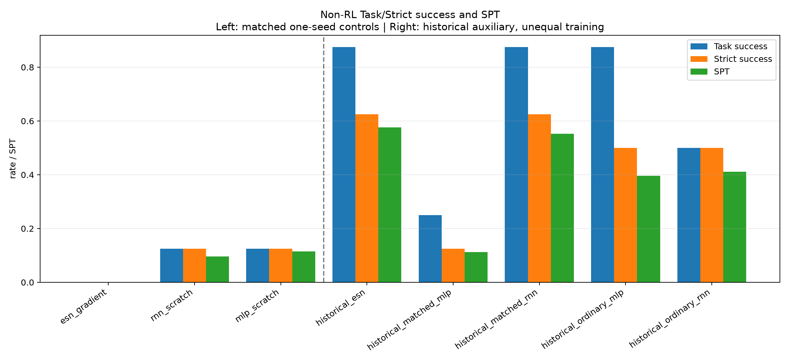
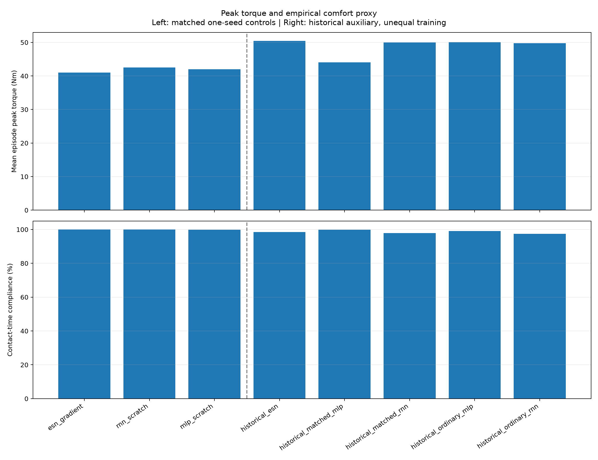
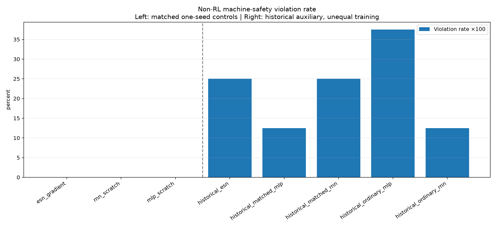

# 非 RL 新指标重评：64 条回合已完成

本轮重新执行了 8 方法 × 8 条条件的 64 条物理回合，未使用旧曲线冒充新结果。
`nonrl_spt_matrix_20261025_v4` 的执行与报告均为 complete，64 条证据链和 188 项执行源码
hash 核验通过；所有失败回合保留。RL 不参与本轮。

当前结果不支持 proposed 在大部分主指标上已经具有说服力的优势。
公平重训的单 seed ESN 为 Task/Strict 0/8，RNN、MLP 各为 1/8。
历史 ESN 在本组有较好完成度，但历史 matched RNN 的成功率相同；历史配置的训练预算和
数据曝光不能与新重训组三方法混为一个公平排名。

## 指标矩阵

按用户指定规则，整个矩阵 Task AND Strict 成功回合最短时间为 `T_ref=40.72 s`。
SPT 以双门成功加权，失败为 0；这是该固定方法/条件集合内的后验参考，不证明最优完成时间。
完成时刻来自 25 Hz 终态 gate crossing，时间分辨率 0.04 s。
力矩列是每回合全关节峰值的均值，不是全体回合最坏峰值；逐关节峰值/P95及最坏回合见 JSON。

| 公平重训组（同数据、seed 2026101301） | Task | Strict | SPT | 平均峰值力矩 Nm | 接触期舒适合规率 | 机器安全违规率 |
|---|---:|---:|---:|---:|---:|---:|
| ESN gradient | 0/8 | 0/8 | 0.0000 | 41.042 | 100.00% | 0.00% |
| RNN scratch | 1/8 | 1/8 | 0.0967 | 42.514 | 99.97% | 0.00% |
| MLP scratch | 1/8 | 1/8 | 0.1155 | 42.036 | 99.85% | 0.00% |

| 历史辅助参考（不可跨组作相等训练预算结论） | Task | Strict | SPT | 平均峰值力矩 Nm | 接触期舒适合规率 | 机器安全违规率 |
|---|---:|---:|---:|---:|---:|---:|
| historical ESN | 7/8 | 5/8 | 0.5763 | 50.429 | 98.54% | 25.00% |
| historical matched RNN | 7/8 | 5/8 | 0.5529 | 50.028 | 97.94% | 25.00% |
| historical matched MLP | 2/8 | 1/8 | 0.1127 | 44.078 | 99.76% | 12.50% |
| historical ordinary RNN | 4/8 | 4/8 | 0.4111 | 49.759 | 97.44% | 12.50% |
| historical ordinary MLP | 7/8 | 4/8 | 0.3965 | 50.066 | 99.14% | 37.50% |

舒适阈值按冻结执行器幅值的 50%，七关节为 `[43.5,43.5,43.5,43.5,6,6,6] Nm`。
分母仅用实际 `human_robot_sum >0.05 N` 子步的 dt，无接触记 NA；这里是经验驱动力矩代理，
不是人体安全/舒适标定。ESN 的低峰矩和 100% 合规不能抵消其任务 0/8。
机器违规包括穿透 >0.2 mm、力矩超过上限、非有限遥测或 abort；slew 无独立阈值，仅作诊断。
冻结 Strict 与独立机器违规列保留各自定义，因此不能简单假定 `Strict = Task × (1−违规率)`。

## 为什么进入修复阶段

55 条示范只有成功轨迹，44/11 整轨迹训练/验证 split 未发现同 ID 或完全重复轨迹跨组。
检查已有模型发现 ESN 验证 MSE 在最后 2000/8000 更新仍下降 18.2%，尚无充分收敛证据。
旧 loss 日志只有最后 minibatch 的值，不能代表全训练集趋势。

闭环状态覆盖检查：用训练集统计量标准化 18 个 actor 字段，计算到训练观测的最近邻距离。
teacher 验证集距离 P95 为 0.9667；ESN、RNN、MLP 闭环帧超出该参考的比例分别为
55.77%、35.97%、53.14%。ESN 八条都结束于 carry。这是状态分布偏移线索，忽略历史，
不能单凭它判断采集方式是唯一原因。

另确认训练代码的逐块权重归一化与登记的全局加权目标不完全一致；修正已通过梯度测试。
已启动独立 `nonrl_learning_repair_20261026_v1`，三方法均做 8k/32k 两档、共六次拟合，
记录完整训练集目标与验证曲线，沿用同数据与原验证集选定学习率。预算完成不等于收敛，
修正不等于闭环任务改善。具体协议与入口见 [学习修复说明](NONRL_LEARNING_REPAIR_20261026.md)。
之后先在开发条件下验证；若需补采，给所有学习对照相同数据，新的确认性测试独立登记。
本八条件已经观察，不能再称修正算法的未见测试组。

## 证据与复现

- [完整指标与逐回合 hash](evidence/nonrl_spt_20261026/REPORT.json)
- [最终审计](evidence/nonrl_spt_20261026/FINAL_AUDIT.json)：64 行、188 项执行源码、checkpoint/config/actor/filter/轨迹与物理子步。
- [人体接触与超阈值补充](evidence/nonrl_spt_20261026/SUPPLEMENTAL_CONTACT.json)：峰力、冲量、接触时长、超阈值时长、逐关节超额积分与失败阶段。
- [注册协议](evidence/nonrl_spt_20261026/REGISTRATION.json)、[全部文件清单](evidence/nonrl_spt_20261026/SHA256SUMS)。
- [数据与学习诊断](evidence/nonrl_spt_20261026/DIAGNOSIS.json)、[真实学习曲线](evidence/nonrl_spt_20261026/learning_diagnostics.png)。

计算主机 airpig，解释器 `/home/airpig/桌面/hwy/compliance_control/.venv-sii-local-rl/bin/python`，
Python 3.13.13、MuJoCo 3.11.0，物理 dt=5e-5，单线程、3 GiB、worker 禁 swap。
结束前资源快照显示内核 `memory.peak=3221225472`、`memory.events.max=6845`，OOM/oom-kill 为 0。
max 是触及硬内存上限的压力事件，不是 high 事件；早期进度日志中约 3.02/2.99 的数字实际是
十进制 GB，被误标为 GiB，此处更正。worker swap 为 0 不代表整机未使用 swap。

原始约 9.1 GiB 文件目前仅本地：
`/home/airpig/桌面/hwy/compliance_control/SII_compliance/code/mujoco_6d_vmc_benchmark/outputs/nonrl_spt_matrix_20261025_v4/`。
清单含 2280 文件，SHA256 为 `a629a11f4a1e0ddca0d7412c1b69dd1c8281bb0a30116b79ffa018297ea19446`。
远端原始数据传输被自动审批拒绝，未上传；只创建了
`arm1@192.168.31.70:/home/arm1/sii_shared/SII_compliance/incoming/nonrl_spt_matrix_20261025_v4_completed_20261026/`
空暂存目录，不能把它写成已核验归档。旧 v1/v2/v3 失败目录保留。

GitHub 提供小型报告、图表、注册与清单，不含大轨迹、MJB 或完整训练数据；clone 不等于全部复现依赖齐备。
本轮只证明这八条件与这些 checkpoint 的测量结果。尚未完成全部非 RL 类别的多 seed 复杂场景公平比较，
持续 Goal 保持 active，不声称已经得到拟改善后的好结果。
