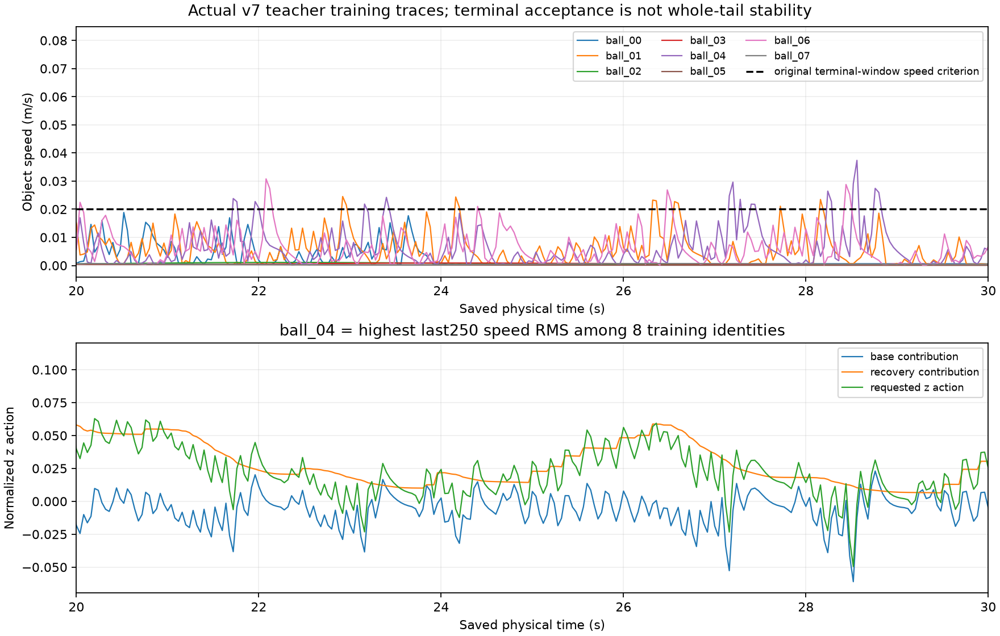

# v7完整采集与球撞末段稳定性修复

本轮Goal继续，前轮完整棍推审计/发布属于progress。本轮实际查询、fetch并读取main
`2b41371d01cc1b766b6cfccade9311d1f966551a`、baseline
`f6e8f8c2711a93f0b5dfc88c608bd82647084d5d`。无RL操作、子agent或服务器计算。

## 全30完成，29合格、1失败，未训练学生

原collector1056282/start31377244于2026-10-28 20:04:10.559689 UTC自然结束；
原服务inactive/success。全30真实三场景按原条件、seed、24train+6validation采集完毕：

| 场景 | 合格 | 失败 |
|---|---:|---|
| 带挡板棍推 | 10/10 | 无；全部撤棍前让位—蹭过—持续回位已审 |
| 自由球撞 | 9/10 | validation ball08，原末段速度门失败 |
| 厚桌角 | 10/10 | 无 |

原handoff1056692于20:04:11.913853 UTC以`failed_preserved`退出：
`Original30 incomplete or contains nonqualified demonstrations`，service failed/exit-code，MainPID0。
这是数据资格保护实际生效，不是OOM；不存在`outputs/special_scene_retrain_20261029_v7`，
没有构建该批数据集、拟合或新主矩阵。不重启原采集/接续，不复用v7绑定的18/108准备运行后继数据。
[全30审查](evidence/NONRL_INTENT_RECOVERY_20261029/V7_FULL_COLLECTION_REVIEW.json)、
[接续失败原收据](evidence/NONRL_INTENT_RECOVERY_20261029/V7_FITTING_BLOCKED.json)。

原进程有界观察19:56:26–20:04:26共17次，确认同PID/start真实推进17→30，
最后service inactive而原PID消失；观察自然结束，没有把超时或沙箱可见性当死亡。

## 失败原门复算与训练集同类波动

ball08完整30秒，接触、安全、动作/filter回放均通过；lift=.149360880m，
末9个速度差分最大值`.031113961858026614 m/s`超过原`.02 m/s`，因此grasp_lift/task为false。
不是穿透/执行器违规，也没有把到达stage5当成功。十条ball的原末段lift、motion、
末10位置误差、物理/上游接触/阶段判据逐项复算与原标签完全一致。
独立标量实现再次复算全部10条速度/误差和8条train的尾段RMS，最大速度误差1.74e−18。

只用8条train的最后250速度样本RMS排名：ball04、06、01、00、02、03、07、05。
前三条末10秒RMS分别`.0092294482/.0085790311/.0079571153 m/s`，峰值
`.0373699389/.0307916141/.0245215365 m/s`；最后短窗口都过原门，但不能称整个尾段稳定。
这些训练条件提供控制器修复依据；validation只复算原资格，不用于排名/拟合或参数搜索。

全部8train原actor逐帧精确回放。ball04末段基础/恢复/总z动作标准差分别
`.0123691974/.0158746991/.0189878925`，两种分量都有变化；共变不证明某一项导致振荡。
实际图已目视检查，所有8条训练曲线与训练RMS最高的ball04动作分量均来自本轮保存数据，
无平滑、无假想动力学。`.02`虚线是原末窗口门，不是新全尾段资格门。

[球组审查](evidence/NONRL_INTENT_RECOVERY_20261029/V7_BALL_TAIL_REVIEW.json)、
[实际训练数组](evidence/NONRL_INTENT_RECOVERY_20261029/v7_training_ball_tail.npz)。

## 已启动：唯一七回合垂向阻尼对照

`outputs/special_teacher_vertical_damping_20261029_v1`，工具
`tools/teacher_vertical_damping_control_20261029.py`。只将虚拟z阻尼110→220 Ns/m；
保留x/y/旋转阻尼、刚度/质量、原读出、恢复偏移.03456819977m、intent=.003、公共filter、
canonical48、物理/MJB、执行器和dt5e−5。没有新增恢复机制或场景特判。
较大虚拟阻尼是待检验的训练尾段稳定性假设，不承诺实际速度减半或全闭环稳定。

七项固定为rod00、ball00、ball04、ball06、ball01、corner00、已检查office000。
ball04/06/01由全部8train RMS排名选，ball00和两其他场景保护既有行为；office只是开发回归，
从不进入模仿数据。只有六训练场景原资格和office Task/Strict均通过，且四球训练尾段
速度平方和总量低于原v7对照，才有候选资格。各条件退化也必须报告；不是新最终gate。
没有自动新30/拟合。只有实际完整结果审查后才决定下一步。

独立8000虚拟子步复算最大误差0；两组局部离散谱半径均小于1，静态动作差1.48e−17。
只排除孤立积分/静态映射改变，不证明耦合稳定。
[登记](evidence/NONRL_INTENT_RECOVERY_20261029/VERTICAL_DAMPING_REGISTRATION.json)、
[数值检查](evidence/NONRL_INTENT_RECOVERY_20261029/VERTICAL_DAMPING_ACTOR_CHECKS.json)。

启动前修正模板继承的祖先review/execution hash，明确绑定实际offset父；
源和登记重新hash核验，科学配置/7cases不变，尚无execution时完成。
[修正记录](evidence/NONRL_INTENT_RECOVERY_20261029/VERTICAL_DAMPING_PRELAUNCH_METADATA.json)。
实际REG SHA256 `01d9abbf5f721ce040640edeca6a930fd782b6ac0b19fea7c6895b294344b028`。

唯一service `sii-special-teacher-vertical-damping-v1-20261029.service`，parent1080783/start31622555，
20:09:28.516732 UTC启动，单线程/单模拟器/CPUQuota100%/3GiB/swap0，20:10原进程active，
rod00在途、OOM计数0。不要修改绑定源或再派发同任务。完整后运行原工具`--review`，
不是复用固定六项的旧reviewer。七项通过也不意味着学生/主矩阵完成。

## 学生审查入口与后续

新增`review_repaired_student_closures_20261029.py`读取完整18条的实际来源、配对teacher、
选模锁定/fit audit、物理/场景/seed/filter及源码hash，保留失败；精确重放学生自身动作和教师实际动作，
分开统计学生在teacher历史上的模仿误差、2秒窗口/恢复激活描述分组，以及teacher在学生历史上的反事实误差。
反事实不作为实际物理效果或新训练标签，validation诊断不重选checkpoint。

helper在实际v7 rod00教师及历史ESN/RNN/MLP各500帧学生轨迹上精确复现；独立简易算术/空集NA检查通过。
真实未开始的v7 18入口被拒绝且无REVIEW输出。**完整18正向审查尚未发生**；
历史helper验证不冒充新学生结果。本工具只准备，后继必须重新绑定采集/训练和18计划。

全30旧物理包已本机逐605文件/hash核验：2798858240bytes，SHA256
`fa6eb5b9e3a90f19388c02df0c6b910bc56678a7f73b520665f41d74652c2631`，
包含唯一失败、所有原始子步/轨迹/source/资格。共享上传中，最终核验前不宣称已归档。
新七项仍在本机；不得把当前teacher进度写成ESN、9模型、18或108完成。
