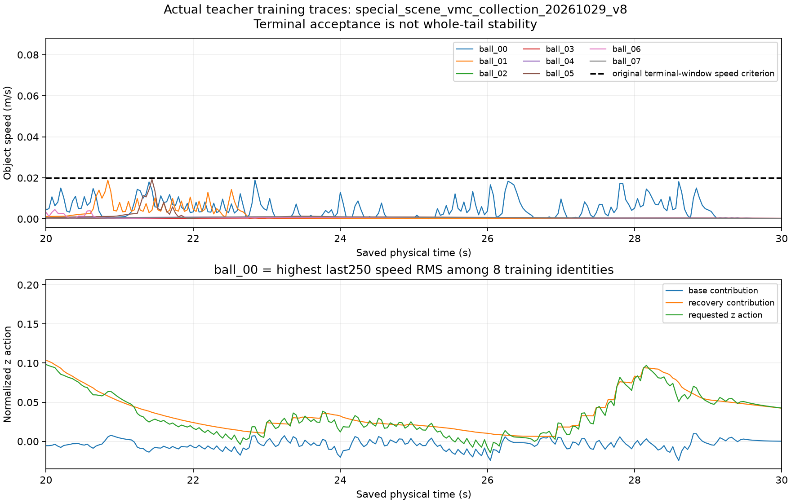

# v8全30合格、恢复覆盖与公平训练启动

后续[ESN训练误差与ridge独立核验](NONRL_V8_ESN_TRAINING_DIAGNOSTIC_20261029.md)：
三seed全部24train导出一致、正规方程通过，但关键阶段有拟合残差；21:19原队列17/75，
尚无新学生闭环结果。下文启动快照按其实际时间保留。

21:09:12UTC更新：原接续1089228同PID active，已9/75作业完成，
seed2026102801 RNN candidate01到21624更新，内存1085460480bytes。
完整数据及本轮代码/证据已核验共享，覆盖下文传输中快照：

- 原物理全集：`arm1@192.168.31.70:/home/arm1/sii_shared/SII_compliance/runs/main/nonrl_v8_full_collection_20261029_v1/FULL_COLLECTION.tar`，2802442240bytes/SHA76f23adc。
- commit`1a2afabc`源码/小证据：`arm1@192.168.31.70:/home/arm1/sii_shared/SII_compliance/runs/main/nonrl_v8_full_source_20261029_v1/SOURCE_AND_EVIDENCE.tar.gz`，1193文件7726159bytes/SHAbf3e5ed2。

[完整共享收据](evidence/NONRL_INTENT_RECOVERY_20261029/V8_FULL_SHARED_RECEIPT.json)。
科学63186fd7及合并1a2afabc已push/远端核验，双方日志逐字保留。
9/75是已结束训练作业数，不是九个最终模型已经锁定；没有学生闭环/最终矩阵结果。

## 实际完成范围

三种真实特化场景的原30条示范于2026-10-28 20:59:59.156349 UTC全部结束，
棍推10/10、自由球撞10/10、厚桌角10/10均合格。原collector1088910自然退出，
service inactive/success、MainPID0；原接续1089228先审查全部30条，再构建数据与开始拟合。
[全30审查](evidence/NONRL_INTENT_RECOVERY_20261029/V8_FULL_COLLECTION_REVIEW.json)、
[原采集结束收据](evidence/NONRL_INTENT_RECOVERY_20261029/V8_COLLECTION_COMPLETE.json)。

这完成了本轮数据资格要求，尚未完成学生闭环或108主矩阵。
旧v7失败、其他历史失败和综合场景旧结果均保留，没有降低gate或删除失败验证条件。
棍推十条完整顺序及真实回放见[已完成审查](NONRL_V8_ROD_REVIEW_20261029.md)。

完整新30原物理归档本机逐614成员核验：2802442240bytes，SHA256
`76f23adc3187e7b15ecd48e991a6f4ce879f739734be81330c43e159dedad569`。
包括原始子步、轨迹、来源、teacher/config、资格、完整review及rod00媒体。
本段记录时正向独立共享暂存传输，最终核验前不宣称共享完成；不含学生训练。

## 球撞末段问题：原失败修复，个别尾段退化保留

十条球撞的lift、原末9速度、末10误差及其他原gate均从保存数组复算，与原标签一致。
独立`math.dist`/`math.fsum`实现再次核对全10末速度/误差与8train尾段RMS，
末速度最大差0。验证只复算原终态gate，不参与尾段参数排名。

原失败validation ball08末9最大速度由`.031113961858026614`降至
`.0001722263749620731 m/s`，低于原`.02 m/s`；ball09由`.01064060546`降至`.00022518030`。
完整8train末250帧速度平方和`.0607764198904 → .0163188739840`，下降73.1493%。
这覆盖全部8训练条件，区别于此前只对4条探针的75.75%。

| 训练身份 | v7尾段RMS m/s | v8尾段RMS m/s | 变化 |
|---|---:|---:|---|
| ball00 | .00445704 | .00673569 | 上升，保留 |
| ball01 | .00795712 | .00348872 | 下降 |
| ball02 | .00070346 | .00057133 | 下降 |
| ball03 | .00060240 | .00045665 | 下降 |
| ball04 | .00922945 | .00068941 | 下降 |
| ball05 | .00020211 | .00237011 | 上升，保留 |
| ball06 | .00857903 | .00081134 | 下降 |
| ball07 | .00049370 | .00067004 | 上升，保留 |

[十条原门复算](evidence/NONRL_INTENT_RECOVERY_20261029/V8_BALL_TAIL_REVIEW.json)、
[独立标量与完整配对](evidence/NONRL_INTENT_RECOVERY_20261029/V8_BALL_TAIL_PAIRED_SCALAR_REVIEW.json)。
全部8train教师动作精确重放，实际图已目视检查，原始数组保存，未平滑或删去退化条件。
绘图工具唯一代码修改是去掉写死的“v7”，标题取实际collection目录名；数值算法未改，
该诊断工具不在运行采集/训练的绑定源中，不影响原作业。旧v7图/源hash仍保留。

图中虚线仅表示原末窗口速度门，不是新增全尾段门槛；ball00尾段仍有起伏，
末窗成功不等于整段无振荡，也不构成学生稳定性证明。

## 24train恢复覆盖

全30完成后才运行覆盖审查，全部24train逐帧教师动作精确重放；6validation只核来源，
未进入恢复覆盖统计或调参。恢复激活>.5只是描述分组，不是新的资格门。

| 场景 | 训练帧 | 激活>.5帧 | 最长连续激活 s |
|---|---:|---:|---:|
| 棍推 | 4000 | 0 | 0 |
| 球撞 | 6000 | 447 | 5.12 |
| 厚桌角 | 2600 | 171 | .64 |

棍推路径主要为垂向，水平路径权重使该水平恢复项不激活；其让位/跨越已由独立行为审查验证。
球撞与桌角确实包含恢复状态，但这些边际统计不证明覆盖了综合回归的全部联合状态，
也不能据此认定ESN、RNN或MLP已经学会。后续18回合诊断将区分teacher历史模仿与学生自身闭环。
[完整覆盖审查](evidence/NONRL_INTENT_RECOVERY_20261029/V8_TRAINING_COVERAGE_REVIEW.json)、
[实际覆盖数组](evidence/NONRL_INTENT_RECOVERY_20261029/v8_training_recovery.npz)。

## 学习已实际开始

共同数据集15,750帧（12,600train/3,150validation），24+6完整身份划分，
SHA256 `527bb7341e19b2345f16c04bb48d9b6b9dd643e9d1beeda0b8bb8228cb520805`。
[数据来源](evidence/NONRL_INTENT_RECOVERY_20261029/V8_DATA_COMPLETE.json)、
[公平预算](evidence/NONRL_INTENT_RECOVERY_20261029/V8_TRAINING_REGISTRATION.json)。

21:00:07开始有限75作业：每家每seed12候选、三seed，ESN固定储备池+解析ridge；
普通RNN/MLP每候选32000更新、同seed曝光安排、共同六验证身份requested-action MSE选模型。
等候选数不代表等FLOPs或参数数，神经网络有限更新数不自动等于收敛。
运行源已隔离快照，沿用原单线程/CPU100%/3GiB/swap0，未重启或另建训练队列。

21:03:20原接续service active/MainPID1089228，已5/75作业完成：三ESN搜索及第一组
RNN/MLP；当前seed2026102802 RNN candidate00到5912更新。内存1167417344bytes、
OOM事件0、swap0。[实际启动快照](evidence/NONRL_INTENT_RECOVERY_20261029/V8_FITTING_STARTED_SNAPSHOT.json)。
三ESN验证MSE分别3.08229e−5/2.61399e−5/2.58560e−5；只是已完成的各自内部候选选择，
不是最终三家比较、9模型锁定或闭环成功。禁止在75作业完整和模型审查前启动原18/108。

后续保持：完整拟合/9模型审计→实际三场景学生18及失败诊断→原12×9回归108→
Task、Strict、双成功条件SPT、全回合平均峰矩、实际人体接触dt舒适代理、机器合规率。
原12已被检查过，仅为回归；不声称未见泛化，不向拟合混入综合场景/测试轨迹。

本轮实际fetch/read main`dd8ff343f9613a3bdff50e71ad488380b949c5a7`、
baseline`f6e8f8c2711a93f0b5dfc88c608bd82647084d5d`。前轮完整棍推审查/媒体属progress，
本轮完整数据审查及实际训练接续属progress。无RL/子agent/服务器计算/删除，Goal active。
