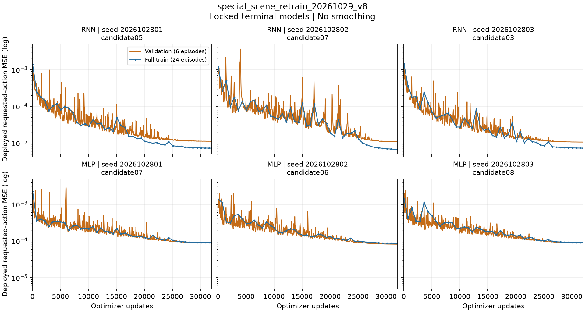
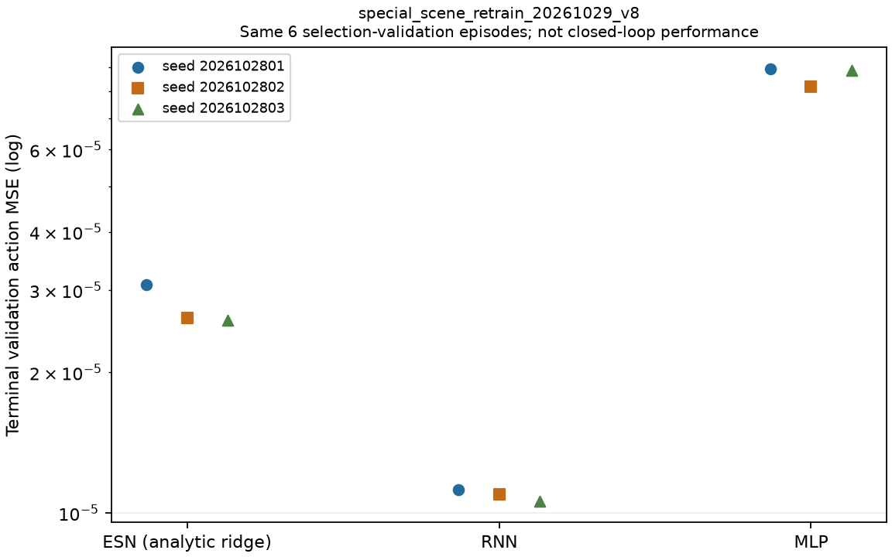

# v8实际学习曲线与当前108后处理接续

本轮14文件（八源码、准确报告、登记/启动快照、两张真实图及完整绘图数值）已逐Git blob、
暂存/最终大小hash核验共享到
`arm1@192.168.31.70:/home/arm1/sii_shared/SII_compliance/runs/main/nonrl_v8_learning_postprocess_20261029_v1/SOURCE_AND_CURVES.tar.gz`。
科学commit `41a2e7f29c17da3b426cdf610e546800af9be172`，462790bytes，
SHA `856c9691d722fa2254492dcef6ea6bd4b63a5010eeb2754964ae7bfa0177b929`。
[完整收据](evidence/NONRL_INTENT_RECOVERY_20261029/V8_LEARNING_POSTPROCESS_SHARED_RECEIPT.json)。
此处覆盖文末待共享快照；不含在途108原数据、未来全审或本段后补说明。

本轮从**当前v8九个锁定模型的原始训练记录**生成两张图，并完成实际目视检查。
没有新拟合、模型替换或仿真派发。原108从11推进到12，仍未完成；主矩阵未修复。
承接[首条件九模型审计](NONRL_V8_FIRST_CONDITION_REPAIR_PROGRESS_20261029.md)。

## 学习结果能说明什么

每条曲线来自对应模型的真实history，共894或895个日志点，无平滑。蓝线完整训练集MSE
记录较稀疏，仅连接真实采样点；橙线为同六条选择验证示范。不是reward或测试曲线。

| 方法 | seed末位 | 首次记录训练MSE | 最终训练MSE | 最后10%更新的已记录训练值极差/均值 |
|---|---:|---:|---:|---:|
| RNN | 1 | 1.38850e-3 | 7.25475e-6 | 2.054% |
| RNN | 2 | 1.22548e-3 | 6.75479e-6 | 5.872% |
| RNN | 3 | 1.45495e-3 | 7.27322e-6 | 1.994% |
| MLP | 1 | 2.27335e-3 | 8.98249e-5 | 1.599% |
| MLP | 2 | 1.37627e-3 | 8.62591e-5 | 1.712% |
| MLP | 3 | 1.46034e-3 | 9.07732e-5 | 1.465% |

seed为2026102801/02/03，每候选32,000更新。末段指标只是描述统计，没有另设收敛门；
前中段尖峰全部保留。ESN为解析ridge，没有梯度更新曲线，不为它编造loss序列。

验证动作MSE的家族顺序是RNN、ESN、MLP，但不能转述为闭环顺序。已有首条件九模型
Task/Strict全部失败；低的同分布模仿误差未转化为原测试域成功。结合此前成功教师历史
上的动作偏差和方向覆盖缺口，下一优先项仍是**真实场景覆盖修复与闭环检查**，不能仅
增加同一批数据的训练更新数，也不能据曲线断言唯一病因已经确定。

[全部绘图数值](evidence/NONRL_INTENT_RECOVERY_20261029/V8_LEARNING_CURVE_EVIDENCE.json)
SHA `b08a6314eafa5efb3e131c5fa6f2beea8448c806676ad0bf6394fbd5b09e1685`。
每个绘图点与原history逐字段相等，六个尾段极差独立math.fsum复算通过；
两PNG的hash及八后处理源码快照逐一核验，图题/曲线/三seed标签实际目视核对。
原拟合全75/108候选和数据已在之前完整拟合归档中，本轮不重复拟合。

## 修复当前批次的后处理接续

检查发现旧`dispatch_special_frozen108_handoff_20261028.py`只支持从尚未结束的训练开始
派发另一历史108；当前v8已经独立运行，不能复用该入口。完整归档器却要求正确的
handoff审计/接触补充/图表。因此新增独立`postprocess_running_special108_20261029.py`，
只接手报告，不调用物理dispatcher。

- 登记`outputs/special_scene_postprocess_20261029_v8`，REG SHA
  `fd8d90a1fb2d28b5eed222cb8002fae123d8bab6ef1efc0be818271ebea0e71d`。
  绑定原用户服务1172675/start32623702、准确命令中的preparation路径、原九模型lock和8源码快照。
- 实际后处理服务`sii-special-postprocess-v8-20261029.service`，PID1201537，23:49:25UTC启动，
  CPU50%/线程1/3GiB/swap0。已完成上述学习图，当前每30秒核原进程身份与execution，
  最长等待12小时；观察过期不终止或重启物理作业，也不自动恢复后处理。
- 只有原服务自然inactive/success、原108和其准备均完整，才执行原全审到
  `outputs/special_scene_frozen108_20261029_v8/FROZEN108_AUDIT.json`，准确复制到
  后处理目录`FINAL_AUDIT.json`，再做原contact diagnostics和six-metric presentation。
  最终标记`complete_pending_visual_review_and_archive`，不能称Goal完成。
- 之后应实际查看完整图，并调用原`archive_special_frozen108_20261028.py --handoff
  outputs/special_scene_postprocess_20261029_v8 --output <独立新目录>`，核验共享完整108。
  本服务不归档上传、不启动八球，不修改原物理/门槛/输入/filter/训练数据。

三个纯边界正例（active等待、deactivating等待、完整终态就绪）及六个负例通过：PID重用、
终态不完整、服务失败、原进程仍存在、准备不完整、实验失败均拒绝。真实不完整v8调用
原完整归档器已拒绝且未建输出。实际全108审计/报告正向尚待，不能拿这些检查代替它。

23:51:12UTC原1172675仍active、12/108、内存689020928bytes；后处理1201537 active、
11116544bytes。有效八球v3全部绑定源hash未改，仍须原108完成后再启动。
开工main `e0781ff5301ad0130279993e9ccf69e7a3795eb3`、baseline
`f6e8f8c2711a93f0b5dfc88c608bd82647084d5d`实际fetch/read。
新代码/图表目前仅本机待共享；Goal active，无RL操作/子agent/服务器计算/删除。
