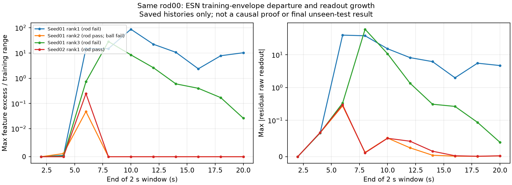

# ESN训练覆盖与闭环读出放大诊断

当前诊断使用真实三个独立场景v9训练数据SHA `120173888964ee0545393cd0d2685c794f7aa261626463fa7c10fc981b9c6407`，以及此前已经观察到的四条rod00 ESN开发轨迹，不读最终未见条件、不拟合、不积分、不更改选择规则或冻结源码。

对每个checkpoint，重置并回放全部24条训练历史（12600帧），建立其实际读出特征各坐标的最小/最大包络；在原学生闭环历史重建同一特征与限幅前读出。checkpoint逐帧actor动作精确replay通过，原资格input hashes、数据hash与checkpoint前后hash核验通过。

| 候选 | rod00原资格 | 500帧中有特征超训练包络的帧 | 最大超出量/该特征训练跨度 | 最大残差读出绝对值（限幅前） |
| --- | --- | ---: | ---: | ---: |
| ESN seed01 rank1 | 失败 | 392 | 87.710 | 39.758 |
| ESN seed01 rank2 | 通过（ball09另失败） | 4 | 0.048 | 0.277 |
| ESN seed01 rank3 | 失败 | 357 | 28.654 | 60.021 |
| ESN seed02 rank1 | 通过 | 11 | 0.247 | 0.297 |

失败rank1在4–6s窗口最大超出约15.09倍跨度、首次动作饱和5.12s；rank3在4–6s超出约0.73倍，首次饱和6.84s，之后超出扩大。最早单坐标包络超出也包括约1e-6倍训练跨度的微小数值差，不能将首次超出时间当失稳起点。

图按50帧/2s窗口绘制：左图最大包络超出，右图最大限幅前残差读出，采用symlog显示零与大范围。输入JSON/source/PNG/PDF均绑定hash并目视检查。不同候选各自历史、特征及训练跨度不同，归一化值不是共同输入性能排名；每坐标包络忽略特征相关性，包络内不证明有联合训练支持，包络外也不独立证明唯一因果。绝对贡献/抵消比另存证据，仅作描述。

当前结果支持学生闭环偏离教师训练历史后读出放大这一机制线索，不支持“teacher从未完成蹭棍”或“仅指标变了”。同时小teacher-history MSE不足以保证闭环合格。当前修复按三方法共同的完整12候选/九开发资格继续：ESN01 rank4已通过rod00/08/09，正在ball00；尚非九条全通过或最终测试成功。全部12仍耗尽时需另登记恢复状态覆盖和共享学习修复，而不是降阈值、加ESN专属手工控制或使用最终测试选模。

重现入口在`docs/evidence/nonrl_v9_candidate_catalogue_20261029/diagnose_esn_feature_coverage_20261030.py`；原v1入口副本与v1输出保留其真实source hash，v2补时间窗口与最坏特征值，不覆盖旧证据。大文件的完整top3 raw归档含全部72回合/10失败正在只读打包；此诊断不是最终108主矩阵。Goal active。
