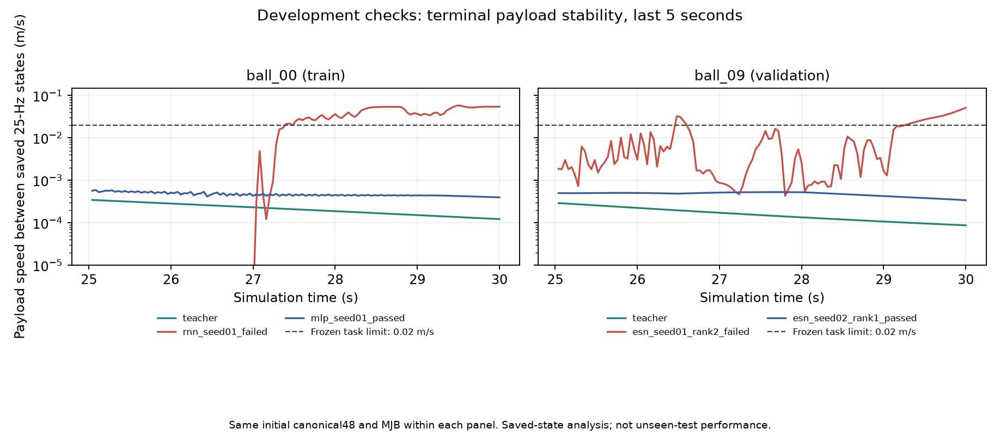

# 全候选共同闭环资格接续与球撞稳定性（2026-10-30）

## 首个完整开发资格模型

原共同筛选`nonrl_v9_common_eligibility_20261029_v3`仍实际推进；ESN seed2026102802、验证MSE第1候选rho0.8/input_gain0.08/ridge0.1已通过全部九train00/validation08/09 × rod/ball/corner开发资格。不是正式未见测试成功或九模型整体修复。seed01前三耗尽null，seed03继续，失败不隐藏。

## 按已有完整12候选推进

原108候选拟合均已完成，各方法/seed原本有12候选。为修复前三预算耗尽组，新增前瞻共同规则：全部九组统一按原同一validation teacher-history MSE顺序，最多检查其完整12候选；选择首个九闭环全合格候选。成功组不无谓测试更差候选，失败组继续剩余候选；所有失败保留，全12均不合格仍null，无回退、不派发最终测试。既有拟合预算仍12/组、数据/划分不变，无新增拟合、测试输入读取或门槛放宽。

完整候选预算上界9组×12候选×9闭环=972 case检查，首失败即停所以通常少得多。原18和top3阶段完全同checkpoint/identity/来源绑定的完整回合复用，不重复启动。继承全部旧失败与排名，不重新计一轮不受限预算；全12仍失败再依据train/val设计下一次学习/覆盖修复，而非冒称已解决。

新`extend_v9_common_eligibility_20261030.py`、独立`review_v9_full_grid_eligibility_20261030.py`：先等待原top3**全部九组**结束且服务inactive，自动完整独立审查原phase，再登记新source、旧phase execution/registration/review hash与cap12规则。运行前、逐case前后核不可变来源，独立协调器锁不占wrapper全局仿真锁。兼容字段reused_parent_episode在新阶段涵盖两个已审查祖先，另写reused_origin_run指明实际来源；审查器精确核回合路径与身份，不把复用当新执行。

零物理mock验证六路径通过：rank1/rank4/rank12首合格分别81/108/180 case检查；所有首case失败共108检查、最末case失败达到972上界，均九组相同预算且null无回退；登记中途变化立即failed_preserved。真实在途parent前置拒绝通过，不生成新registration/execution。只增加wait源清单对新reviewer的绑定后更新source hash，run/evaluate/register控制流程未变。

唯一后继`sii-v9-full-grid-eligibility-20261030.service` PID1697598/Invocation f84e957a3d8e45b7a9f60236f33f2020已启动，HANDOFF=waiting_for_original_three_rank_phase，MemoryCurrent59375616/3GiB、swap上限0、显式CPU6/线程1。无新phase execution/registration/worker，最长6h等待。原v3 PID1684974继续唯一仿真；不重启任一已存在服务或改绑定源。

## 同场景成功/失败物块稳定性

新增`diagnose_v9_ball_stability_20261030.py`实际核六条完整保存回合；每面板teacher与学生初始canonical48逐值、MJB相同，teacher自己与各学生actor精确回放均0误差，原gate逐分项重建与legacy成功一致。仅train/validation，无新积分或拟合。

- train ball00：teacher末10帧物块最大速度0.000131188m/s，RNN seed01失败0.0549170m/s，MLP通过0.000417230m/s。
- validation ball09：teacher0.0000930620m/s，ESN seed01/rank2失败0.0512587m/s，ESN seed02/rank1通过0.000368333m/s。

失败均超过原0.02m/s稳定门，不通过者不能因跟踪误差小就计成功。各学生历史上的独立teacher反事实动作输出只作诊断，不执行纠偏、不当训练标签；RNN失败尾段反事实MSE反而小于MLP成功尾段，历史不同不能作共同输入拟合排名。该证据支持继续检查模型稳定/抓取覆盖，不证明单一原因或teacher在所有学生失稳状态均能恢复。

图完全读取本次登记回合的legacy.npz，逐输入hash核验；纵轴为25Hz保存状态差分速度，虚线为原0.02m/s门槛，已目视核验。是开发条件图，不是旧实验复用、未见测试结果或每物理子步速度证据。

最终未见三分离108条件/指标登记不变；全部九模型合格并独立审查后还须正式执行、完整统计六指标。原组合office108的57待补保持，不抹去。Goal active。

独立selected-prefix审查已通过21条完整case（3失败、1祖先复用），确认1组九条全合格选择；状态仍为verified_incomplete_prefix，不当九组或最终测试完成。
