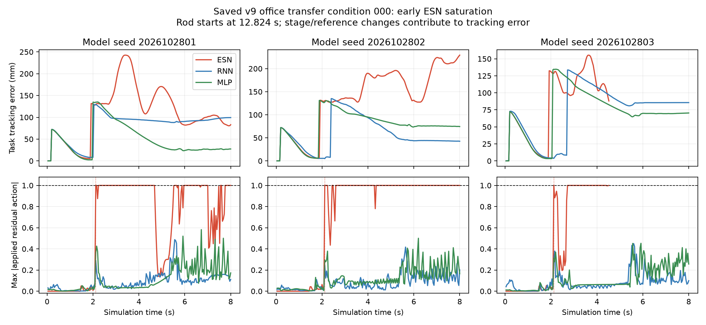

# v9 teacher、拟合与矩阵范围审查

状态：teacher/拟合审计已完成；九模型×原12条件组合回归正在原注册scope中继续。宿主级systemd核实scope active，资源限制为单CPU、1数值线程、MemoryMax=3GiB、MemorySwapMax=0；当前31/108完整结果，第32条RNN seed 2026102802、condition 003在途。sandbox中的PID/systemd视图不完整，以宿主scope和execution收据为准。

## Teacher与拟合审计

- 新30条棍推、球撞、厚桌角示范均qualified。十条棍推均通过接触→让位→越过→持续回位顺序，且确认回位早于棍撤回1.80–5.19秒。teacher对训练轨迹的action重放逐数组精确一致。此证据支持teacher在采集的三个特化场景中执行了目标动作；不代表所有测试状态下均适用。
- 30条逐场景资格复核：rod/ball/corner各10/10均task成功、有效场景接触且qualified；30/30的development safety和penetration≤0.2mm检查通过。此为当前采集场景的teacher证据，不是学生或最终office test的Task/Strict认证。
- v9拟合审计通过75份作业、108个候选、24 train/6 validation的episode隔离，以及九个冻结runtime actor对全部示范帧的精确action replay。训练和导出来源、checkpoint、共同action filter回放均未发现实现漂移。
- 训练帧分布为rod 4,000、ball 6,000、corner 2,600；虽然每类各8个train episode，逐帧损失仍给球场景47.6%的权重、桌角20.6%。因此当前目标函数并非等场景权重。
- ESN三个seed的训练历史误差：rod MSE约3.33e-6–3.98e-6，ball约1.35e-5–1.60e-5，corner约8.14e-6–9.13e-6。rod误差主要上升在接触至越过阶段，其中rod_01跨seed最高。ridge正规方程相对残差5.36e-15–6.12e-15，重建导出动作误差低于4.7e-15；没有发现ridge求解或导出错误。
- ESN slowdown通道在训练帧中有21.4%–25.3%被输出裁剪；其余六通道没有裁剪。需结合闭环轨迹判断影响，单凭裁剪比例不能判为根因。
- 旧恢复覆盖脚本只接受collection plan v2，v9正式plan为v3，因此脚本拒绝该审计。未改写计划或将此拒绝伪装成通过；teacher重放与qualification检查仍可独立通过。

## 主矩阵范围问题

原12个“acceptance”条件每条同时改变ball speed、person stroke和rod stroke，是组合扰动回归。v9训练集则分别是棍推、球撞和厚桌角特化场景。故原12条件测量的是组合扰动迁移/鲁棒性，不是三个特化技能本身；不应单独作为特化能力的主矩阵。该集合保留为组合压力测试，不能删除或更改其冻结条件。

要评估特化能力，仍需新增独立冻结的rod、ball、corner测试条件，并在查看结果前锁定种子、环境参数、Task/Strict定义及六指标统计规则。v9的六条validation已用于选模，不能再当未见最终测试。当前文档没有宣称主矩阵已修复。

## 组合回归当前结果（31/108）

新结果目录为`outputs/special_scene_frozen108_20261029_v9`，保持旧冻结物理源、dt=5e-5、原12条件、Task/Strict gate、canonical48输入、公共filter及执行器限制。原注册scope按单CPU、1数值线程、3GiB内存、禁swap，九模型单路执行。

截至2026-10-29当前本地快照，完整结果按模型汇总如下：

| 方法 | 已完成 | Task成功 | Strict成功 | 平均峰值力矩 | 最大穿透范围 |
|---|---:|---:|---:|---:|---:|
| ESN（三seed） | 11 | 0 | 0 | 48.218–69.423 Nm | 2.810–3.611 mm（各seed最大值） |
| RNN（三seed） | 10 | 1 | 0 | 38.626–42.145 Nm | 0.151–0.292 mm（各seed最大值） |
| MLP（三seed） | 10 | 1 | 0 | 38.508–42.313 Nm | 0.163–0.309 mm（各seed最大值） |

31条中Task成功2条、Strict成功0条、双成功0条，因此当前SPT为NA；这不是最终矩阵统计。两条Task成功分别是MLP seed 2026102803/condition 000（52.08s，穿透0.3090mm）和RNN seed 2026102802/condition 002（50.44s，穿透0.2918mm），均按冻结机器安全门失败。其余29条没有Task成功，ESN已有11条且Task为0，多条超过安全穿透门。所有失败收据保留。不能根据中间分母给出正式方法排名。

## 根因判断与修复边界

- **teacher动作顺序：当前没有发现错误。** 10/10棍推teacher轨迹均通过真实接触、让位、越过、持续回位，且回位早于棍撤回1.80–5.19s；qualified审计与训练帧action精确回放通过。这只证明采到的开发示范正确，不证明teacher在本回归组合条件下也能满足Task/Strict。
- **拟合/导出实现：没有发现数值或接口错误。** 75份训练作业、108个候选、九个锁定actor的训练轨迹重放、ridge复算和共同filter回放均通过。训练内拟合正确不保证闭环分布外表现；ESN在上述11条组合回归快照中Task为0，说明该风险已实际显现，但当前只到部分条件。
- **场景与数据权重：这是目前最明确的设计不匹配。** teacher数据来自分离的棍推、球撞、桌角特化场景；原12条件每条同时包含ball/person/rod扰动。该集合应解释为组合迁移压力测试，不能作为三个特化技能的主矩阵。训练逐帧权重亦不等场景：ball 47.6%、corner 20.6%；ESN slowdown预测输出在训练帧中有21.4%–25.3%被输出裁剪，值得做分阶段闭环误差审计，但尚未被证明是失败根因。
- **因此不能用当前数据断言“棍子蹭回位本身把ESN变差”。** 目前可确认的是：teacher示范内序列合格、学生有正确训练帧拟合，但ESN在已完成的组合扰动条件下出现明显闭环失稳/任务失败。要归因算法，需先完成冻结108迁移回归并另建场景隔离测试；测试集不得用于选模或重训。

原scope持续运行，无需恢复或新派发。完成108后对ESN失败分阶段核查输入是否超训练支持、预测/裁剪/公共filter输出、阶段RMSE/动作误差及状态误差增长；任何重训只可使用训练集与已登记validation，需先修复逐帧场景权重或动作尺度假设并冻结新模型。另建的最终测试必须在每个特化场景隔离变化物理seed/初态，先冻结条件和统计规则，再做teacher参考与三种学生配对比较。不得放宽Task/Strict或机器安全门来制造成功。

## 结论与后续

现有证据没有定位到“teacher在棍推示范中没有蹭过回位”的问题。当前更支持场景迁移/逐帧权重风险，同时ESN在组合回归中确有严重失败信号；因为108尚未完成、teacher也未在相同回归条件下配对，teacher泛化、ESN闭环表征/动作饱和和任务场景不匹配尚不能作唯一因果判断。让现有组合回归完成，再以新的场景隔离矩阵判断主结果；不得用中间数据选模型、放宽安全门或宣称问题已经修复。

## 新增：已保存闭环时序诊断（22:09 CST）

[九条配对轨迹证据](evidence/nonrl_v9_closed_loop_support_20261029/DIAGNOSIS.json)仅使用正确v9数据（SHA12017388、12600 train帧）和condition000的九条完整轨迹，没有拟合、物理积分或测试选模。三个ESN的checkpoint与冻结锁匹配，requested-action重放最大误差4.24e-14以内。

- 三seed首次残差输出和applied action饱和均为2.12s，早于该条件12.824371s棍推开始；同条件RNN/MLP六条均无饱和。饱和帧占ESN整回合38.3%–43.4%。因此“棍推新行为直接引起此次失稳”缺少时序支持，问题已在lift早期出现。
- ESN活跃readout特征超出训练逐维包络超过5个训练标准差（std floor .005）的首次时刻同为2.12s；原始读出残差峰值26.75–221.48，经公共裁剪后限制至[-1,1]。这是外推放大风险证据，不是唯一因果证明；不能从包络超限断言模型必然失败。
- 初始obs的0/2/6关节通道虽超出训练逐维范围，但它们不直接进入此ESN encoder；初始活跃特征包络超限量为0。不能把“初始48维越界”误写成ESN错误的直接原因。
- 0.2s的50mm跟踪误差阈值交叉也在九条共同发生，包含reference/stage切换，不应当作失稳起点。图中三个seed的ESN在lift后的误差增长与持续动作饱和更有区分力。此图使用40ms保存样本，不是独立子步审计或训练loss图。

新登记`outputs/nonrl_v9_paired_scene_closure_20261029_v1/REGISTRATION.json`为18条开发闭环：三个分离场景×train00/validation08×三方法，固定模型seed2026102801，与已有同身份合格teacher配对，不重新挑teacher。它不属于未见最终测试；必须等原108 complete后才运行。实际在途前置拒绝检查通过，未创建execution或启动物理。源码和登记见本证据目录；后续按结果区分同场景学习缺陷与组合迁移，再制定仅train/val的修复，不能依此宣称主矩阵已修复。

最新执行快照35/108、Task3、Strict0、BOTH0；原scope active，MemoryCurrent1582096384/3221225472bytes，MemorySwapMax0。18条尚未执行。SPT仍NA。所有原失败保留，未改九模型、物理、gate、filter或运行绑定源。

18条串行交接服务已启动：`sii-v9-paired-closure-handoff-20261029.service`（PID1629199、Invocation0356b82bcfc94200b2530a5f11b71332），实际HANDOFF为waiting_for_original108，尚无student execution。它等原108完整结束且原scope inactive后才派发；等待上限12h、单CPU6/1线程/3GiB/禁swap，异常保留而不重复重试。此交接器不等于18条已完成或主矩阵已修复。

本轮小证据已共享并核验：`arm1@192.168.31.70:/home/arm1/sii_shared/SII_compliance/runs/main/nonrl_v9_closed_loop_support_20261029_v1/EVIDENCE.tar.gz`，395531bytes，SHA256 `0f8c34c5a8030048f275e55eff1280f04078a24b80fd66e279953ad765607df9`，包含四脚本、图、诊断、18登记、拒绝及交接启动收据。未含完整拟合或仍在途的108产物。
