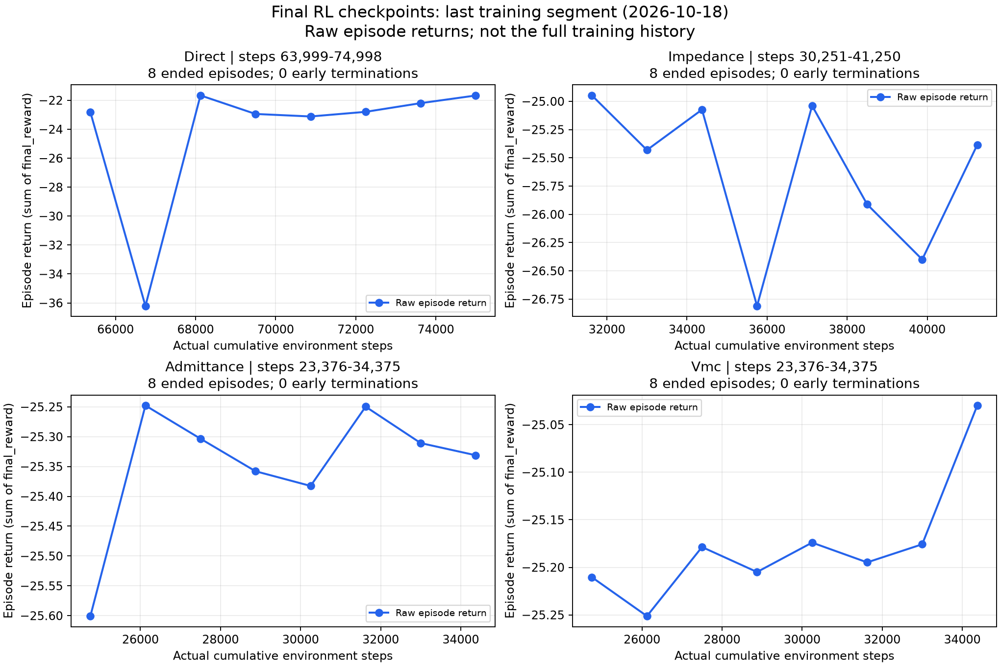
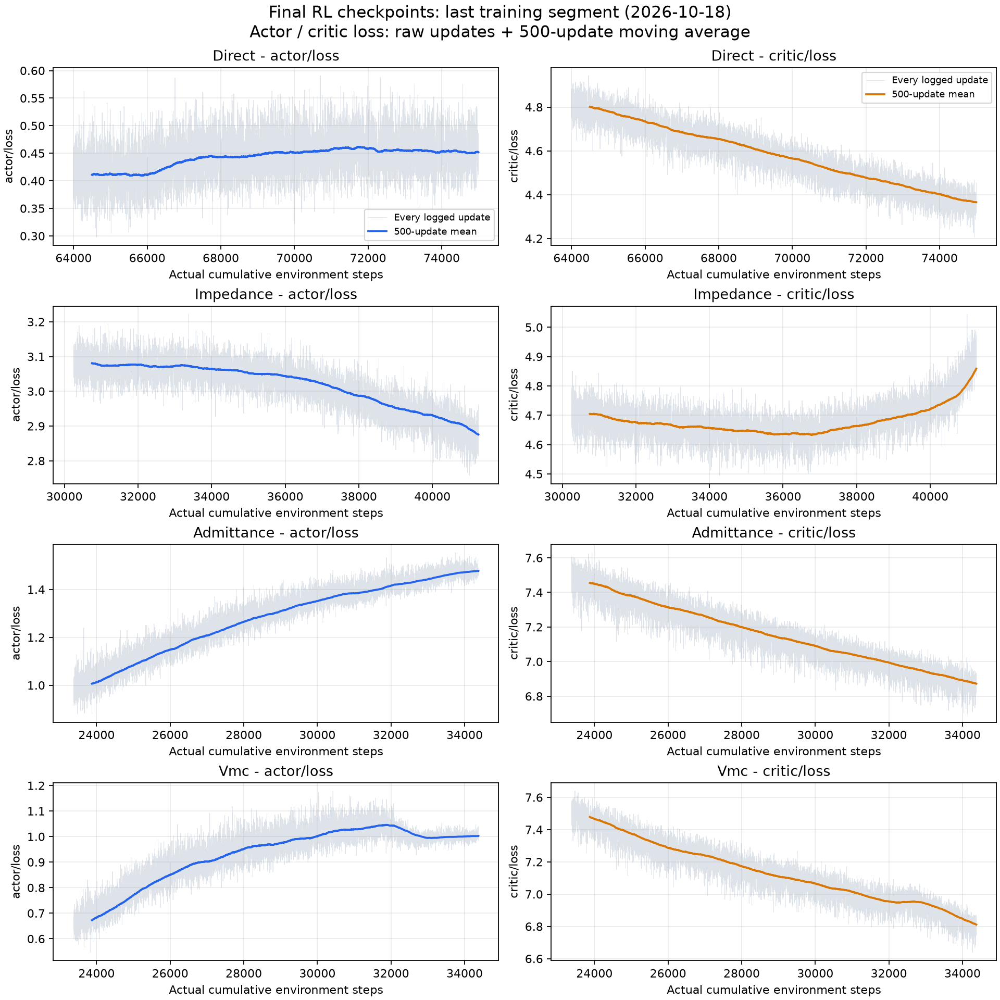

# RL 阶段结果记录：等待新标准与下一步目标

2026-10-25 用户要求先记录当前结果，随后讨论新标准、算力利用及追加训练目标。
本次不启动追加训练、测试或调参；新标准具体内容尚未给出，不推测预算或验收阈值。

## 当前累计训练量和最终 checkpoint

下表计数来自最终 acceptance 使用的 checkpoint 所在训练目录的 execution。
路径均相对于 `code/mujoco_6d_vmc_benchmark/outputs/`。

| 方法 | 累计 steps | 累计 updates | checkpoint |
|---|---:|---:|---|
| Direct | 74,998 | 69,999 | rl_goal_selected_20261018_stage06_retry2_cpu_v1/direct_task_safety/checkpoint_0074998 |
| Impedance | 41,250 | 36,251 | rl_goal_selected_20261018_stage06_retry2_cpu_v1/impedance_payload/checkpoint_0041250 |
| Admittance | 34,375 | 29,376 | rl_goal_recovery_20261018_backend_cpu_v3/admittance_payload/checkpoint_0034375 |
| VMC | 34,375 | 29,376 | rl_goal_recovery_20261018_backend_cpu_v3/vmc_payload/checkpoint_0034375 |

各路均未达到此前提到的每策略100万步；达到有限阶段预算不等于充分训练。
本次绘图逐一核验 actor 文件 SHA256 与 `rl_goal_acceptance_20261018_v3/execution.json`
一致；该核验不等于重新核验整个 checkpoint 或重做 acceptance。

## 真实曲线及统计

图只使用上述目录的 `training.jsonl` 和 `optimizer.jsonl`，每路末段11,000步、8个完整55秒回合。
Direct 范围63,999–74,998；Impedance 30,251–41,250；Admittance/VMC 23,376–34,375。
不拼接其他实验，不填补早期历史，不删除低回报点。reward 为各回合 `final_reward` 的和；
loss 同时展示逐更新原值与500次更新移动平均。子图纵轴各自缩放，不应仅凭视觉振幅跨方法比较。

| 方法 | reward窗口回合数 | 窗口均值 | CV（总体标准差/绝对均值） | critic首/末1000更新均值 |
|---|---:|---:|---:|---:|
| Direct | 4 | -22.447736 | 0.02479 | 4.79064 / 4.37239 |
| Impedance | 6 | -25.769766 | 0.02587 | 4.69885 / 4.81395 |
| Admittance | 6 | -25.322585 | 0.00167 | 7.44221 / 6.88507 |
| VMC | 6 | -25.159660 | 0.00235 | 7.45761 / 6.83546 |

以上短窗口仅为描述性统计，并非新登记的收敛门槛。完整逐回合值、日志路径和 SHA256 见
[数据来源与统计](evidence/rl_snapshot_20261025/sources_and_statistics.json)。

## 更正先前结论

此前回复误用了 `reward_training_curves_20261013` 的历史图片来解释最终训练，明确撤回该图证。
“四路均已收敛”的表述也过强：当前只能确认末段reward存在低波动窗口，不能由4–6回合证明
经历有效学习后趋稳，也无法排除长期停滞。Direct末段仍有一次return=-36.211995；
多数critic仍持续下降，Impedance critic末段回升。loss并未全部平台化，且actor loss升降本身
不能直接判定策略好坏。正式判断需要完整同源历史和事先明确的稳定/学习判据。

历史10月18日独立acceptance四方法均完整运行，但Task/Strict都是false/false；不计任务成功。
10月20日发布的24条件ESN/RL对照使用历史RL模型，并非以上最终四checkpoint；最终模型的
未见测试组配对比较仍未完成。

## 存储与后续交接

本次图、统计和报告随Git提交；原始日志/checkpoint保持本地原路径，不覆盖历史收据。
既有小型acceptance归档（10月18日已核验，本次未重新核验）：
`arm1@192.168.31.70:/home/arm1/sii_shared/SII_compliance/runs/main/rl_goal_acceptance_20261018_v3/evidence/`。
本次新图未另外上传服务器。等待用户讨论新标准、训练预算/资源及比较目标后再登记新实验。
