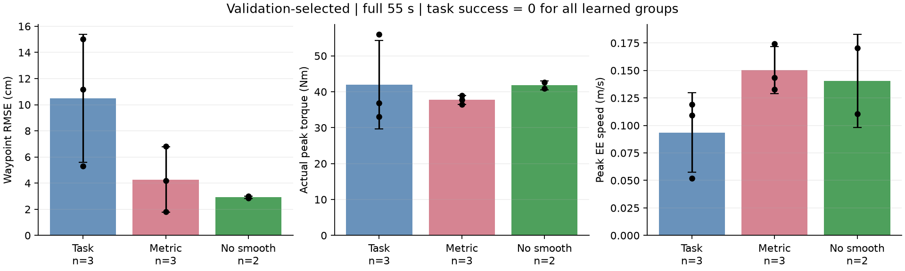
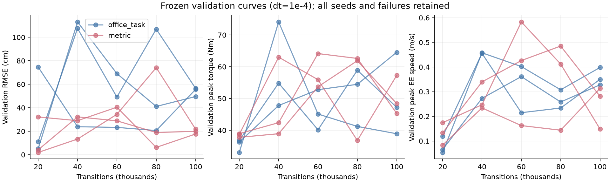

# SimbaV2 在复杂 Office 仿真中的奖励对照实验报告

> 日期：2026-09-30。数据截点：17:21（Asia/Shanghai）。campaign_03 全部训练、验证、主组及消融评测、零动作对照均已完成，所有进程退出码通过；后续 progress_dense 诊断已单独启动，尚不纳入主结果。所有实验在 DGX Spark 上执行，尚无真实 FR3 硬件实验。
>
> 主产物目录：/home/arm1/vmc_mujoco_runtime/reward_study_20260930/campaign_03/
>
> 本文不能作为“已排除人为弱基线、证明 SimbaV2 不适合该任务”的结论。实现与评测接口经过验证，但训练覆盖和进度奖励仍存在明确问题。

## 1. 最重要的结果

本轮已真实完成 **8 × 100,000 个 RL transitions**、合计 **1,520,016 次 SAC 更新**及 **320,000,000 个物理子步**。主对照为两个奖励版本、三个配对训练 seeds，另外两路是去平滑项消融。并非只运行了很短的 smoke 后把失败称为算法结果。

在验证集选择的 checkpoint 上，两主组各完成 18 条完整 55 s 评测，均通过既定物理有效性判据，但 **任务成功、稳定放置、strict success 都是 0/18**。新增指标奖励降低了 RMSE 和平均回合峰值力矩，同时提高了峰值速度；这只说明指标发生变化，尚未学会完整柔顺抓取放置。

| 验证集选模后的方法 | 独立训练 seeds | 评测回合 | 全程位置 RMSE（cm） | 回合峰值实际力矩（N·m） | 回合峰值线速度（m/s） | 物理有效 | 稳定放置 / task / strict |
|---|---:|---:|---:|---:|---:|---:|---:|
| SimbaV2 + office_task | 3 | 18 | 10.4868 ± 4.8930 | 41.9397 ± 12.3139 | 0.0936 ± 0.0363 | 18/18 | 均为 0/18 |
| SimbaV2 + metric | 3 | 18 | 4.2742 ± 2.4923 | 37.7209 ± 1.2178 | 0.1503 ± 0.0214 | 18/18 | 均为 0/18 |
| SimbaV2 + metric，去平滑项 | 2 | 12 | 2.9203 ± 0.0895 | 41.7902 ± 1.2472 | 0.1404 ± 0.0424 | 12/12 | 均为 0/12 |

“±”是独立训练 seed 均值之间的**样本标准差**，不是把所有回合当作独立训练实验得到的置信区间。先对每个 seed 的六个条件求均值，再对 seeds 等权汇总。力矩和速度表项是“每回合最大值的均值”，并非一次取全部实验的最大值，也不是速度 P95。

更重要的失败证据是：8 路训练的 **648 条已结束、已记录回合全部止于 approach 或 align，没有进入 grasp**。这里“已结束”包含物理提前终止，不等于全部跑满 55 s。部分低 RMSE 策略一直留在初始目标附近。不能据此把低 RMSE 解释为成功绕障，或把较高峰值速度解释为更快完成任务。

## 2. 实验问题与对照定义

研究问题有两个：首先，在正确接入官方实现的情况下，从零训练的 direct-action SimbaV2 能否在复杂 Office 任务中学习柔顺抓取和放置；其次，加入与论文拟报告指标对齐的奖励，能否改善其表现。

SimbaV2 原论文是 Lee 等人的 *Hyperspherical Normalization for Scalable Deep Reinforcement Learning*，ICML 2025。原论文没有通用的机械臂 Office reward，而是沿用各 benchmark 的任务奖励，并使用其奖励缩放方法。因此第一组准确名称是 **“官方 SimbaV2 + Office 适配任务奖励”**，不称“原论文 Office reward”。

本轮组别定义如下：

| 组别 | 奖励组成 | 训练来源 | 用途 |
|---|---|---|---|
| office_task | 成功/失败 + 全局势函数进度 + 时间成本 + 失败剩余代价补偿 | 从零在线 RL | 主基线 |
| metric | office_task + 全物理子步位置误差 + 实际峰值力矩增量 + 弱动作平滑 | 从零在线 RL | 指标奖励主对照 |
| metric_nosmooth | metric，令平滑系数为 0 | 从零在线 RL | 次要消融，仅两个 seeds |

没有使用 VMC teacher、BC、ESN 权重、CEM 或专家 replay。三个组共同使用已有 WBC 执行器及公共动作 filter。这里的 direct action 是直接输出统一的 7 维控制动作，而不是直接输出七关节力矩；动作仍需经过共同 WBC 生成执行力矩。

office_task 保留了势函数和时间成本，不以人为设置极端稀疏的 task-only reward 作为主要对手。稀疏 task_only 的代码支持仍在，但不属于本次主结果。

## 3. 原论文复核与实际算法

官方代码固定为：

- 仓库：https://github.com/DAVIAN-Robotics/SimbaV2
- commit：86899c277cdc697b2b02d827243de1ea93f20a1d
- 服务器 checkout：/home/arm1/vmc_mujoco_runtime/SimbaV2/
- 论文：https://arxiv.org/abs/2502.15280
- 审计报告：/home/arm1/vmc_mujoco_runtime/reward_study_20260930/PAPER_AUDIT.md

SimbaV2 在 SAC 上使用超球面特征及权重归一化、可学习插值块和 categorical critic。训练参数如下：

| 参数 | 本轮实际值 |
|---|---|
| Actor | 1 个 HyperLERP block，宽度 128，tanh Gaussian action7 |
| Critic | 2 个 blocks，宽度 512，clipped double Q |
| Return atoms / support | 101 / [-5, 5] |
| 观测归一化 | 官方 running mean / variance；评测冻结 |
| 奖励处理 | 官方 return bounding / scaling，不做均值中心化 |
| Discount γ | 0.995 |
| UTD | 2 |
| Batch size | 256 |
| 随机 warmup | 5,000 transitions；到达阈值后才开始更新 |
| Actor BC weight | 0 |
| Target τ | 0.005 |
| 初始 temperature | 0.01 |
| Entropy 系数 | 官方配置 -0.5 × action dimension |
| 学习率 | 1e-4 线性向 5e-5，预设 200,000 次更新的衰减长度 |
| 随机初始化 seeds | 41001、41002、41003 |
| 每路实际 updates | 190,002 |

官方论文 §4.3 的奖励处理为运行折扣回报统计及无中心化缩放，可概括为：

$$
G_t=\gamma G_{t-1}+r_t,\qquad
\bar r_t=\frac{r_t}{\max\{\sqrt{\operatorname{Var}(G)+\epsilon},\,G_{\max,\mathrm{observed}}/5\}}.
$$

官方实现的 episode 边界处理及 max-absolute-return 统计直接沿用代码。奖励本身保持 raw 值写入 replay，再由 wrapper 在更新时缩放。观测统计只在训练采样更新，测试不更新。

本轮修正了旧 runner 绕过官方 normalizer、固定 tanh 观测缩放、固定 reward × 0.04、过早开始梯度更新等差异。但不能由这些修正反推旧结果差的唯一原因。论文附录表格的末学习率与固定官方代码存在差别，本轮明确采用官方代码的 5e-5，不声称所有论文文字超参逐项一致。

## 4. Actor、动作和参考轨迹口径

Actor 接收 48 维因果本体观测及任务命令：

$$
o_t=[q_{1:7},\dot q_{1:7},\,\nu_{\mathrm{cmd}},\,
e_{\mathrm{pose}},\,\nu_{\mathrm{cmd}}-\nu_{\mathrm{actual}},\,
\widehat\tau_{\mathrm{ext},1:7},\widehat w_{\mathrm{ext}},\,d_{\mathrm{path}}].
$$

维数依次为 7、7、6、6、6、7、6、3。外力/力矩来自因果关节负载观测器及等效末端 wrench，不把 MuJoCo 接触真值、障碍物几何、事件时钟或任务阶段编号加入 actor。

Actor 输出归一化动作：

$$
a_t\in[-1,1]^7
=[a_{\mathrm{slowdown}},\delta v_x,\delta v_y,\delta v_z,
\delta\omega_x,\delta\omega_y,\delta\omega_z].
$$

公共 filter 将其转换为名义速度调节及笛卡尔速度残差，交给相同 WBC 执行。本轮没有额外的 RL 专属误差保护层。公共 filter 前 requested action 与 filter 后实际动作均保留，避免只观察裁剪后的平滑现象。

当前参考是 PickPlaceTask 的**当前阶段 waypoint**，不是按绝对时间推进的连续轨迹，也没有在这轮实现新的连续路径参数 σ。公共误差和 reward 使用同一个 waypoint 定义。阶段为：

approach → align → grasp → lift → carry → load_transfer → release → retreat。

切换除位置误差小于 12 mm 外，还要求姿态误差小于 0.12 rad、末端速度小于 0.025 m/s，并连续满足 0.20 s；抓取、卸载、松爪阶段还有原始额外条件。本轮没有放宽这些条件。

这一参考口径有重要含义：若策略不能离开初始 approach，目标 waypoint 也不会推进，低位置误差不代表任务有进展。因此成功率、阶段覆盖和接触覆盖必须与 RMSE 一起看。

## 5. 实际奖励数学与参数

两个主组共享：

$$
r_t^{\mathrm{office}}
=r_{\mathrm{task},t}
+5[\gamma\Phi(s_{t+1})-\Phi(s_t)]
-c_{\mathrm{time},t}
-c_{\mathrm{failure\ continuation},t}.
$$

metric 进一步加入：

$$
r_t^{\mathrm{metric}}
=r_t^{\mathrm{office}}
-4c_{\mathrm{error},t}
-8c_{\mathrm{peak\ torque},t}
-0.0002c_{\mathrm{smooth},t}.
$$

本主实验的平滑系数是 **0.0002**。campaign_02 早期采用的 0.005 不属于本表主结果；发现该项在随机 warmup 的全回合累计过大后，单独冻结了 campaign_03 再从零训练。去平滑消融系数为 0。

### 5.1 任务与失败

只有 validator 的 strict_success 判据满足才发放 +20 成功奖励；失败终止为 -20，并加上避免“提前失败逃避后续代价”的 continuation 代价。55 s deadline 在本轮被定义为有限时域任务终止，replay 中 terminated=True，不作为无限任务的普通采样截断来 bootstrap。

提前失败补偿基于剩余时间、声明的误差支持上界 3 m、归一化实际力矩上界 1 及动作差最大值，保守计算剩余可逃避负代价的折扣上界：

$$
C_{\mathrm{continuation}}
=\sum_{i=1}^{n}\gamma^i C_{\mathrm{per\ interval,max}}
+\gamma\lambda_\tau[1-M_t^2]_+,
$$

并单独处理最后不足一个控制周期的时长。这是保守上界，不是已知的反事实真实回报。较大的提前失败代价可能扩大 reward normalizer 的尺度，压缩普通步奖励的相对幅度，应作为优化因素继续审查。

### 5.2 全物理子步误差

$$
c_{\mathrm{error},t}
=\sum_{k\in\mathcal K_t}\frac{\Delta t_k}{55}
\left(\frac{\|p_k-p_{\mathrm{ref},k}\|}{0.12}\right)^2.
$$

每个 RL 周期的全部物理子步都计入，接触段不关闭、不删除，也不截断正常误差以改善报告数值。误差上界检查超出时会报错，不能静默裁掉异常。

对实际持续时间为 T 的回合：

$$
\sum_t c_{\mathrm{error},t}
=\frac{T}{55(0.12)^2}\operatorname{RMSE}^2.
$$

只有 T 一致时，上式的未折扣累计目标才与 RMSE 排序一致。训练存在提前物理终止，SAC 又使用折扣，不能声称所有回合的 RL 回报与 RMSE 排序严格等价。

### 5.3 实际执行峰值力矩

$$
u_t=\max_{k\in\mathcal K_t,j}
\frac{|\tau^{\mathrm{actual}}_{j,k}|}{\tau^{\mathrm{limit}}_j},
\quad
M_t=\max(M_{t-1},u_t),
\quad
c_{\mathrm{peak\ torque},t}=M_t^2-M_{t-1}^2.
$$

实际信号为 completed mj_step 保留的 qfrc_actuator[:7]，不是 policy 请求力矩，也不是外部碰撞 wrench。每次 reset 令 M=0，同时保存逐关节 Nm 和全局 Nm 峰值。

未折扣求和具有望远镜性质，等于最终峰值平方；γ<1 后不再严格等价。动力学力矩求值与步后运动学状态在一个物理步内可能存在细小时间差，指标文档保留了该说明。

### 5.4 时间、速度与动作平滑

任务未完成时：

$$
c_{\mathrm{time},t}=\Delta t_t/55.
$$

稳定任务完成证据已成立的后续周期不再收取时间成本；评测仍运行到共同完整时域以检查物块是否稳定，成功不能仅根据阶段标签判定。

不正向奖励峰值速度；速度尖峰作为报告和安全诊断。弱平滑项为：

$$
c_{\mathrm{smooth},t}
=\|a_{\mathrm{requested},t}-a_{\mathrm{requested},t-1}\|_2^2,
\qquad a_{-1}=0_7.
$$

这里使用公共 filter 前的归一化动作。恢复时间在这一轮不是额外的接触状态机奖励，也未被伪装成已完成的主指标。

### 5.5 本轮势函数及其后续发现

主实验冻结的势函数是：

$$
\Phi(s)=\frac{i+f_i(s)}{8},
$$

当当前阶段的起终点距离非零时，f 为沿该段的投影比例，裁剪至 [0,1]；阶段几何长度接近零时，使用 clip(ready/0.20,0,1)。终止状态的势函数按 0 处理，进度项严格采用 γΦ(next)-Φ(current)，以避免往返和终止处理产生额外回报漏洞。

数学上的势函数形式正确，并不意味着这个具体 Φ 在当前任务中提供了足够学习信号。第 10 节说明其初始阶段的退化问题。

## 6. 物理场景、训练分布和冻结评测

主实验使用 combined_thick_corner_pillar_v4 场景，包括厚桌角/柱体、动态球、人手模型和持续推杆。此 v4 条件无水杯，不应把历史带杯子的 Office 动画误称为本轮环境。

- 球在 2 s 发射；人手从 3 s 开始；推杆从 7 s 开始、保持 6 s。
- 事件安排只属于世界侧，不作为 actor 输入。
- 完整时域 55 s；policy 25 Hz。
- 训练与验证物理步长 1e-4 s，即每个 RL 周期 400 个物理步。
- 冻结结果评测物理步长 5e-5 s，即每个 RL 周期 800 个物理步。
- 所有条件与原始 model/source hashes 保存在各 PROTOCOL.json 和 rollout.json。

初始几何审查发现 variants 3、4、5、6 的柱底座与目标物块相交约 1 mm，故在训练前排除；合法训练 variants 为 -4、-3、-2、-1。没有为使某方法成功而放宽穿透门槛。

训练按 episode 遍历上述四布局，事件循环为 all、all、ball、person、rod。每个 episode 随机化：

| 变量 | 训练分布 |
|---|---|
| 球速度 | Uniform(1.35, 1.95) m/s |
| 人手推进 stroke | Uniform(0.16, 0.23) m |
| 推杆 stroke | Uniform(0.19, 0.24) m |
| episode seed | training_seed + 100003 × episode_index |
| 其他 fixture 参数 | 由当前 fixture_flags 的固定 seed 生成，原值写入 rollout.json |

验证集使用两个固定条件；评测集使用六个固定条件：

| 用途 | 布局 | Seed | 球速度 | 人手 stroke | 推杆 stroke |
|---|---:|---:|---:|---:|---:|
| validation | 0 | 190100001 | 1.55 | 0.180 | 0.210 |
| validation | 1 | 190100002 | 1.85 | 0.220 | 0.235 |
| 已见开发布局 | 0 | 2026091751 | 1.70 | 0.200 | 0.235 |
| 已见开发布局 | 1 | 2026091852 | 1.70 | 0.200 | 0.235 |
| 已见开发布局 | 2 | 2026091953 | 1.70 | 0.200 | 0.235 |
| 冻结新参数组合 | 0 | 190200001 | 1.45 | 0.175 | 0.205 |
| 冻结新参数组合 | 1 | 190200002 | 1.90 | 0.225 | 0.238 |
| 冻结新参数组合 | 2 | 190200003 | 1.65 | 0.205 | 0.225 |

validation 和 test 的条件不同，但共享部分 layout IDs，而且这些 Office 布局已在历史开发中查看过。故这里只能称为冻结开发评测及新参数组合评估，不能称为首次见到的真实办公室或完全盲测的新几何泛化。

## 7. 实际算力预算、保存和选择规则

8 路全部达到 100k transitions，退出状态为 step_budget_complete；没有以未完成的训练进度冒充最终预算。

| 组别 | Seed | Transitions | SAC updates | 物理子步 | 已结束训练回合 | wall h |
|---|---:|---:|---:|---:|---:|---:|
| office_task | 41001 | 100,000 | 190,002 | 40,000,000 | 78 | 1.80 |
| office_task | 41002 | 100,000 | 190,002 | 40,000,000 | 85 | 1.74 |
| office_task | 41003 | 100,000 | 190,002 | 40,000,000 | 75 | 1.73 |
| metric | 41001 | 100,000 | 190,002 | 40,000,000 | 75 | 1.82 |
| metric | 41002 | 100,000 | 190,002 | 40,000,000 | 76 | 1.79 |
| metric | 41003 | 100,000 | 190,002 | 40,000,000 | 93 | 1.78 |
| metric_nosmooth | 41001 | 100,000 | 190,002 | 40,000,000 | 76 | 1.78 |
| metric_nosmooth | 41002 | 100,000 | 190,002 | 40,000,000 | 90 | 1.81 |
| 合计 | 8 runs | 800,000 | 1,520,016 | 320,000,000 | 648 | 并行执行，不对 wall h 直接相加 |

每路实际模拟时间约 4,000 s，合计 32,000 s。总子步数不能等价为 3.2 亿条独立 RL transitions；每路经验仍是 100k 条决策级 transition。运行时最多四个仿真并行，官方网络在单独 GPU 环境训练。

每 10k 保存 checkpoint，验证候选为 20k、40k、60k、80k、100k。用相同两个 validation 条件，按以下顺序做词典序选择：strict success 高、task success 高、物理有效率高、RMSE 低、实际峰值力矩低、峰值速度低。规则不根据测试集结果改动。成功全部为 0 时，后面的物理与误差指标实际决定了选择，因而容易选中“停留初始附近”的模型，需要明确披露。

| 组别 | Seed | 验证集选中的 step | 路径后缀 |
|---|---:|---:|---|
| office_task | 41001 | 20,000 | office_task_seed41001/checkpoint_step_0020000 |
| office_task | 41002 | 20,000 | office_task_seed41002/checkpoint_step_0020000 |
| office_task | 41003 | 80,000 | office_task_seed41003/checkpoint_step_0080000 |
| metric | 41001 | 20,000 | metric_seed41001/checkpoint_step_0020000 |
| metric | 41002 | 80,000 | metric_seed41002/checkpoint_step_0080000 |
| metric | 41003 | 20,000 | metric_seed41003/checkpoint_step_0020000 |
| metric_nosmooth | 41001 | 80,000 | metric_nosmooth_seed41001/checkpoint_step_0080000 |
| metric_nosmooth | 41002 | 100,000 | metric_nosmooth_seed41002/checkpoint_step_0100000 |

这些后缀均相对于主 campaign_03 绝对目录。选模结果见 SELECTIONS.json。另对六个主训练 runs 的相同 100k checkpoint 做固定预算评测，防止只报告选中的较早模型。

## 8. 验证选模结果与消融解释

第 1 节给出了主表。metric 相比 office_task 的描述性变化为：

- RMSE 均值降低约 59.24%。
- 平均回合峰值实际力矩降低约 10.06%。
- 平均回合峰值线速度提高约 60.58%，因此并非三个指标全面占优。
- 完整任务、稳定放置和 strict success 没有改善，仍全部为 0。

逐 seed 结果如下：

| 组别 | Seed | RMSE cm | 峰值实际力矩 N·m | 峰值线速度 m/s | 结束阶段 |
|---|---:|---:|---:|---:|---|
| office_task | 41001 | 5.2913 | 33.0164 | 0.1093 | 6/6 align |
| office_task | 41002 | 11.1620 | 36.8142 | 0.0521 | 6/6 approach |
| office_task | 41003 | 15.0071 | 55.9885 | 0.1193 | 6/6 approach |
| metric | 41001 | 4.1901 | 37.7705 | 0.1742 | 6/6 approach |
| metric | 41002 | 6.8074 | 36.4791 | 0.1437 | 6/6 approach |
| metric | 41003 | 1.8250 | 38.9132 | 0.1329 | 6/6 approach |
| metric_nosmooth | 41001 | 2.8570 | 40.9083 | 0.1104 | 6/6 approach |
| metric_nosmooth | 41002 | 2.9836 | 42.6721 | 0.1704 | 6/6 approach |

去平滑版本也没有进入抓取。它只有两个训练 seeds，不能与三seed主组做没有限定的胜负结论。描述性结果显示去平滑后可能进一步降低误差，但力矩上升；仍需对同seed、同任务成功条件下的行为做解释。由于所有模型均未完成任务，本次无法判断平滑项是否抑制了“必要的快速让位”。

全部48条已选模型评测均未满足规定的完整接触覆盖（ball/person/rod/pillar）。这意味着当前结果也不是四种交互全部完成后的一套柔顺能力证明。





## 9. 固定 100k 最终 checkpoint：如实保留训练退化

相同100k预算的主组结果明显差于验证选出的 checkpoint。以下必须标记为 **混合时长失败诊断**，不能与完整55秒主表直接排名：

| 100k最终模型 | 回合 | 完整55s | 提前物理abort | 物理有效 | RMSE cm | 峰值实际力矩 N·m | 峰值线速度 m/s |
|---|---:|---:|---:|---:|---:|---:|---:|
| office_task | 18 | 12/18 | 6/18 | 12/18 | 60.0004 ± 12.5882 | 55.1167 ± 8.0142 | 0.4175 ± 0.0419 |
| metric | 18 | 17/18 | 1/18 | 5/18 | 20.5381 ± 2.9316 | 51.3428 ± 4.8341 | 0.2751 ± 0.0756 |

两组的 task、placement、strict success 均为0。metric有很多回合虽然运行满55秒，但外部接触压入超过0.2mm，仍判物理无效；“没有提前退出”不等于物理合格。

七条提前终止原因均为 global_penetration_exceeded_2mm。实际时长为：

- office_task seed41001：一条38.72s；
- office_task seed41002：五条21.32、21.52、21.48、20.04、20.92s；
- metric seed41003：一条17.64s。

失败回合的 RMSE 和峰值只统计实际发生的时长，没有事后补齐55秒、删除失败或替换为较好checkpoint。固定预算的退化说明不能只挑选早期较低误差的模型便宣称充分训练后稳定收敛。

## 10. 失败原因：已确认事实与尚待验证的机制

### 10.1 训练覆盖确实不足

逐episode日志的最终阶段统计：

| 组别 | Seed | approach | align | grasp及之后 |
|---|---:|---:|---:|---:|
| office_task | 41001 | 63 | 15 | 0 |
| office_task | 41002 | 84 | 1 | 0 |
| office_task | 41003 | 52 | 23 | 0 |
| metric | 41001 | 75 | 0 | 0 |
| metric | 41002 | 75 | 1 | 0 |
| metric | 41003 | 83 | 10 | 0 |
| metric_nosmooth | 41001 | 76 | 0 | 0 |
| metric_nosmooth | 41002 | 89 | 1 | 0 |
| 合计 | 8 runs | 597 | 51 | 0 |

阶段在一个回合内按序推进，所以这些记录表明没有获得抓取后、持物抬升、桌角滑移或稳定放置的在线训练经验。更多物理子步并未自动变成更广的任务状态覆盖。

### 10.2 初始势函数接近“无方向信号”

初始 approach waypoint 与 reset 末端位置几乎重合。当 route segment 长度接近零，主实验的 Φ 使用 ready/0.20；而 ready 要同时满足位置、姿态、速度条件，否则立即清零。随机动作很容易破坏这个门槛，使绝大多数初始状态的 Φ=0。

对控制日志统计，两个比例分别是“所有控制步中 stage0 的比例”和“所有控制步中 Φ=0 的比例”，并不是 Φ 的数值：

| 主组 | Seed | stage0占比 | Φ=0占比 |
|---|---:|---:|---:|
| office_task | 41001 | 85.291% | 85.052% |
| office_task | 41002 | 99.964% | 99.902% |
| office_task | 41003 | 72.785% | 72.567% |
| metric | 41001 | 100.000% | 99.954% |
| metric | 41002 | 99.964% | 99.908% |
| metric | 41003 | 92.632% | 92.379% |

这说明虽然reward写成“势函数进度奖励”，实际却在大量关键状态上不提供渐进的接近/稳定方向。metric的位置误差项可能鼓励策略靠近初始目标，却不足以稳定满足姿态与速度门槛。这是有直接数据支持的训练设计问题，不能被包装成 SimbaV2 的固有缺陷。

### 10.3 环境并非完全不可达

nominal_zero 六个条件已全部完成；这是公共WBC零残差对照，无学习策略。物理有效性为6/6，task_success与placement_complete均为1/6，strict_success为0/6。case_000满足稳定放置任务，证明至少一个相同条件下完整任务在环境里可达；其strict_success仍为False，因为接触覆盖不完整。其余条件虽到retreat标签，也没有满足placement_complete，因此如实判失败。

六条件平均全程RMSE为4.0530cm，回合峰值力矩均值45.8477N·m，峰值速度均值0.07373m/s。这个对照没有独立训练seed，不能套用学习器的seed标准差。

case_000 原始结果位置：

/home/arm1/vmc_mujoco_runtime/reward_study_20260930/campaign_03/test/nominal_zero/case_000/episode_000000/rollout.json

“有一例任务可达”不能推出所有条件均可达，更不能把strict gate自动放宽。由于部分学习模型的RMSE低于零残差对照而任务进展更差，也再次说明单独按RMSE排名会奖励停滞。

### 10.4 目前只能提出的解释

较高随机探索强度、起始稳定门槛缺乏密集信号、长时域信用分配、失败代价与normalizer的相互作用，均可能影响学习。γ=0.995下55秒终点的折扣约0.001，长期成功信号向初始动作传播较弱。

这些因素有合理机制，但尚未通过完整消融逐项确定因果。当前不能写“充分训练之后仍失败，所以算法本身不行”；正确表述是“在本轮冻结实现与100k决策预算下未学会任务，且发现明显训练覆盖/奖励密度问题，需要继续修正后再形成强基线”。

## 11. 已进行的实现验证与仍保留的边界

已经通过：

1. 原论文及固定官方commit对照、normalizer接线检查。
2. 真实官方agent update、checkpoint、优化器和统计恢复检查。
3. 5001步fake-physics/real-agent测试，覆盖5000步warmup边界和实际SAC更新。
4. episode边界恢复与连续执行的一致性测试；不支持的中途仿真状态恢复会明确拒绝。
5. 6.4秒真实物理回归：有/无reward hooks的零动作轨迹、model hash及三指标完全一致，最大轨迹差为0。
6. 两个配对seeds的前两warmup回合物理指标完全一致；raw actor观测为N×48。
7. 子步误差积分与回合RMSE恒等式误差约1e-11；未折扣峰矩增量望远镜恒等式误差小于1e-8。
8. 初始刚体相交筛查、原始成功与物理失败判据保留。

这些验证支持实现的一部分正确性，但不构成“所有潜在训练问题均已排除”。本次新增progress诊断正是根据随后暴露的数据覆盖问题开展。

统计和论文解释仍需保留以下边界：

- 结果属于MuJoCo Office仿真；没有实机部署和sim2real成功结论。
- RMSE为全程当前waypoint的物理时间加权位置误差，不是偷偷替换后的接触后RMSE，也不是姿态误差。
- 速度是峰值，不是P95；小力矩、小速度可能来自停滞。
- 三seed或两seed只能给描述性不确定性，不能宣称稳健统计显著性。
- 当前物理有效性门槛通过，不代表对真实机械臂的全部安全要求均已验证。
- 稳定放置、task_success、strict_success、接触覆盖分别报告，不把passed当成抓取放置成功。
- 不拼接旧ESN、VMC、MLP或导纳阻抗结果组成跨协议“最终排名”。
- 本轮学习曲线并不支持充分收敛；100k final模型反而明显退化。
- 验证选模与固定100k结果同时保留，不用选模结果掩盖末期失败。
- 失败回合保留；不把文件完成、进程退出码0误认为任务成功或完整55秒。

## 12. 后续补充：progress_dense诊断

基于本轮发现，在剩余时间内已单独启动两reward × 两seeds × 40k的诊断，产物目录为 /home/arm1/vmc_mujoco_runtime/reward_study_20260930/progress_dense_diagnostic_04/。它属于后续补充，不属于上述8路100k主实验。本报告截点尚无可引用的完整性能结果。

诊断保持物理环境、actor输入、动作filter、网络与成功判据不变，仅替换进度势函数的阶段内部分，让位置、姿态与速度接近门槛时有连续信号，而不依赖ready计时器：

$$
\Phi_{\mathrm{dense}}(s)
=\frac{i+0.5 f_{\mathrm{route}}
+0.5\exp[-(e_p/0.048)^2-(e_R/0.48)^2-(v/0.10)^2]}{8}.
$$

其中 e_p、e_R、v 分别表示位置误差范数、旋转对数误差范数和末端线速度范数；尺度取共同门槛的4倍。Gaussian在远离目标多个尺度时仍很弱，不能预先声称已解决探索。

零长度路径段的投影项置0；奖励仍采用 γΦ(next)-Φ(current)，终止势函数仍为0。该设计要检验的是：先能否增加进入grasp及后续阶段的真实覆盖，再谈指标改善。

冻结快照及补丁清单：

- /home/arm1/vmc_mujoco_runtime/reward_study_20260930/frozen_v4_progressdiag/
- /home/arm1/vmc_mujoco_runtime/reward_study_20260930/frozen_v4_progressdiag/PROGRESS_DIAGNOSTIC_PATCH.json

这项修改是在查看开发结果后提出，之后的评测必须标为诊断/开发迭代。若要写正式未知条件泛化结论，仍需另行冻结未参与本轮分析的新测试条件。

## 13. 复核和接续入口

### 13.1 源码、版本与官方文献

| 内容 | 已核验服务器位置 |
|---|---|
| 主训练冻结源码 | /home/arm1/vmc_mujoco_runtime/reward_study_20260930/frozen_v3/code/mujoco_6d_vmc_benchmark/ |
| 主快照manifest | /home/arm1/vmc_mujoco_runtime/reward_study_20260930/frozen_v3/MANIFEST.json |
| 主快照commit | 32d2ea5ec28925a9074bdf119f823416c87c3af8 |
| 场景继承main版本 | 38caf3152282df4963435bb65c11c93a1e4fffa5 |
| 当前可维护源码入口 | /home/arm1/SII_compliance_baseline/code/mujoco_6d_vmc_benchmark/experiments/simba_reward_20260930/ |
| 官方SimbaV2 | /home/arm1/vmc_mujoco_runtime/SimbaV2/ |
| GPU虚拟环境 | /home/arm1/vmc_mujoco_runtime/reward_study_20260930/venv_gpu/ |
| 论文与实现审计 | /home/arm1/vmc_mujoco_runtime/reward_study_20260930/PAPER_AUDIT.md |
| 论文PDF | /home/arm1/vmc_mujoco_runtime/reward_study_20260930/paper_sources/SimbaV2_2502.15280.pdf |

本次主campaign从启动至全部训练和评测完成约17,901s（4.97h），COMPLETE.json记录all_processes_passed=True。实际训练过程是否学会任务仍由成功指标判断，不能用进程成功代替。

冻结源码内，experiments/simba_reward_20260930/ 下的 official_agent.py、office_env.py、rewards.py、train.py、evaluate.py、campaign.py 是主要入口。公共阶段和物理审计分别在 scripts/office_task_v4_20260917.py、scripts/validate_office_apparatus_v5_20260917.py、scripts/physics_substep_metrics_20260923.py。

### 13.2 数据与结果

下列位置均以 /home/arm1/vmc_mujoco_runtime/reward_study_20260930/campaign_03/ 为根：

| 相对位置 | 内容 |
|---|---|
| CAMPAIGN_PROTOCOL.json | 组别、seeds、预算、manifest hash、冻结代码位置 |
| TRAIN_STATUS.json | 各训练进程状态 |
| SELECTIONS.json | 各seed验证选出的checkpoint |
| COMMON_BUDGET.json | 六主runs共同最终step=100000 |
| report/RESULTS.latest.json | 可机器读取的完整聚合 |
| report/across_seed.csv | seed等权均值、样本SD、完整时域/abort数量 |
| report/per_seed.csv | 每训练seed的评测结果 |
| report/episodes.csv | 逐评测条件原始指标 |
| report/training.csv、budgets.csv | 实际预算、完成状态和训练统计 |
| report/learning_curves.csv | 学习曲线数据 |
| report/selected_metrics.png | 验证选模后的三指标对比图 |
| report/validation_curves.png | 候选checkpoint验证曲线 |
| test/<run>/ | 验证选模后的六条件评测 |
| fixed_final/<run>/ | 同一100k checkpoint的六条件评测 |
| test/nominal_zero/ | 公共WBC零残差可达性对照 |
| <run>/control_audit.jsonl | 每控制周期的子步积分、requested/filtered action与reward组成 |
| <run>/episode_summaries.jsonl | 已结束训练回合的阶段、成功和物理统计 |
| <run>/checkpoint_step_XXXXXXX/ | 网络、优化器、normalizer、RNG、replay与runner状态 |

每个评测case保留原始rollout.json、rollout.npz、rollout_metrics/substep_metrics.npz，以及requested_actions.npz。回放和审计应使用同一保存model与对应源hash，不能用重新编译的其他场景替代。

刷新可读汇总的命令为：

```bash
/home/arm1/vmc_mujoco_runtime/reward_study_20260930/venv_gpu/bin/python \
  /home/arm1/SII_compliance_baseline/code/mujoco_6d_vmc_benchmark/experiments/simba_reward_20260930/report.py \
  --campaign /home/arm1/vmc_mujoco_runtime/reward_study_20260930/campaign_03
```

刷新只重新读取已有结果，不启动训练。主报告还提供selected_metrics.png和validation_curves.png；绘图所用90条评测回合对应保存MJB均已完成hash复核，图像由主agent视觉检查。图中的低RMSE仍须结合本报告的零成功和停滞事实解读。

本文主结论以当前实际JSON为依据；progress_dense后续数据须明确补充日期与协议，不覆盖或改写本轮失败记录。
